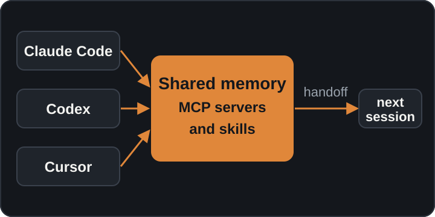
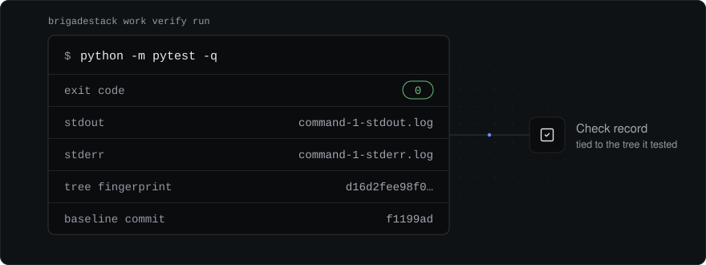

<p align="center">
  <picture>
    <source media="(prefers-color-scheme: dark)" srcset="https://raw.githubusercontent.com/escoffier-labs/brigade/main/docs/assets/brigade-wordmark-dark.svg">
    
  </picture>
</p>

<h1 align="center">Run agents anywhere. Same memory everywhere.</h1>

<p align="center">
  <a href="https://github.com/escoffier-labs/brigade/actions/workflows/ci.yml?query=event%3Amerge_group"></a>
  <a href="https://pypi.org/project/brigadestack/"></a>
  <a href="https://github.com/escoffier-labs/brigade/blob/main/LICENSE"></a>
</p>

BrigadeStack gives the agent tools you already use one shared memory and one set of MCP servers and skills. It keeps a record of the work they check.

Install with pipx or npm. The pipx route needs Python 3.11 or newer. The command is `brigade`, and `brigadestack` runs the same CLI.

```bash
pipx install brigadestack
npm install -g brigadestack
```

## Shared memory, shared tools

Claude Code, Codex and Cursor each keep their own notes and their own MCP config. What one agent learns on Monday is gone when another one starts on Tuesday.

BrigadeStack keeps memory as markdown cards in your repository. An agent that learns something durable writes a handoff. A reviewer files it as a card. Commit the card, and any checkout finds it with `brigade memory search`.

MCP servers and skills follow the same rule. List a server once, and `brigade mcp sync` writes it into the config each tool reads. It previews until you pass `--write`. The targets are Claude Code, Codex, Cursor, OpenCode, Grok and Antigravity.

Claude Code also gets recall at session start. Codex gets memory through its handoff inbox and an agent-run `memory search`.

<p align="center">
  
</p>

Here one checkout drafts a handoff, a reviewer files the card, and a second checkout finds it:

```console
$ cd ~/api
$ brigade handoff draft --type decision \
    --title "Payments client retry policy" \
    --summary "Retries stop after 3 attempts with jittered backoff." \
    --fact "Backoff starts at 200 ms and doubles." \
    --fact "A 4xx response is never retried." \
    --action create-card --target-card payments-retry-policy.md \
    --content-file card.md
handoff draft: ~/api/.codex/memory-handoffs/20261117-185216-payments-client-retry-policy.md
id: 20261117-185216-payments-client-retry-policy
inbox: .codex/memory-handoffs
action: create-card
target_card: payments-retry-policy.md
lint: ok
$ cp card.md memory/cards/payments-retry-policy.md
$ git add memory && git commit -qm "memory: payments retry policy"
$ git worktree add -q ../api-2 -b second && cd ../api-2
$ brigade memory search "retry backoff"
memory search: retry backoff (1 match(es))
- memory/cards/payments-retry-policy.md  [0.74]  payments-retry-policy
```

## Then prove it

"Tests pass" is a claim. `brigade work verify run` turns it into a record. It runs the command and keeps the command, the exit code, the logs and a fingerprint of the tree that was tested. Another agent can open the record and see what ran against which code, without taking anyone's word for it.

Records live under `.brigade/work/verify-runs/`, one folder per run. A failing command leaves a failed record, so a red check is as easy to find as a green one. Each record is a folder of plain files that any agent or script can read.

<p align="center">
  
</p>

## Modes

`strict` is the default. Checks run through `brigade work verify run`, and Claude Code's stop hook asks for a record before a session finishes. `observe` records checks and blocks nothing. `off` drops the check rules and keeps memory and briefs. The names `yolo` and `engineer` still work as input for `off` and `strict`. Safety rails, meaning secret scanning and pre-push checks, are a separate setting and are on by default in every mode.

```console
$ brigade work mode show
work mode: strict; safety rails: on (~/api)
$ brigade work mode set observe
work mode: observe; safety rails: on (~/api)
$ brigade work mode set off
work mode: off; safety rails: on (~/api)
```

## Quick start

Wire a repository, write a first handoff, and run a first check. Add `--dry-run` to the first command to preview it.

```bash
brigade operator quickstart --target . --harnesses codex,claude
brigade handoff draft --type setup --title "Test command" \
  --summary "Run pytest -q from the repo root before every push." \
  --action no-card --target-document TOOLS.md \
  --content "Run pytest -q from the repo root."
brigade work verify run --command "git diff --check"
```

The first command writes `.brigade/`, a handoff inbox for each tool you name, and the MCP config. The second drafts a handoff, and its lint refuses anything the ingester would reject. The third records the command, the exit code and the logs. Keep local `.brigade/` state out of commits unless you mean to share it. The [first 10 minutes](https://github.com/escoffier-labs/brigade/blob/main/docs/first-10-minutes.md) covers the rest.

## Works with

| Tool | What you get |
| --- | --- |
| Claude Code, Codex, Cursor, OpenCode | Workspace instructions, handoff inboxes, and MCP and skill config. |
| ChatGPT Dot | Memory, skills, Hub messages and T3 fleet dispatch, through a connector you host. |
| Claude Duet | Memory, skills, Hub messages and read-only fleet views, through a connector you host. |
| T3 Code | Session presence only. |

Setup guides: [Dot](https://github.com/escoffier-labs/brigade/blob/main/docs/grokbot-dot.md) and [Duet](https://github.com/escoffier-labs/brigade/blob/main/docs/duet-connector.md).

## Across machines

Run the BrigadeStack backend on a network you control, and agents on several machines share it. A card pushed from a laptop turns up in a search on a desktop. Task ownership, messages and model policy live in the same place. The [fleet docs](https://github.com/escoffier-labs/brigade/blob/main/docs/fleet-sync.md) cover setup.

## Limits

A check record shows what ran. It does not show that the tests are good. Handoffs are drafts: a reviewer files them as cards, and nothing files itself yet. Session-start recall is Claude Code only. Sharing across machines and the hosted connectors need a backend or host that you run.

<p align="center">
  <a href="https://brigadestack.com">Website</a> ·
  <a href="https://github.com/escoffier-labs/brigade/blob/main/QUICKSTART.md">Quickstart</a> ·
  <a href="https://github.com/escoffier-labs/brigade/tree/main/docs">Docs</a> ·
  <a href="https://github.com/escoffier-labs/brigade/blob/main/CHANGELOG.md">Changelog</a> ·
  <a href="https://github.com/escoffier-labs/brigade/issues">Issues</a> ·
  <a href="https://github.com/escoffier-labs/brigade/blob/main/LICENSE">MIT license</a>
</p>

The Python CLI may send a passive version request. [Telemetry](https://github.com/escoffier-labs/brigade/blob/main/docs/telemetry.md) lists its fields and opt-outs.

<!-- MCP Registry ownership markers; keep each on its own line. -->
<!-- mcp-name: io.github.escoffier-labs/brigade-memory -->
<!-- mcp-name: io.github.escoffier-labs/brigade-skills -->
