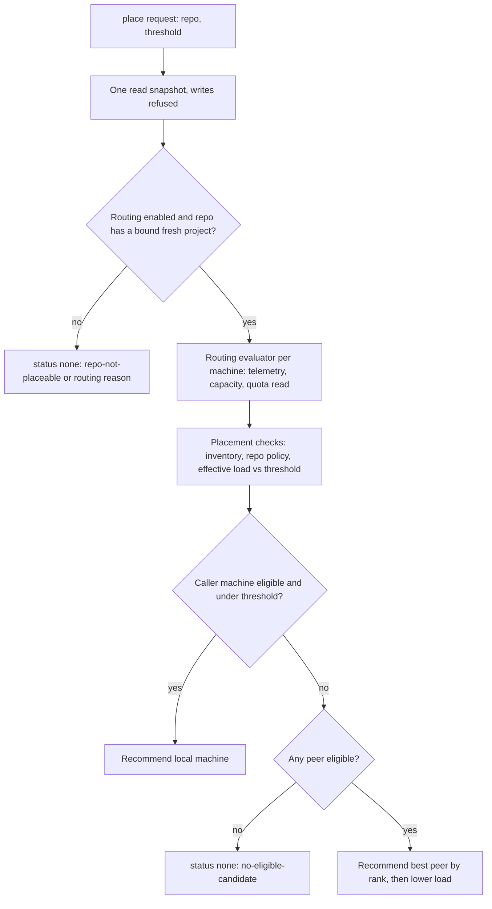

# Native T3 Code thread presence

This optional observer reads current conversations from native T3 Code shell
metadata. Ordinary user conversations are included independently of t3-fleet's
managed dispatch receipt store. It uses no thread snapshots, chat history, or
provider turns and installs no packages, service, configuration, or credentials.

Use an explicitly configured absolute path to an existing trusted local Python
interpreter with t3-fleet installed:

```bash
python -m brigade.fleet_t3_observer --t3-python /absolute/path/to/t3/venv/bin/python
```

The default only reports counts. Add `--publish` to publish through Brigade's
public fleet client using this node's existing enrollment. A node token and Hub
URL are required for publishing. The interpreter is trusted operator
configuration, never browser or remote input. Missing executables, missing or
incompatible packages, schema errors, and native failures return `ok=false`.
No Brigade runtime dependency on t3-fleet is added.

A constant bounded subprocess calls the installed
`t3_fleet.agent._build_agent(os.environ).t3.shell_snapshot()` read client, which
uses its existing local configuration and credential broker. Native authentication
may issue its own local grant. The helper exposes no grant values. The supported
native schema is version 2, with project `id` and `workspaceRoot`, and thread
`id`, `projectId`, `status`, `activeRunId`, `activityRunStatus`, `worktreePath`,
`archivedAt`, and `deletedAt` when present. The helper validates states across
current threads, then projects only active threads and their referenced projects into operational metadata. The optional
`archivedThreads` array is excluded when present and may be omitted. The helper
never accesses or serializes
`latestVisibleMessage`, titles, prompts, provider identities, or model selection.
The native client bounds the underlying shell response to 16 MiB. The helper
bounds projection to 256 KiB, 2,000 projects, and 10,000 total threads including
archived records. Incompatible schema and any exceeded bound fail visibly.

Known active states are queued, preparing, starting, running, and waiting.
A nonterminal thread with an active run ID or known active run status also
qualifies. Pending runtime requests or background tasks also qualify. Their native
shapes are validated against the installed client contract. The helper projects
only `hasPendingRuntimeRequest` and `hasPendingBackgroundTasks` booleans from
field truthiness, never their contents. Unknown shapes fail the whole collection.
Idle threads without activity, terminal states, deleted threads,
and archived threads are excluded. Unknown states fail collection with a fixed error. Only active referenced projects need an existing absolute
workspace. A valid actual `worktreePath` needs no project lookup. Only a null
worktree falls back to the project's `workspaceRoot`. A bad non-null worktree
never falls back. Invalid active-row IDs, workspaces, or referenced project
metadata skip that row and increment `invalid_rows`. Valid rows still publish,
with `ok=false` and exit 1. Identity collisions, schema/bounds errors, and
unknown states reject the whole collection before publication. Obsolete project
directories do not block active threads. Workspace paths, including resolved
paths, are capped at Hub's 1,024 characters.

Presence uses `harness="t3"` (T3 Code), TTL 300 seconds, and the native thread ID
when it is a valid opaque ID of at most 128 characters. Every other valid native
ID uses `t3-` followed by the SHA-256 hexadecimal digest of the full native ID.
This includes long delegated IDs and short IDs containing `/` or `%`. Native
IDs must first be nonempty, at most 4,096 characters, and free of controls or
whitespace. This bounded value is an internal presence identity, never a native
execution request handle or a substitute for native correlation.
Native provider-thread references do not reliably match Claude or Codex hook
session IDs, so the observer does not guess deduplication or report an aggregate
working-agent total. `activity_scope="native_t3_presence"` describes reported
presence and makes no execution, capacity, or model-policy admission claim.

The observer shares the safe bounded workspace snapshot and publication loop
with the OpenClaw observer. Git identity and branch metadata are read with
fsmonitor disabled. No dirty paths are attributed to a thread. Non-repository
workspaces use the existing node-scoped `local:` path-hash identity.
`dirty_paths=()` and `dirty_truncated=True` mean dirty-file ownership is unknown.

A poll has a total 15-second work budget. The first native snapshot may use the
rest of it minus a reserve for publishing (the session call timeout plus the policy
call timeout, plus one safety margin, so about 10 seconds), and the optional detail
pass keeps its eight-second cap, less the policy call timeout. Up to 50 publication
attempts while time permits, leaving the policy call timeout free after the loop for
the health post. The observer finishes inside its own 15-second budget. The per-host
telemetry script that runs it applies a subprocess timeout of its own (17 seconds in
the reference script), which must stay above 15 seconds.
Every native/Git call uses the remaining deadline. Publication starts only when
the public client's fixed two-second call plus 250 ms fits. A fast Hub can
refresh all 13 active threads in one pass. Slow calls or the 50-row cap leave
partial publication without extending the TTL.

A private numeric cursor stores the next offset into sorted thread selection,
independently of caller cadence. List churn can shift which row that offset selects. It contains no native metadata
and lives at `$BRIGADE_HOME/observer-cursors/t3.cursor` (default
`~/.brigade/observer-cursors/t3.cursor`). Inspect mode never creates it. Cursor
files use the fleet client's existing portable private-file helpers, including
its Windows path fallback, plus atomic replacement. The fallback is covered by
fixtures without POSIX-only ownership functions. Native Windows execution still
requires platform verification. Run one publisher per harness.

OpenClaw and T3 run separately with independent budgets and cursors. A large
OpenClaw listing cannot consume T3's deadline. Partial publication can still
leave rows to expire before the cursor returns to them.

JSON reports active, total, observed, invalid_rows, published, skipped, and truncated counts.
Skipped includes invalid rows and valid rows not published.
Exit 0 means collection and requested publication completed. Exit 2 means the
publication cap or deadline left partial publication. Exit 1 means collection or
publication failed. All partial and failed results set `ok=false`. Publication failures are counted as partial and later rows are attempted while
the two-second deadline reserve remains. Successful writes remain counted. Raw stdout, stderr, credentials, shell
contents, and native identifiers are never copied to the count report.

Live inspection does not publish or prove Hub visibility. The integration owner
must review and explicitly wire publishing into the existing telemetry path.

## Repository inventory for placement

With `--publish`, the observer also reports which repositories this node can
run as T3 projects, so the Hub can answer which machine has a repository as a T3
project, with which T3 environment id and project id. The inventory is a
separate key in the same native read. It never changes the session `projects`
list that path mapping relies on.

It holds the local T3 environment id from the t3-fleet agent descriptor, and for
each project that is neither archived nor deleted and has a repository identity,
the T3 project id and its canonical repository key. It never carries workspace
roots, titles, paths or remote URLs. A canonical key is lowercase
`host.tld/segment/segment...` with at least two segments after a dotted host,
segments of `a-z`, `0-9`, `.`, `_` and `-`, and no scheme, userinfo, leading
slash or tilde, backslash, whitespace or `..`. A trailing `.git` is stripped.
A project id must be an opaque token of at most 128 characters
(`[A-Za-z0-9][A-Za-z0-9:_.-]*`, no `..`), such as a UUID with an optional `mcp:`
style prefix, so a path, URL or credential cannot reach the Hub. The observer
applies the Hub's exact row predicate and limits (512 for the repo key),
drops invalid or repeated rows individually, and reports the count as
`inventory_dropped`. If every row is invalid the set is unknown, not empty.
The Hub itself stays strict and rejects a whole body that contains a bad row.
The environment id is read first, from a worker bounded to about one second,
and is skipped in the second-pass detail read, so a stalled descriptor cannot
cost session publishing. If the environment id is unavailable, the
inventory does not exist for that run, which means unknown and never empty.
An unavailable or failed inventory never erases a stored one. A result that
would exceed the 256 KiB bound drops the inventory rather than the sessions.

The report adds `inventory` with `ok`, `error` or `skipped`. It is sent once per
publish run, after sessions and inside the same deadline, as the node-token
`projects-observe` policy action. A failure is reported there and never changes
`ok`, the exit code or session publishing. The Hub keeps each node's latest full
set (900 second TTL), ignores an older snapshot than the stored one, and raises
a conflict for two same-instant snapshots that disagree. A node can only write
its own inventory.

A node token proves the node id, not its T3 environment. The operator binds each
machine's environment in the policy document with the optional machine field
`t3_environment_id` (letters, digits and hyphens, unique across machines,
admin token only). The environment id is compared case-insensitively, in the
uniqueness check, the binding check and the stored value. A report whose
environment id differs from the machine's binding is rejected with `environment-binding-mismatch`, and in the same
transaction that node's stored project rows and snapshot are deleted, so
placement stops using a stale environment at once. A node can only clear its own
rows. A mismatched report older than the stored snapshot changes nothing.
A machine without a binding is stored but read as unbound. Reads recompute the
binding from the current policy, so a policy change applies without a
republish, and placement must skip unbound rows.

## Observer health

Presence rows expire after 300 seconds, so a node whose observer is failing looks
like a node with no sessions. Each `--publish` run therefore also sends the
node-token `t3-observe` policy action, after sessions and before the inventory:
`ok: true` only when the snapshot parsed, the session publication returned
without an error and no active thread was skipped as invalid (rotation truncation
and the inventory outcome do not matter),
and `ok: false` when the observation failed and time remains. The report adds
`health` with `ok`, `error` or `skipped` (the post outcome). A failed post never
changes `ok`, the exit code or session publishing.

The Hub stamps its own clock when it receives the report, never a node-supplied
time, in the optional `fleet_t3_observations` table (created on the first
report). A node with a row whose last success is missing or at least 300 seconds
old, the same as the session TTL, has unknown T3 sessions. With a 120-second
timer a node is still known after two missed cycles (age 240 seconds) and unknown
on the third (age 360 seconds). `GET /sessions` adds `nodes_unknown`, and
`brigade fleet sessions` prints a footer naming those nodes (with `--json`,
stdout stays the bare session list and one warning line goes to stderr). If the
health table cannot be read, `nodes_unknown_error` is set. Session views leave a
node with no row alone.

Placement is stricter: it trusts a session count only for a node whose observer
succeeded within 300 seconds. A stale node, a node that only ever failed, a node
with no health row (every host runs the observer, so a missing row means the node
is not reporting) and an unreadable health table all make the machine ineligible.
A node with no row at all gets its own reason, `t3-health-missing`, so it can be
told apart from a failing or stale node, which gets `sessions-unknown`. A node can
only write its own row.

Rollout order: upgrade the Hub first, then each node's observer. Until a node
posts its first health report, placement has `t3-health-missing` for it, so
placement recommends nothing until every candidate machine has reported once
(about one observer cycle after its upgrade).

Causes that keep a node unknown until fixed: an active thread that stays invalid
(its `invalid_rows` count is non-zero every run, so `ok: true` is never posted), a
`rotation_state_unavailable` error from an unreadable cursor file, and a host that
has no T3 install or cannot reach the native client, because its observer fails
every run and posts `ok: false`. Read the observer's JSON (`error`, `invalid_rows`,
`health`) on that host to tell which.

## Placement

`brigade fleet place --repo <canonical key> [--threshold 0.70] [--json]` asks the
Hub which machine should run a new child agent for a repository. It prints one
line: the recommended machine, its T3 environment id and project id, and the
reason, or why no machine qualifies. Run it on an enrolled node with a node
token; it exits 1 when nothing is recommended.

The answer is advice, never admission. Trust statement: node-reported telemetry
and inventory; advisory only, never admission. The Hub does not reserve a slot,
store a decision, or write anything while answering (one read snapshot with
writes refused, and the quota and routing schemas are never created on a Hub
that lacks them). A caller that wants a slot still goes through `route`, which
re-checks every gate.

Placement reuses the routing candidate evaluator and adds three checks:

- The repository must be a bound, fresh T3 project on the machine. A machine
  with no row is `repo-not-placeable`, an unbound row is `inventory-unbound`,
  an expired row is `inventory-stale`, and a stored row whose ids fail the shared
  project and environment id rules is `inventory-invalid`. A repository with no usable row
  anywhere is denied as `repo-not-placeable`. A policy
  `repositories.<id>.eligible_machines` list narrows the set further
  (`repo-machine-not-eligible`). The policy entry is found by the normalized
  key only (casefolded, one trailing `.git` removed), never by the caller's
  spelling, so its patches, privacy and machine list apply together for every
  spelling. A policy save whose `repositories` keys collide after that
  normalization is refused, and a stored document that already has such a pair
  makes placement fail closed with `repo-policy-ambiguous` and no
  recommendation. When one machine has several usable projects
  for the repository, the lowest project id is chosen, the recommendation
  carries `project_choices`, and that candidate gets the informational reason
  `multiple-projects` (it never changes `eligible`).
- Effective load is the higher of the node-reported CPU `load` and the
  Hub-counted live sessions on the node divided by the machine's policy
  `concurrency`. Missing or stale telemetry, or a null `load`, excludes the
  machine (`machine-unknown-telemetry`, `machine-stale-telemetry`,
  `machine-load-unknown`). If the Hub cannot read its live session counts, no
  machine is eligible (`sessions-unknown`) rather than reading as zero. Node memory joins this maximum
  once nodes report it.
- A machine at or over the threshold (default 0.70, range 0 to 1) is shed
  (`machine-load-shed`).

If the caller's own machine is eligible and under the threshold it wins
(`local-under-threshold`). Otherwise the remaining machines are ordered by the
existing routing rank (preferred and discouraged workloads, then priority) and
then by lower effective load (`peer-ranked`). Machine preference stays in the
existing policy fields, so a low-weight machine is configured with
`discouraged_workloads`, `priority` or `os`, not a placement setting.

Inventory privacy: for every candidate other than the caller's own machine, the
inventory reasons (`repo-not-placeable`, `inventory-unbound`, `inventory-stale`,
`inventory-invalid`) collapse into one opaque `not-placeable`. The caller's own
machine keeps the detailed reason, and the top-level `repo-not-placeable`
denial stays explicit. Any enrolled node can still learn whether some bound
machine has a repository, and which one is recommended, with that machine's
environment and project id. That is accepted: the query needs a node token, so
only enrolled fleet nodes can ask. A machine with no usable load (missing,
stale or null telemetry) is never placeable, and `place` returns the named error
`placement-unavailable: <class>` for a storage failure, never row data.

The response schema is `brigade.fleet_placement.v1`. Only the recommended
machine carries its `environment_id` and `project_id`, and the block has no node
id: a caller launching a child agent needs the machine, `environment_id`,
`project_id` and `expires_at`. Every candidate carries its eligibility,
effective load and reasons only. `expires_at` is the earliest of the telemetry
expiry, the inventory expiry and two minutes after `decided_at`. A caller that
already holds an open database transaction gets
`placement-unavailable: open-transaction`, because the read snapshot is rolled
back and must not be the caller's. The HTTP path never has one.



## Keeping local Claude Code and Codex sessions open

The optional session heartbeat renews the exact snapshot last published by a
Claude hook or a Codex `brigade work brief`. It does not rebuild repository,
checkout, branch, or dirty-path metadata. Enable it for a primary checkout and
its linked worktrees from the existing telemetry service, alongside the T3 observer:

```ini
[Service]
ExecStartPost=-/absolute/path/to/brigade/venv/bin/python -m brigade.fleet_session_heartbeat --worktrees-of /example/project --publish
```

Repeat `--worktrees-of` for other repositories. Discovery queries Git with a
two-second timeout and examines at most 512 worktree entries across at most 32
repository queries. Git output is capped at 1 MiB. Only existing, wired
worktrees with regular `.presence` sidecars qualify. Bare and prunable entries
are skipped, and sidecar checks refuse symlinks. Candidates are ordered by their
newest sidecar modification time. Explicit `--target` checkouts take priority
and combine with discovered worktrees without duplicates. Use the existing
enrolled node credentials and Hub configuration. Without `--publish`,
the module reports counts without sending presence. Removing the command opts
out. Removing a harness from the target's Brigade configuration also stops its
renewals. No service, timer, credentials, or configuration is installed by this
module.

Successful hook publications save private `.presence` sidecars under each
target's `.brigade/work/claude-hooks/sessions/`. They are separate from the
runtime's `.json` task state and fingerprint. A sidecar contains the last
snapshot and its owner's PID, Linux process start ticks, and boot ID. Discovery
walks at most 32 ancestors through `/proc` to find the same-user Claude Code or
interactive Codex executable. Hook workers and shells are skipped. Each renewal
requires the same boot, PID, start time, and executable. Dead processes, zombies,
PID reuse, missing proof, disabled records, and unwired targets are skipped.
Claude `SessionEnd` disables the sidecar before ending Hub presence. Heartbeat
publication and invalidation share a short file lock.

Codex coverage requires `CODEX_THREAD_ID`, a successful `brigade work brief`,
and a provable interactive Codex ancestor. Multiplexed `codex app-server`,
noninteractive `codex exec` and review processes are excluded because their
lifetimes do not prove a specific thread remains open. T3 threads continue to
use the separate native T3 observer. macOS and Windows currently skip renewals
because this module cannot prove process birth identity there. Existing sessions
need another successful hook or brief after upgrading before they qualify.

Each invocation shares a 15-second work budget between discovery and renewal,
and accepts at most 32 unique targets,
2,048 directory entries per target, 200 session records, and 50 publications.
State reads are capped at 64 KiB. Each publication reserves the client's full
two-second timeout plus 250 ms. Run the invocation under an outer 20-second hard
timeout for filesystem stalls and cleanup. The first Hub failure ends the poll
without retries or spooling. JSON contains counts and fixed error codes, without
session IDs, paths, process arguments, or transport error text. Discovery reports
`discovered_targets` and `discovery_errors` counts. A failed or timed-out Git
query adds an error and contributes no targets. Exit 0 means
complete, 2 means the cap or deadline left partial work, and 1 means failure.
The `-` service prefix keeps heartbeat failures from failing telemetry.

The saved TTL remains unchanged, normally 900 seconds. Once the owner exits,
renewals stop and the last Hub write expires within that TTL. The poller never
ends rows merely because a target or process is temporarily unavailable. Caps
can leave sessions unrenewed in large targets. Schedule narrower target sets
when reports show `truncated=true`.
