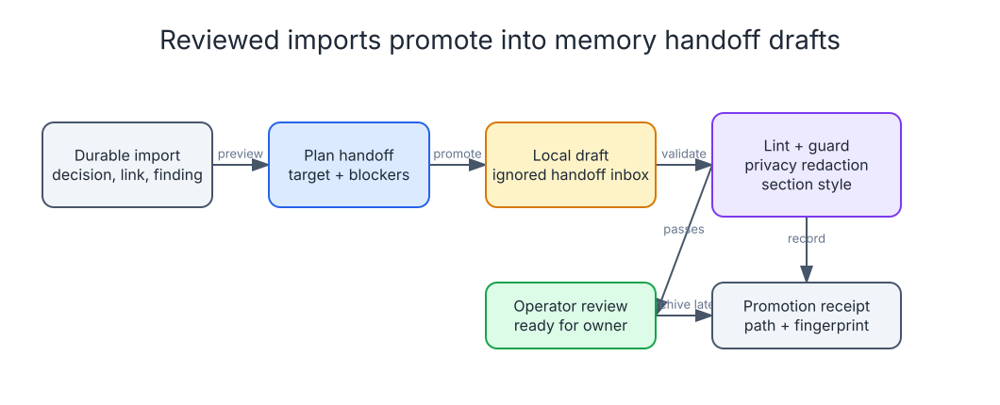

# Reviewed Handoff Promotion

`brigade work import promote-handoff` turns a reviewed durable scanner import into a local Memory Handoff draft. It is for non-task imports that should become durable knowledge after review, not for work execution.



## Commands

```bash
brigade work import plan-handoff <import-id>
brigade work import plan-handoff <import-id> --json
brigade work import promote-handoff <import-id>
brigade work import promote-handoff <import-id> --json
brigade handoff list
brigade handoff show <handoff-id-or-path>
brigade handoff archive <handoff-id-or-path>
brigade handoff archive --all-reviewed
brigade handoff runs
brigade handoff run-show <run-id>
brigade handoff reconcile
```

`plan-handoff` previews the handoff target, type, local inbox, provenance, and blockers. `promote-handoff` writes the draft, runs handoff lint, and only then marks the import promoted.

## Supported Imports

Handoff promotion is for durable non-task import kinds:

- `decision`
- `preference`
- `link`
- `command`
- `finding`
- `incident`

Task imports still use `brigade work import promote` and `brigade work import promote --run`.

## Target Documents

Brigade picks a no-card handoff target from kind and metadata:

- preferences go to `USER.md`
- commands and operational notes go to `TOOLS.md`
- incidents and failures go to `.learnings/ERRORS.md`
- feature requests go to `.learnings/FEATURE_REQUESTS.md`
- workflow rules go to `rules/scanner-imports.md`
- other durable lessons go to `.learnings/LEARNINGS.md`

Scanner metadata can set `handoff_target_document` to a valid document target when the default is too broad.

## Privacy Boundary

Handoff promotion writes only a local draft under the configured handoff inbox, usually `.codex/memory-handoffs/`, `.claude/memory-handoffs/`, `.opencode/memory-handoffs/`, `.antigravity/memory-handoffs/`, `.pi/memory-handoffs/`, `.cursor/memory-handoffs/`, `.aider/memory-handoffs/`, `.goose/memory-handoffs/`, `.continue/memory-handoffs/`, `.copilot/memory-handoffs/`, `.qwen/memory-handoffs/`, `.kimi/memory-handoffs/`, `.adal/memory-handoffs/`, `.openhands/memory-handoffs/`, `.grok/memory-handoffs/`, `.amp/memory-handoffs/`, `.crush/memory-handoffs/`, or `.hermes/memory-handoffs/`. It does not edit `MEMORY.md`, memory cards, or canonical memory, and it does not run the ingestor.

Raw private chat fields are rejected by default, including `raw_text`, `raw_messages`, `messages`, `message_text`, `quotes`, and `transcript`. Unsafe URLs, tokens, host-private paths, user ids, channel ids, hostnames, and secret-looking values are redacted before the draft is written.

Promoted imports preserve the local handoff path, target document, promotion timestamp, and source fingerprint for review.

## Writing A Handoff

Write handoffs with `brigade handoff draft`, not by hand. Before it writes anything it runs the checks the ingester runs, so it cannot produce the handoffs that otherwise end up as ingest conflicts:

| Ingest conflict | What `draft` does |
|---|---|
| `update-card` without the expected SHA | Reads the target card in the workspace and writes `## Expected card SHA256` for you |
| Stale expected SHA | Refuses when `--expected-sha` no longer matches the live card |
| Missing frontmatter, `category`, `title` or `topic`, or `tags` | Refuses and names the missing field |
| `create-card` whose card id another card already holds | Refuses with `card-id-collision` and names the existing file. A card takes its `id`, else its `topic`, else its file name, the same id `memory hub push` counts, so an id-less card can collide on a broad topic. Give it an explicit `id: card-<uuid4>` or another topic. `update-card` on the card that holds the id stays allowed |
| Unsafe card name | Refuses names with a path, a leading dot or a non-`.md` ending |
| Unsafe target document | Refuses anything outside `USER.md`, `TOOLS.md`, `rules/<name>.md` and the three `.learnings` files |
| Bootstrap size guard | Refuses an append that would push `USER.md` or `TOOLS.md` over its budget |
| No recognizable sections | Cannot happen, `draft` always writes the canonical sections |

`brigade ingest` applies the same check to a `create-card` handoff. A card that would share an id is routed to the review inbox as `card-id-collision` and never written. A card with no valid `id` is written with a freshly minted `card-<uuid4>` id, so only an explicit id can collide there. Lint is stricter: it flags the id-less topic case too, because other ingesters may write the card as is.

A refused draft prints one `error: draft refused, nothing written:` line per problem and exits 2. `--workspace` points at the memory workspace when it is not `--target`. `--expected-sha` supplies the SHA when the workspace is not reachable, and `draft` says so by name if it needs one of the two. `brigade handoff lint` applies the same rules to files written another way, and `--workspace` works there too.

### Publish atomically

A handoff inbox is read while it is written: `brigade ingest`, the draft queue and worktree cleanup all list `<inbox>/*.md`, and cleanup may move or remove files. A writer that opens `<inbox>/<name>.md` and writes into it lets a reader see a half-written file, and a descriptor the writer keeps can write to a file a reader has already moved. So every writer publishes in three steps:

1. Write to a private temp name in the same inbox directory that no reader lists. Brigade uses `.handoff-<random>.tmp`: dot-prefixed and not `*.md`.
2. `fsync` the temp file.
3. Publish it with a no-replace rename to the final `*.md` name. If the name is taken, fail and leave the existing file alone. Remove the temp file on any failure.

A published `*.md` is complete and is never written again. `brigade handoff draft` is the supported writer and follows these steps on POSIX and Windows. A harness that writes a handoff directly must do the same, or call `brigade handoff draft` instead. Do not write, append to or truncate a file that already carries a `*.md` name.

## Draft Queue Review

`brigade handoff list` discovers pending drafts from `.claude/memory-handoffs/`, `.codex/memory-handoffs/`, `.opencode/memory-handoffs/`, `.antigravity/memory-handoffs/`, `.pi/memory-handoffs/`, `.cursor/memory-handoffs/`, `.aider/memory-handoffs/`, `.goose/memory-handoffs/`, `.continue/memory-handoffs/`, `.copilot/memory-handoffs/`, `.qwen/memory-handoffs/`, `.kimi/memory-handoffs/`, `.adal/memory-handoffs/`, `.openhands/memory-handoffs/`, `.grok/memory-handoffs/`, `.amp/memory-handoffs/`, `.crush/memory-handoffs/`, `.hermes/memory-handoffs/`, and inboxes declared in `.brigade/handoff-sources.json`. Each draft summary includes:

- filename id and path
- created and modified timestamps
- lint status and recommended memory action
- target card or target document
- source import id and source fingerprint when present
- scanner provenance such as scanner id, run id, and sweep id
- stale age and source coverage status

Before ingesting into canonical memory, run:

```bash
brigade handoff lint --content-guard --guard-policy personal --target .
```

The intended memory-owner rule is: Brigade lint is available, Content Guard runs when configured, and the ingester files only safe targeted handoffs. Ambiguous, risky, malformed, or failed handoffs should stay pending for operator review instead of being trusted automatically.

For the short operational checklist, see [OpenClaw Memory Ingest Checklist](openclaw-memory-ingest-checklist.md).

`brigade handoff show <handoff-id-or-path>` prints the same detail for one draft. `brigade handoff archive <handoff-id-or-path>` moves one draft into `.brigade/handoffs/archive/` and appends a closeout record under `.brigade/handoffs/archive.jsonl`. `brigade handoff archive --all-reviewed` archives lint-valid drafts only, leaving invalid drafts in place for repair.

The draft queue is review visibility only. These queue commands do not run the canonical ingestor, route drafts into canonical memory, edit `MEMORY.md`, or mutate memory cards. Separately, explicit `brigade ingest --promote-cards --route-documents` can file handoffs into the target's canonical stores when Brigade is the chosen ingestor.

## Ingestion Receipt Visibility

When an external memory owner performs ingestion, Brigade can read local receipt summaries that the ingestor or wrapper leaves behind under `.brigade/handoffs/ingest-runs/`. A receipt records the run id, timestamps, source root, inbox paths, processed handoff paths, promoted card targets, routed document targets, skipped paths, failed paths, warning count, safe summary, and local log path.

`brigade handoff runs` lists those receipts. `brigade handoff run-show <run-id>` shows the full normalized receipt and outcome summary. `brigade handoff list` and `brigade handoff show` include the latest known ingestion status for each draft when a receipt references it.

OpenClaw receipt writers should use the normalized JSON shape shown in [OpenClaw Memory Ingest Checklist](openclaw-memory-ingest-checklist.md), or emit a latest-run log that `brigade handoff reconcile` can parse.

`brigade handoff reconcile` reads the configured `ingestor.last_run_log`, parses recognizable processed, promoted, routed, skipped, failed, malformed, unreachable-source, warning, and no-reply lines, then writes a normalized receipt locally. Reconcile may update `.brigade/handoffs/archive.jsonl` with known ingestion outcome fields while preserving manual archive reasons.

Normalized receipts preserve warning events, malformed handoff paths, unreachable source labels, and no-reply state so operators can see when a clean-looking scheduler run still hid skipped, failed, or unreachable work.

Source coverage issues for uncovered writer inboxes include stable source keys and fingerprints. If an operator dismisses an unchanged uncovered-inbox import, Brigade does not recreate it. When the pending inbox coverage state changes, the source fingerprint changes and the repair import can resurface.

This receipt surface is observability only. It does not run the ingestor, edit canonical memory, promote cards, route documents, or summarize draft content.


## Automatic review-inbox drain

Memory care verifies already-applied drafts by reading their destinations and retries transient ingest failures.
Unapplied knowledge, explicit review items and unknown outcomes stay held. No
current ingest code qualifies for expiry. Trust and security holds stay in place
with a recorded reason. Evidence-linked drafts retain their
paths and use a resolved ledger. See [Review inbox](memory-care.md#review-inbox)
for the disposition table, safe skips and undo behavior.

## Origin gate for automatic filing

Ingest now requires a verified origin before it can promote a card, reinforce an
existing card, append to a document, or route content to an overflow card. Only
an `interactive` origin with `untrusted_tools: false` reaches the existing filing
rules. Worker, cron, subagent, unknown, and tool-touched origins go to
`memory/handoff-inbox/` with reason `origin-review-required`. The inbox drain
classifies that reason as human review and cannot retry it automatically.

Ingest also signs each review draft's final bytes, path, routing reason, and
promotion and document-routing flags with the memory owner's key. The drain and
direct reprocessing require that record before retrying. Headers are display
text, never retry authority. Missing, legacy, altered, or unverifiable records
stay in human review with `origin-review-required`. Files in a writer inbox's
`malformed/` folder always require human review. Ingest removes source stamps
after archiving, and the drain removes review stamps after resolution or retry.

The tooling API `brigade.handoff_origin.stamp_handoff` writes a private,
atomically published sidecar under `.brigade/handoffs/origins/`, outside the
writer inbox. A hash of the full handoff path selects the sidecar.
It records the session kind, untrusted-tool status, harness, and host label.
An HMAC-SHA256 covers the canonical JSON payload, including the exact handoff
SHA-256 digest, path digest, filename, file identity and modification time,
schema, and receipt key id. The MAC uses a separate
message domain from receipt signatures. Markdown sections and comments never
supply origin metadata. Changing either the content or the signed fields
invalidates the stamp. Replacing, touching, or renaming a handoff also requires
a new stamp. A failed attempt to stamp a replacement cannot reuse its previous
publication's authorization.

Ingest reads handoffs through a no-follow descriptor and refuses symlinks,
hardlinks, and non-regular files. Verification retains the exact sidecar path
for cleanup, so replacing the inbox pathname after archive cannot redirect
stamp removal. Before any canonical write, ingest atomically claims the
record's MAC in `.brigade/handoffs/consumed-stamps/` and flushes the claim to
disk. Review dispositions and retries use the same one-time claim after journal
preparation and before canonical writes. Recovery can resume a claim only
under the journal decision that owns it.
Restoring an archived inode or a consumed sidecar cannot revive its authority.
A crash or failed write after the claim requires human review unless an
already-prepared journal transaction can complete recovery. New tooling stamps
include a random nonce. Only trusted tooling can authorize a fresh attempt.

Origin stamps use only the fixed workspace-owned key at
`.brigade/receipt-signing-key`. The receipt-only
`BRIGADE_RECEIPT_SIGNING_KEY_FILE` override cannot select an origin key. Run
`brigade receipts keygen` without that override to provision the fixed key.
Ingest uses the source workspace's key, even when it writes memory into a
different owner. The key must be a single-link regular file owned by the
current OS user, with no group or world permission bits. No-follow opens
reject links in the key path. On Windows, or any platform that cannot prove
these ownership and permission checks, automatic filing fails closed and
handoffs require review.
A missing key, missing sidecar, bad MAC, changed content, malformed stamp, or
unknown tool status requires review. Neither drafting nor ingest creates a key.
Stamps are local to the source workspace and path. Worktree rescue and archive
do not yet carry them, so rescued or renamed handoffs conservatively require
review.

### Current integration limit

This is the filing gate and stamp format slice of issue #2451. `handoff draft`
writes a stamp when a usable receipt key exists. It records the detected harness
and host, but records session kind and tool status as unknown. A Brigade run id
can mark a draft as worker, which also requires review. There is no draft flag
that can declare an interactive or clean session.

Claude and Codex hooks do not yet supply complete session-kind and tool-use
observations to this API. Until that observer integration lands, normal drafts
require review, including drafts from interactive sessions. Trusted harness
integration can use the API with observed values. A verified clean interactive
stamp preserves the existing opt-in filing behavior and all content checks.

### Threat model

The signer, its observations, the fixed key file, and Brigade's consumed-stamp
state are trusted. The gate defends against text-only and file-drop agents
that cannot read the key or modify trusted state. It rejects forged claims in
handoff text and sidecar edits made without the key. An agent able to read the
key file or run code as the same OS user can still compute a valid MAC and
forge an origin. Deployments that need protection from that agent must run
the signer and key under a separate account or broker and restrict the
agent's access. The local host label
is local metadata and does not prove a remote host identity.
### Replace a preference through review

A `preference` handoff with action `no-card` and target `USER.md` can include
an optional `## Superseded preference` section. It holds the exact existing
line. `## Suggested document content` holds the new line. Both must be single,
nonempty lines without headings. Handoffs without this section still append
as before.

Use the atomic draft writer to propose a replacement:

```bash
brigade handoff draft --type preference --title "Reply length" --summary "The preference changed." --target-document USER.md --superseded-preference '- Prefer short replies.' --content '- Prefer detailed replies.'
```

Ingest always holds a replacement in the review inbox, including during the
automatic inbox drain. Lint or handoff closeout does not approve it. Use the
existing proposal commands with the handoff path, either in its writer inbox
or after ingest moved it to `memory/handoff-inbox/`:

```bash
brigade memory proposal create --relation replace-preference --handoff memory/handoff-inbox/example.md --reason "The user changed the preference."
brigade memory proposal show <proposal-id>
brigade memory proposal review <proposal-id> --digest <digest> --reason "Reviewed both lines."
brigade memory proposal apply <proposal-id> --digest <digest>
```

The preview includes an old and new `preference_diff` pair and exact file
mutations. Review accepts only that digest. Apply replaces the unique matching
line in place and writes the old line with a UTC date to
`.brigade/memory/proposals/<proposal-id>/history.md` in the same transaction.
History stays outside bootstrap context. The proposal also retains the full
original document for recovery.

Use `brigade memory proposal reject <proposal-id> --digest <digest> --reason
"Keep the old preference."` to reject it. Rejection leaves `USER.md` unchanged
and prevents apply. A missing or duplicate target line refuses. Changes to the
source document or owner configuration after preview also refuse, so review
cannot apply to a different revision. Create a fresh proposal after inspecting
the current document. Apply remains a separate explicit step after approval.
