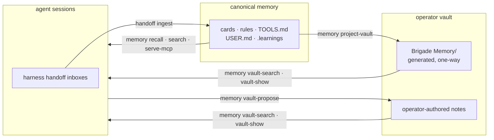

# Memory operations

Memory Operations is the read-only topology and inventory surface for Brigade-wired memory. Stable in v0.27.0. Earlier releases still have handoffs, care scan/plan, and owner-mediated filing. This page covers the operations facade added on the 0.27 line.

## Topology

```bash
brigade memory topology --target .
brigade memory topology --target . --json
```

Topology reports how writer inboxes, care jobs, evidence, and canonical destinations connect for one target. It assembles existing health helpers. It does not invent a new memory store or start a daemon.

## Inventory

```bash
brigade memory inventory --target .
brigade memory inventory --target . --json --limit 100
```

Inventory pages durable stores (cards, rules, tools, user, learnings) with freshness, review, and evidence filters. Default page size is 100. The maximum is 500. Field values are truncated for safe display.

## Recall

```bash
brigade memory recall --target <hub-or-mirror> --cwd <session-cwd> --query "token refresh" --limit 5
```

Bounded recall searches with the user's prompt when there is one (Claude `UserPromptSubmit`) and falls back to folder terms, labeled `query_source: "cwd"`, at session start. It returns index-level matches only: title, tags, path. Card bodies never appear. Fail-open: missing or unreadable targets do not block the harness. Repo-depth installs need an explicit `memory_recall_target` in `.brigade/config.json`. Details: [memory care](memory-care.md#session-start-and-prompt-recall-466-slice-1-2196).

## Hub memory client

A workspace can read hub memory on a Rust hub that serves `POST /memory`. The mode lives in a `[hub]` table in `.brigade/memory-care.toml`:

```toml
[hub]
mode = "read"          # off (the default), read or sync
scope = "repo:me/app"  # sync publishes here: fleet, repo:<identity> or principal:<id>
replica_max_mb = 50
```

The hub URL and credential come from the fleet settings that `brigade fleet` reads: `[fleet] hub_url`, then the node token, then the admin token. The token is sent as a bearer header and is never printed or stored.

```bash
brigade memory hub status --target . --json
brigade memory hub pull --target . && brigade memory hub push --target . --yes
```

`memory hub import --scope <scope> <card.md>...` sends one `import` call per card and needs the hub's import grant. `memory hub card <card_id>` prints one hub card's text. Every hub refusal is reported with its `code`, for example `memory_grant_missing`.

- `off`: `memory search` behaves exactly as before and never contacts the hub.
- `read`: `memory search` asks the hub within 800 ms and fuses its matches with local ones by reciprocal rank fusion. A match found in both places appears once. Each match says where it came from (`source`: `hub`, `local` or `replica`). If the hub is unreachable, times out, or answers 404 or 503, the answer comes from local cards and the replica and carries a warning with the reason.
- `sync`: as `read`, and `memory hub push` publishes changed local cards into the configured scope. The first push into a scope prints how many cards it would publish and needs `--yes`. Cards marked `visibility: private` are never published or imported.
- `pull` follows the hub log into `.brigade/memory/hub-replica/`. When the hub's `log_epoch` changes (a restore), the old replica is deleted first and rebuilt from empty, so search never answers from it.
- Writes the hub cannot take right now wait in `.brigade/memory/hub-spool/` and are resent with the same `client_event_id`, so a replay never appends twice. A 404 from a hub this workspace has pulled from spools too. The spool holds at most 10,000 entries.
- A spooled write that conflicts with a newer hub revision, was read under an older `log_epoch`, is older than 28 days, or that the hub refuses, becomes a local proposal in `.brigade/memory/hub-proposals/`. `memory hub status` lists them. They are never resent on their own.

All of this state is per host, 0700 directories and 0600 files, and ignored by Git. Dot and Duet `memory_search` and `memory_card` follow the same mode.

## Evidence projection and identity audit

```bash
brigade evidence memory audit . --json
brigade evidence crawl memory . --dry-run --json
brigade evidence crawl memory . --json
```

The identity audit is read-only. It reports explicit card ids versus path fallbacks and duplicate coverage without calling the evidence engine or rewriting frontmatter. New cards mint `card-<uuid4>` IDs, and consumers dual-read those IDs and legacy path/stem/topic aliases. `brigade memory care backfill` emits a dry-run old-to-new mapping receipt before any reviewed rewrite.

The crawl command projects memory into the evidence log only when the installed engine advertises `memory-projection.v1`. It accepts `--dry-run`, `--json`, `--rebuild`, and a positive `--limit`. It rejects the broader `--full` scan. Completed scans may tombstone missing projection rows. Failed or interrupted scans preserve the last completed projection and mark it stale instead of deleting it. Evidence projection status also appears inside Memory Operations inventory rows when evidence artifacts are present or missing.

## Obsidian vault projection

```bash
brigade memory project-vault --target . --vault /path/to/vault
brigade memory project-vault --target . --vault /path/to/vault --json
brigade memory vault-index --target .
brigade memory vault-search "rotation policy" --scope notes --json
brigade memory vault-show card-00000000-0000-4000-8000-00000000000a --json
brigade memory vault-propose --title "Rotation Policy" --scope notes --json
brigade memory vault-doctor --target . --json
```

One-way projection of canonical memory into a `Brigade Memory/` subfolder of an operator-supplied vault: one note per store item with care-state frontmatter and tags, category and harness maps, and a topology canvas. Writes go through the projection transaction kernel, so a failed run restores the vault. A manual edit inside the projection is untrusted data: Brigade preserves it, writes a conflict copy, and reports drift instead of merging.

The read path is a separate surface. Configure it once in `.brigade/vault.toml` with the vault path, allowlisted `[[roots]]` (`scope`, vault-relative `path`, optional), and `schema_version = 1`. `--scope` names a configured root, and an unknown scope is an error. `vault-index` writes a derived, owner-readable index under `.brigade/vault-index/` and never writes into the vault. `vault-search` returns bounded, redacted hits with a per-result `trust` of `untrusted_vault_content`. Projected notes key on `canonical_id` from the #934 contract. Operator-authored notes fall back to the vault-relative path.

Note titles come from a card's leading heading when its frontmatter has no `title`, falling back to the inventory title. Related links are ranked (explicit refs, then shared tags, then shared category) and capped per note, so a large shared category does not turn into a complete graph. A map that would cover every note is omitted. The vault path stays out of topology and vault-search output as `redacted:operator-vault`.

Rerunning projection is idempotent: unchanged notes produce no mutation. `vault-propose` is the additive write-back: it stages a note outside the vault, then delivers it into the `--scope` inbox root. It does not edit existing notes or replace `project-vault`.

### Where memory flows



An operator configures a vault once in `.brigade/vault.toml` and gets cited retrieval plus inbox write-back from `brigade` alone. The vault stays untrusted data: hits are labeled per result, snippets are bounded, and `project-vault` remains the only writer for generated `Brigade Memory/` content. Agent proposals land only in an allowlisted inbox via `vault-propose`.

## Care

Care remains a separate mutating/planning family:

```bash
brigade memory care scan --target .
brigade memory care plan-fixes --target .
brigade memory care status --target .
```

Care does not auto-edit card bodies on scan. Scheduling stays operator-owned. See [scheduled care](scheduled-care.md) and [execution model](execution-model.md).

## Ownership boundaries

| Owner | Role |
| --- | --- |
| Canonical memory system | Long-term cards, rules, `MEMORY.md` index |
| Brigade | Receipts, queues, topology/inventory views, review gate plumbing, and opt-in local ingestion |
| Scheduler | External cron, systemd, launchd, or CI that invokes Brigade |
| Manual process | Human or agent commands run on demand |
| External adapter | Harness-native memory that is not the Brigade owner |

Safe targeted handoffs may auto-file under owner policy. `brigade ingest` stages handoffs for review by default. Explicit `--promote-cards` and `--route-documents` enable card and document writes into the target's canonical stores. Ambiguous or risky notes wait for review. Brigade does not replace OpenClaw, Hermes, or another chosen memory owner unless the operator asks for that migration.

## Center view

The Center dashboard Memory Operations view reads `memory topology --json` and paginated `memory inventory --json`. It does not perform filesystem writes, cron installs, or card body reads beyond the inventory contract.

Related: [memory care](memory-care.md), [handoff promotion](handoff-promotion.md), [outcome scoring](outcome-scoring.md), [comparison](comparison.md).
