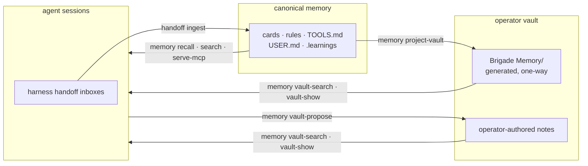

# Memory operations

Memory Operations is the read-only topology and inventory surface for Brigade-wired memory. Stable in v0.27.0. Earlier releases still have handoffs, care scan/plan, and owner-mediated filing. This page covers the operations facade added on the 0.27 line.

## Topology

```bash
brigade memory topology --target .
brigade memory topology --target . --json
```

Topology reports how writer inboxes, care jobs, evidence, and canonical destinations connect for one target. It assembles existing health helpers. It does not invent a new memory store or start a daemon.

## Inventory

```bash
brigade memory inventory --target .
brigade memory inventory --target . --json --limit 100
```

Inventory pages durable stores (cards, rules, tools, user, learnings) with freshness, review, and evidence filters. Default page size is 100. The maximum is 500. Field values are truncated for safe display.

## Recall

```bash
brigade memory recall --target <hub-or-mirror> --cwd <session-cwd> --query "token refresh" --limit 5
```

Bounded recall searches with the user's prompt when there is one (Claude `UserPromptSubmit`) and falls back to folder terms, labeled `query_source: "cwd"`, at session start. It returns index-level matches only: title, tags, path. Card bodies never appear. Fail-open: missing or unreadable targets do not block the harness. Repo-depth installs need an explicit `memory_recall_target` in `.brigade/config.json`. Details: [memory care](memory-care.md#session-start-and-prompt-recall-466-slice-1-2196).

## Hub memory client

A workspace can read hub memory on a Rust hub that serves `POST /memory`. The mode lives in a `[hub]` table in `.brigade/memory-care.toml`:

```toml
[hub]
mode = "read"                  # off (the default), read or sync
scope = "repo:me/app"          # sync publishes here: fleet, repo:<identity> or principal:<id>
read_scopes = ["repo:me/app"]  # the only scopes search, card reads and the replica use (default [scope])
replica_max_mb = 50            # cap on the replica's heads.json
```

`read` and `sync` need `scope` or `read_scopes`. Every hub search and card read names the read scopes, so a credential that can read more, such as one with a `principal:` grant, still answers only from them. Dot and Duet read through the same commands and get the same limit.

The hub URL comes from `[fleet] hub_url` and the credential is this machine's node token (`BRIGADE_FLEET_NODE_TOKEN` or `[fleet] node_token_file`). The client never reads the shared admin token: with only an admin token configured, the hub client reports `no-node-credential` and sends nothing. If the node-token slot holds the admin token by mistake, `status`, `pull`, `push`, `import` and `proposals drop` refuse with exit 2 as soon as the hub's `status` reports `credential: "admin"`. Search makes no `status` call, so it cannot tell, but its reads stay inside the read scopes and it writes nothing. The token is sent as a bearer header and is never printed or stored.

```bash
brigade memory hub status --target . --json
brigade memory hub pull --target . && brigade memory hub push --target . --yes
brigade memory hub proposals list --target .
```

`memory hub import --scope <scope> <card.md>...` sends one `import` call per card and needs the hub's import grant. `memory hub card <card_id>` prints one hub card's text from the read scopes. When the id is in more than one of them it answers `memory_card_ambiguous`, and `--scope` picks one. With `--all`, every chunk must come from the first chunk's revision and `log_epoch`: a restore between chunks restarts the read once and then refuses with `memory_epoch_changed`, and joined text that does not hash to the card's `content_hash` is refused. While the hub is unavailable (the same answers that send search to the replica), the card comes from this host's replica, with `source: "replica"` and a warning on stderr. A refusal never falls back. Dot and Duet `memory_card` take the same optional `scope`, as a search match reports it. Every hub refusal is reported with its `code`, for example `memory_grant_missing`.

- `off`: `memory search` behaves exactly as before and never contacts the hub. A config that cannot be read or is not UTF-8 gives the same error and exit status as before.
- `read`: `memory search` asks the hub within 800 ms and fuses its matches with local ones by reciprocal rank fusion. The same bytes under one card id in one scope appear once, and a local card joins the hub entry with its bytes. Each match says where it came from (`source`: `hub`, `local` or `replica`). The hub returns at most 20 matches, so a larger `--limit` is capped there with a warning, and `hub_match_count` reports how many the hub found.
- If the hub is unreachable, times out, or answers a redirect, 404, 408, 429 or 503, the answer comes from local cards and the replica and carries a warning with the reason. If the hub refuses (401, 403 or another coded answer), the answer comes from local cards only and the warning names the refusal. The replica never stands in for a hub that said no.
- `sync`: as `read`, and `memory hub push` publishes changed local cards into `scope`. The first push into a scope prints how many cards it would publish and needs `--yes`. Cards marked `visibility: private` are never published or imported. A credential that can write but not read still pushes, and the hub checks each write's base epoch itself.
- `pull` follows the hub log into the replica. The replica belongs to the principal the hub's `status` names for this credential, and covers only read scopes that principal could read at that pull. A changed `log_epoch` (a restore) or a different principal discards it and rebuilds from empty, so search never answers from it. A scope that is no longer readable, for example after a revoked grant, is dropped from the replica at the next pull. A replica is only checked against the hub when the hub answers, so after changing the credential, run `pull` before relying on fallback answers.
- `replica_max_mb` caps the size of the replica's `heads.json`. Cards left out for the cap stay listed and are fetched by a later pull once space frees, and a fallback answer says when the replica is incomplete.
- Writes the hub cannot take right now (unreachable, 401, a redirect, 408, 429 or 503) wait in the spool and are resent with the same `client_event_id`, so a replay never appends twice. A 404 from a hub this workspace has pulled from spools too. Each hub has its own spool of at most 10,000 entries, and entries for one hub never block cards on another.
- A spooled write that conflicts with a newer hub revision, was read under an older `log_epoch`, is older than 28 days, or that the hub refuses, becomes a local proposal. Its card is skipped until the proposal is resolved or dropped. `memory hub proposals list` shows them. A proposal resolves on its own when the local card takes exactly the hub head's text. `memory hub proposals drop <id>` closes one after review and needs an explicit choice. `--keep-local` makes the replica's hub head the card's base, so the next push writes the local card over the other writer's text. `--keep-hub` rewrites the local card file with the hub head, so the next push sends nothing. Both ask the hub's `status` and refuse unless the replica was pulled from this hub, as this principal, under its current `log_epoch`, so pull first. A closed proposal, dropped or resolved on its own, moves to `.brigade/memory/hub/proposals/dropped/` (0600) with its text, and `--keep-hub` also keeps the card file's text it replaced.
- `push` and proposal changes hold a lock on the workspace's hub state for their whole run. `pull` holds a separate pull lock for its whole run and takes the state lock only while it changes the replica, so a push never waits on a long pull's network calls. A run that waits more than 30 seconds for a lock exits 75 with `another memory hub push or pull is running`.

All of this state is per host, in `.brigade/memory/hub/`: a 0700 directory with 0600 files and a `*` ignore marker, so Git skips all of it. The shared `.brigade/memory/` keeps its own mode.

## Evidence projection and identity audit

```bash
brigade evidence memory audit . --json
brigade evidence crawl memory . --dry-run --json
brigade evidence crawl memory . --json
```

The identity audit is read-only. It reports explicit card ids versus path fallbacks and duplicate coverage without calling the evidence engine or rewriting frontmatter. New cards mint `card-<uuid4>` IDs, and consumers dual-read those IDs and legacy path/stem/topic aliases. `brigade memory care backfill` emits a dry-run old-to-new mapping receipt before any reviewed rewrite.

The crawl command projects memory into the evidence log only when the installed engine advertises `memory-projection.v1`. It accepts `--dry-run`, `--json`, `--rebuild`, and a positive `--limit`. It rejects the broader `--full` scan. Completed scans may tombstone missing projection rows. Failed or interrupted scans preserve the last completed projection and mark it stale instead of deleting it. Evidence projection status also appears inside Memory Operations inventory rows when evidence artifacts are present or missing.

## Obsidian vault projection

```bash
brigade memory project-vault --target . --vault /path/to/vault
brigade memory project-vault --target . --vault /path/to/vault --json
brigade memory vault-index --target .
brigade memory vault-search "rotation policy" --scope notes --json
brigade memory vault-show card-00000000-0000-4000-8000-00000000000a --json
brigade memory vault-propose --title "Rotation Policy" --scope notes --json
brigade memory vault-doctor --target . --json
```

One-way projection of canonical memory into a `Brigade Memory/` subfolder of an operator-supplied vault: one note per store item with care-state frontmatter and tags, category and harness maps, and a topology canvas. Writes go through the projection transaction kernel, so a failed run restores the vault. A manual edit inside the projection is untrusted data: Brigade preserves it, writes a conflict copy, and reports drift instead of merging.

The read path is a separate surface. Configure it once in `.brigade/vault.toml` with the vault path, allowlisted `[[roots]]` (`scope`, vault-relative `path`, optional), and `schema_version = 1`. `--scope` names a configured root, and an unknown scope is an error. `vault-index` writes a derived, owner-readable index under `.brigade/vault-index/` and never writes into the vault. `vault-search` returns bounded, redacted hits with a per-result `trust` of `untrusted_vault_content`. Projected notes key on `canonical_id` from the #934 contract. Operator-authored notes fall back to the vault-relative path.

Note titles come from a card's leading heading when its frontmatter has no `title`, falling back to the inventory title. Related links are ranked (explicit refs, then shared tags, then shared category) and capped per note, so a large shared category does not turn into a complete graph. A map that would cover every note is omitted. The vault path stays out of topology and vault-search output as `redacted:operator-vault`.

Rerunning projection is idempotent: unchanged notes produce no mutation. `vault-propose` is the additive write-back: it stages a note outside the vault, then delivers it into the `--scope` inbox root. It does not edit existing notes or replace `project-vault`.

### Where memory flows



An operator configures a vault once in `.brigade/vault.toml` and gets cited retrieval plus inbox write-back from `brigade` alone. The vault stays untrusted data: hits are labeled per result, snippets are bounded, and `project-vault` remains the only writer for generated `Brigade Memory/` content. Agent proposals land only in an allowlisted inbox via `vault-propose`.

## Care

Care remains a separate mutating/planning family:

```bash
brigade memory care scan --target .
brigade memory care plan-fixes --target .
brigade memory care status --target .
```

Care does not auto-edit card bodies on scan. Scheduling stays operator-owned. See [scheduled care](scheduled-care.md) and [execution model](execution-model.md).

## Ownership boundaries

| Owner | Role |
| --- | --- |
| Canonical memory system | Long-term cards, rules, `MEMORY.md` index |
| Brigade | Receipts, queues, topology/inventory views, review gate plumbing, and opt-in local ingestion |
| Scheduler | External cron, systemd, launchd, or CI that invokes Brigade |
| Manual process | Human or agent commands run on demand |
| External adapter | Harness-native memory that is not the Brigade owner |

Safe targeted handoffs may auto-file under owner policy. `brigade ingest` stages handoffs for review by default. Explicit `--promote-cards` and `--route-documents` enable card and document writes into the target's canonical stores. Ambiguous or risky notes wait for review. Brigade does not replace OpenClaw, Hermes, or another chosen memory owner unless the operator asks for that migration.

## Center view

The Center dashboard Memory Operations view reads `memory topology --json` and paginated `memory inventory --json`. It does not perform filesystem writes, cron installs, or card body reads beyond the inventory contract.

Related: [memory care](memory-care.md), [handoff promotion](handoff-promotion.md), [outcome scoring](outcome-scoring.md), [comparison](comparison.md).
