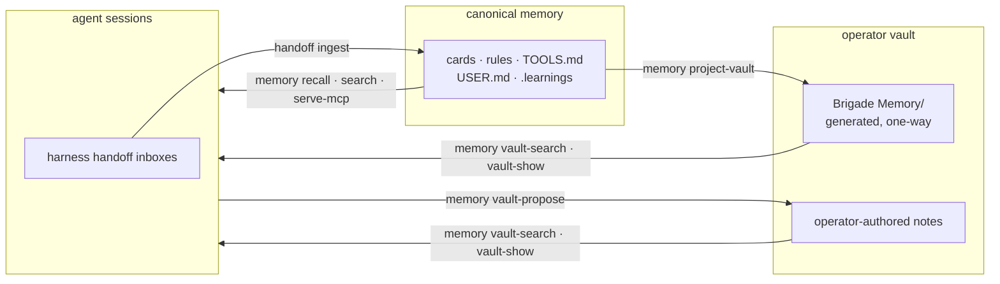

# Memory operations

Memory Operations is the read-only topology and inventory surface for Brigade-wired memory. Stable in v0.27.0. Earlier releases still have handoffs, care scan/plan, and owner-mediated filing. This page covers the operations facade added on the 0.27 line.

## Topology

```bash
brigade memory topology --target .
brigade memory topology --target . --json
```

Topology reports how writer inboxes, care jobs, evidence, and canonical destinations connect for one target. It assembles existing health helpers. It does not invent a new memory store or start a daemon.

## Inventory

```bash
brigade memory inventory --target .
brigade memory inventory --target . --json --limit 100
```

Inventory pages durable stores (cards, rules, tools, user, learnings) with freshness, review, and evidence filters. Default page size is 100. The maximum is 500. Field values are truncated for safe display.

## Recall

```bash
brigade memory recall --target <hub-or-mirror> --cwd <session-cwd> --query "token refresh" --limit 5
```

Bounded recall searches with the user's prompt when there is one (Claude `UserPromptSubmit`) and falls back to folder terms, labeled `query_source: "cwd"`, at session start. It returns index-level matches only: title, tags, path. Card bodies never appear. Fail-open: missing or unreadable targets do not block the harness. Repo-depth installs need an explicit `memory_recall_target` in `.brigade/config.json`. Details: [memory care](memory-care.md#session-start-and-prompt-recall-466-slice-1-2196).

## Hub memory client

A workspace can read hub memory on a Rust hub that serves `POST /memory`. The mode lives in a `[hub]` table in `.brigade/memory-care.toml`:

```toml
[hub]
mode = "read"                  # off (the default), read or sync
scope = "repo:me/app"          # sync publishes here: fleet, repo:<identity> or principal:<id>
read_scopes = ["repo:me/app"]  # the only scopes search, card reads and the replica use (default [scope])
replica_max_mb = 50            # cap on the replica's heads.json
```

`read` and `sync` need `scope` or `read_scopes`. Every hub search and card read names the read scopes, so a credential that can read more, such as one with a `principal:` grant, still answers only from them. Dot and Duet read through the same commands and get the same limit.

The hub URL comes from `[fleet] hub_url` and the credential is this machine's node token (`BRIGADE_FLEET_NODE_TOKEN` or `[fleet] node_token_file`). The client never reads the shared admin token: with only an admin token configured, the hub client reports `no-node-credential` and sends nothing. If the node-token slot holds the admin token by mistake, `status`, `pull`, `push`, `import`, `card` and `proposals drop` refuse with exit 2 as soon as the hub's `status` reports `credential: "admin"`. Dot and Duet `memory_card` run `card`, so they refuse too. Search (`memory search`, and Dot and Duet `memory_search`) makes no `status` call, to keep within its 800 ms budget, so it cannot tell: with the admin token in the node slot it returns any match the admin can read inside the read scopes, including a scope this node holds no grant for. Search writes and replicates nothing. The token is sent as a bearer header and is never printed or stored.

```bash
brigade memory hub status --target . --json
brigade memory hub pull --target . && brigade memory hub push --target . --yes
brigade memory hub proposals list --target .
```

`memory hub import --scope <scope> <card.md>...` sends one `import` call per card and needs the hub's import grant. `memory hub card <card_id>` prints one hub card's text from the read scopes. When the id is in more than one of them it answers `memory_card_ambiguous`, and `--scope` picks one. With `--all`, every chunk must come from the first chunk's revision and `log_epoch`: a restore between chunks restarts the read once and then refuses with `memory_epoch_changed`, and joined text that does not hash to the card's `content_hash` is refused. While the hub is unavailable (the same answers that send search to the replica), the card comes from this host's replica, with `source: "replica"` and a warning on stderr. A refusal never falls back. A scope the hub refused the card in during the read (`memory_grant_missing` or `memory_card_not_found`) is never served from the replica, whether the hub then turns unavailable on another scope, on a later chunk, or on the restarted read after an epoch change. The replica serves nothing at all when the hub's `status` answered 403 `memory_grant_missing` (this credential can read no scope) or when the `log_epoch` moved during the read. When `status` or a scope's first chunk answered before the hub turned unavailable, the replica stands in only if it was pulled as the principal `status` named and under the `log_epoch` every answer carried. A restore since the last pull, or a node token that now belongs to another principal, means no replica answer until the next pull. If `status` itself is unavailable, nothing was learned, so the replica still stands in. Dot and Duet `memory_card` take the same optional `scope`, as a search match reports it. Every hub refusal is reported with its `code`, for example `memory_grant_missing`.

Hub writes scan the normalized UTF-8 bytes under the write authorization and
memory transaction. The hub links the guard's pinned PCRE2 engine and bundles
its default rules with the connector's injection rules. Repository policies,
baselines and allow comments do not apply. `status.scan.ruleset_version` and
`memory_meta.scan_ruleset_version` identify the bundle by version and digest.

| Input or operation | Result |
|---|---|
| Blocking guard rule, bidi control, invisible operator, embedded BOM or tag character | `422 memory_content_blocked` with rule ids only. No bytes are stored |
| Warning, role override, U+200C or U+200D | `put` stores `flagged`, with a Tier 2 floor and rule ids attached to the content hash |
| Clean `put`, including combining marks or a leading BOM | Stores `agent-unreviewed`. Scanning never raises trust |
| `import` with any finding | Refused with `422`. Imports keep their clean-scan requirement |
| Engine missing, pin mismatch or rule compilation failure | `put` and `handoff` store `pending`. `import` returns `503 memory_scan_unavailable` with `retryable: true` |
| Input-specific engine failure | `503 memory_scan_failed` with `retryable: false`. No bytes are stored |
| Invalid UTF-8 or an unpaired surrogate in the JSON request | `400 memory_request_invalid` before normalization |

The `memory-scan` Cargo feature is enabled by default. A build with
`--no-default-features` has no scanner and serves pending writes and explicit
searches only. Restarting with the scanner does not promote or rescan old
versions automatically. A later authorized write scans its exact bytes.

Searches with `query_source: "prompt"` scan the returned fields and card bytes
again. Any finding replaces the match with `{card_id, blocked: "<rule id>"}`.
The response carries `content_trust: "untrusted"`. Explicit searches can still
inspect flagged versions. Local connector prompt loads share the same rule
bundle and placeholder. Every finding, including a warning, withholds prompt
text. Leading BOM handling applies to each field separately.

The internal `Store::push` boundary requires a current, live, trusted head with
a clean scan under the current bundle. It then applies the prompt-load scan.
An unavailable scanner, a pending scan or an old rule-set receipt produces no
push hits. S23 connects this boundary to native tool responses. The public
search API continues to reject `query_source: "push"`.

Input-specific PCRE2 failures return `503 memory_scan_failed` for puts,
imports and handoffs. No blobs, events, scan receipts or idempotency rows are
stored. An earlier or later blocking finding still returns
`422 memory_content_blocked`. Missing engines retain the pending-write policy.
The response includes `retryable: false` and the message
`input cannot be scanned, retrying will not help`. Edit the input before
submitting it again. The Python client records a proposal and removes any
spooled copy. It does not automatically retry this refusal. Generic status-based
retry policies should not retry `memory_scan_failed`, even though its status is 503.
The in-tree client treats every coded 503 as a refusal, including
`memory_scan_unavailable`. The `retryable` field is a hint for other clients.
It does not make the in-tree client spool or retry that refusal.
Each native regex has an explicit 8,388,608 match limit, 16 times the
512 KiB text limit. Each compiled regex also has an explicit 32 MiB JIT stack
ceiling, allocated on demand. The former implicit 32 KiB ceiling returned PCRE2
`-46` on a 1,000-segment Windows path. That input now reaches the Windows-path
warning. A separate exponential regex tests the match limit (`-47`), and a
repeated-alternation regex tests the explicit JIT stack limit (`-46`).
The 32 MiB setting was measured against 128 KiB and 512 KiB repeated path
segments, Windows space-separated tokens and dotted hostnames. Home paths
produce their existing warning ids. Dotted hostnames and dense single-line
salutations are clean.

Python prompt loads scan each distinct field and joined value once. They skip
equal scan copies and redundant ASCII passes on ASCII text. Non-ASCII text
retains both regex modes. Email and SSH-target rules require an `@` before
running their unanchored searches. Full-width normalization is included in that
check. Two Linux runs at 512 KiB reduced the six clean corpus cases from
1.035-1.527 seconds to 0.103-0.246 seconds. Dense single-line salutations took
0.355 seconds per `blocked_rule` call. The corpus subprocess deadline is
5 seconds, over 14 times the slowest measured call. Windows CI must confirm
the remaining headroom on its slower runner.

The bundle uses conservative guard matches in both PCRE2 UTF and byte modes.
Python prompt loads also run Unicode and ASCII-class passes. The scanned
copies preserve every Python `str.splitlines()` boundary as LF, remove
Unicode 16 default-ignorable characters, and fold full-width ASCII
U+FF01-U+FF5E plus U+3000 to ASCII. Every injection rule also runs on a copy
with an explicit shared whitespace set collapsed to single spaces. These
copies never replace stored bytes. Bundle v3 bounds the salutation-to-override
gap to 256 characters in both engines, including the flattened cross-line copy.
Cross-line detection remains enabled. Publication-guard context exceptions do
not apply.

Bidi marks U+061C, U+200E and U+200F block alongside overrides and isolates.
Default-ignorable characters and U+FFF9-FFFB block, except U+200C/U+200D
flag and an initial BOM is allowed. U+E0100-E01EF always block. Selectors
U+FE00-FE0F are allowed only immediately after a conservative emoji-base
allowlist: U+2600, U+2764, U+1F680 and U+1F600-U+1F64F. Other selector
positions block, including emoji bases outside this allowlist.

Full NFKC remains deferred pending a maintainer decision on a normalization
dependency. This release performs only the explicit full-width ASCII fold.

- `off`: `memory search` behaves exactly as before and never contacts the hub. A config that cannot be read or is not UTF-8 gives the same error and exit status as before.
- `read`: `memory search` asks the hub within 800 ms and fuses its matches with local ones by reciprocal rank fusion. The same bytes under one card id in one scope appear once, and a local card joins the hub entry with its bytes. Each match says where it came from (`source`: `hub`, `local` or `replica`). The hub returns at most 20 matches, so a larger `--limit` is capped there with a warning, and `hub_match_count` reports how many the hub found.
- If the hub is unreachable, times out, or answers a redirect, 404, 408, 429 or 503, the answer comes from local cards and the replica and carries a warning with the reason. If the hub refuses (401, 403 or another coded answer), the answer comes from local cards only and the warning names the refusal. The replica never stands in for a hub that said no.
- `sync`: as `read`, and `memory hub push` publishes changed local cards into `scope`. The first push into a scope prints how many cards it would publish and needs `--yes`. Cards marked `visibility: private` are never published or imported. The check fails closed: a leading byte-order mark is ignored, every `visibility:` line in the frontmatter counts whatever its case, and the first word of its value decides, so `visibility: private  # keep local` is private. Only an absent `visibility` or `public` publishes. Any other value, an empty one included, is skipped as `visibility-unrecognized`, and so is a file with a `visibility:` line in a leading block that does not parse as frontmatter, such as one with no closing `---`. A card the replica holds with the same bytes but no published base is adopted only when the replica was pulled under the `log_epoch` the push preflight reports. Otherwise it is skipped as `replica-stale` until a pull. A card published under an older `log_epoch` counts as unpublished after a restore, because the restored hub may not hold it: push adopts a current replica head with the same bytes, or sends the card again. A credential that can write but not read still pushes, and the hub checks each write's base epoch itself.
- `pull` follows the hub log into the replica. The replica belongs to the principal the hub's `status` names for this credential, and covers only read scopes that principal could read at that pull. A changed `log_epoch` (a restore) or a different principal discards it and rebuilds from empty, so search never answers from it. A scope that is no longer readable, for example after a revoked grant, is dropped from the replica at the next pull. A scope whose grant the hub refuses in a `card` answer during a pull is dropped then too, with every head already pulled in it, and is not marked readable, and the narrowed replica is saved at once so a later failure in that pull cannot leave the scope served. A pull whose `status` or `log` answers 403 `memory_grant_missing` at any point, meaning this credential can read no scope, discards this hub's replica and any rebuild. A replica is only checked against the hub when the hub answers, so after changing the credential, run `pull` before relying on fallback answers.
- `replica_max_mb` caps the size of the replica's `heads.json`. Cards left out for the cap stay listed and are fetched by a later pull once space frees, and a fallback answer says when the replica is incomplete.
- Writes the hub cannot take right now (unreachable, 401, a redirect, 408, 429 or 503) wait in the spool and are resent with the same `client_event_id`, so a replay never appends twice. A 404 from a hub this workspace has pulled from spools too. A spooled write always sends the card as it is now: when the card changed since it was spooled, for example to take out a line pasted by mistake, push drops the spooled text and sends the current text on the same base under a new `client_event_id`, in the same push. If an earlier try of the old write reached the hub and its answer was lost, the hub refuses that base and the current text becomes a proposal. A write that already reached the hub cannot be taken back: it stays in the hub's log, so remove the text there with a new revision and treat any credential in it as exposed. Each hub has its own spool of at most 10,000 entries, and entries for one hub never block cards on another.
- A spooled write that conflicts with a newer hub revision, was read under an older `log_epoch`, is older than 28 days, or that the hub refuses, becomes a local proposal. Push replays a spooled write only into the current `[hub] scope`, and only when exactly one readable, public local card holds its card id at the path it was spooled from. Otherwise the write becomes a proposal and its text is never sent: `scope-changed` (the write was spooled under another `[hub] scope`, so narrowing the scope never sends it to the old one), `card-now-private` (the card was marked `visibility: private`), `card-visibility-unrecognized` (its `visibility` is neither absent nor `public`, or sits in a block that does not parse as frontmatter), `card-gone` (no card holds the id or the path, for example after a delete, or a rename that changed an id taken from the file name), `card-unreadable` (the file is no longer UTF-8), `card-id-duplicated`, or `card-identity-changed` (the id or the path moved). A public card that was only moved or renamed lands here too, so a write never goes out under a stale path: review it and run `drop --keep-local`, and the next push sends the card from where it is now. Its card is skipped until the proposal is resolved or dropped. `memory hub proposals list` shows them. A conflict proposal resolves on its own when the local card takes exactly the hub head the hub reported in the conflict, the replica holds that same head, and the hub confirms it at push time. The push preflight's `log_epoch` must equal the replica's, and one `card` call must answer that head. A local card that matches only an older replica head leaves the proposal open. So does a write after the pull, a restore since the pull, or a refused or unavailable `card` answer. `memory hub proposals drop <id>` closes one after review and needs an explicit choice. `--keep-local` makes the replica's hub head the card's base, so the next push writes the local card over the other writer's text. When another writer retired the card, the retired head's revision becomes the base, so the next push revives the card with the local text. When no readable local card holds the id, the card is private, or it already holds the hub head, it says the next push sends nothing for it. `--keep-hub` rewrites the local card file with the hub head, so the next push sends nothing. It refuses when the local card is private, since the hub's public text would replace it. Use `--keep-local` or edit the card instead. Both ask the hub's `status` and its `card` for the card's current head, and refuse unless the replica was pulled from this hub, as this principal, under its current `log_epoch`, and holds that same head, so pull first. A replica pulled before the conflicting write has the current epoch and an old head, so it is refused. Both refuse when more than one local card holds the id, and when the proposal's scope is not the current `[hub] scope`, since push compares cards only against that scope. Set `scope` back to drop it. `--keep-hub` finds the local card by its id, so a card moved since the proposal is rewritten where it is now. It refuses when the file at the recorded path is not UTF-8 or now holds another id. A closed proposal, dropped or resolved on its own, moves to `.brigade/memory/hub/proposals/dropped/` (0600) with its text, and `--keep-hub` also keeps the card file's text it replaced.
- `push` and proposal changes hold a lock on the workspace's hub state for their whole run. `pull` holds a separate pull lock for its whole run and takes the state lock only while it changes the replica, so a push never waits on a long pull's network calls. A run that waits more than 30 seconds for a lock exits 75 with `another memory hub push or pull is running`.

All of this state is per host, in `.brigade/memory/hub/`: a 0700 directory with 0600 files and a `*` ignore marker, so Git skips all of it. The shared `.brigade/memory/` keeps its own mode.

The v5 bundle bounds retryable address spans at 256 characters for the local
part and the domain span before the final dot, with a 63-character TLD. Reserved
domains allow 127 labels of at most 63 characters. Longer uninterrupted local
parts or domains no longer match that address rule. Dotted local parts can
still match a suffix that starts within 256 characters of `@`.

Whitespace and cue gaps allow 256 characters per span. The optional slash
in a system tag permits two adjacent spans, so its combined gap can reach
512 characters. Directive scan copies collapse whitespace before matching.
Bearer and quoted assigned tokens hit at 4097 characters even without a
closing delimiter. JWT segments hit at 4097 characters after their fixed
prefixes. Provider suffixes hit at 8193, including oversized AWS-shaped values.
Ordinary AWS credentials retain their fixed-length boundary checks. Unquoted assignments retain their safe-code
exclusions. Short unquoted values need a digit within the first 4096 characters,
and longer token runs also hit the ceiling without a digit.
A PEM private-key header alone blocks, independent of body size or an END line.
The shared guard policy engine extends detected token spans through the full
token run and PEM spans through the END line. Without END, the mask stops at
the contiguous base64 body, including consistent indentation or quote prefixes,
escaped newlines, and space-separated runs on the header line. A blank after the
body ends the mask. Header-only mentions preserve the following paragraph.
END searches share a per-scan cache, including exhausted suffixes.
Later rules compare raw spans and retain their findings inside expanded secrets.
Only masking secret edits supersede contained edits, so allowing or warning on a
PEM still permits independent hostname masking. This applies to
Python and native matching, including the pre-push content guard and evidence
redaction. It prevents bounded prefix matches from leaving secret tails.
Custom rules retain their configured spans.

The Python memory scanner skips literal-based bundle rules on raw copies
without ASCII letters or digits, including Unicode letter case folds. Unicode
phone matches still scan the raw copy to preserve boundary behavior. Assignment
digit indexes are built only when an assignment prefix exists. Folded copies
retain the email-domain prefilter and are scanned once per required regex mode.

SSH suffixes still match their first 4096 characters and local port strings
allow 256 digits. The base64 heuristic accepts a bounded prefix of a longer
blob. It searches for a blob starting within the first 256 characters of a
line and a decode cue within 4096 characters per line across a four-line window.
Cues outside that window remain documented heuristic misses.
The shared untrusted-context directive rules use the same gap bounds.
For `a@b.co:\x1fx`, Python flags the warn-level email rule while the hub is less strict and scans clean, because their ASCII whitespace classes differ.

Python skips impossible address rules with necessary domain/prefix checks and
indexes assignment digits once before trying bounded candidates. Parity tests
compare these filters with the same rules running without filters.
The corpus test asserts each subprocess-reported scan time below 2 seconds,
with a separate 60-second process timeout for startup and runner stalls.
On Linux the worst local 512 KiB case fell from 2.29 seconds to 0.28 seconds
across all six placements and ASCII/full-width forms. These are local scan
measurements, excluding interpreter startup. Windows speed is not measured here.

## Evidence projection and identity audit

```bash
brigade evidence memory audit . --json
brigade evidence crawl memory . --dry-run --json
brigade evidence crawl memory . --json
```

The identity audit is read-only. It reports explicit card ids versus path fallbacks and duplicate coverage without calling the evidence engine or rewriting frontmatter. New cards mint `card-<uuid4>` IDs, and consumers dual-read those IDs and legacy path/stem/topic aliases. `brigade memory care backfill` emits a dry-run old-to-new mapping receipt before any reviewed rewrite.

The crawl command projects memory into the evidence log only when the installed engine advertises `memory-projection.v1`. It accepts `--dry-run`, `--json`, `--rebuild`, and a positive `--limit`. It rejects the broader `--full` scan. Completed scans may tombstone missing projection rows. Failed or interrupted scans preserve the last completed projection and mark it stale instead of deleting it. Evidence projection status also appears inside Memory Operations inventory rows when evidence artifacts are present or missing.

## Obsidian vault projection

```bash
brigade memory project-vault --target . --vault /path/to/vault
brigade memory project-vault --target . --vault /path/to/vault --json
brigade memory vault-index --target .
brigade memory vault-search "rotation policy" --scope notes --json
brigade memory vault-show card-00000000-0000-4000-8000-00000000000a --json
brigade memory vault-propose --title "Rotation Policy" --scope notes --json
brigade memory vault-doctor --target . --json
```

One-way projection of canonical memory into a `Brigade Memory/` subfolder of an operator-supplied vault: one note per store item with care-state frontmatter and tags, category and harness maps, and a topology canvas. Writes go through the projection transaction kernel, so a failed run restores the vault. A manual edit inside the projection is untrusted data: Brigade preserves it, writes a conflict copy, and reports drift instead of merging.

The read path is a separate surface. Configure it once in `.brigade/vault.toml` with the vault path, allowlisted `[[roots]]` (`scope`, vault-relative `path`, optional), and `schema_version = 1`. `--scope` names a configured root, and an unknown scope is an error. `vault-index` writes a derived, owner-readable index under `.brigade/vault-index/` and never writes into the vault. `vault-search` returns bounded, redacted hits with a per-result `trust` of `untrusted_vault_content`. Projected notes key on `canonical_id` from the #934 contract. Operator-authored notes fall back to the vault-relative path.

Note titles come from a card's leading heading when its frontmatter has no `title`, falling back to the inventory title. Related links are ranked (explicit refs, then shared tags, then shared category) and capped per note, so a large shared category does not turn into a complete graph. A map that would cover every note is omitted. The vault path stays out of topology and vault-search output as `redacted:operator-vault`.

Rerunning projection is idempotent: unchanged notes produce no mutation. `vault-propose` is the additive write-back: it stages a note outside the vault, then delivers it into the `--scope` inbox root. It does not edit existing notes or replace `project-vault`.

### Where memory flows



An operator configures a vault once in `.brigade/vault.toml` and gets cited retrieval plus inbox write-back from `brigade` alone. The vault stays untrusted data: hits are labeled per result, snippets are bounded, and `project-vault` remains the only writer for generated `Brigade Memory/` content. Agent proposals land only in an allowlisted inbox via `vault-propose`.

## Care

Care remains a separate mutating/planning family:

```bash
brigade memory care scan --target .
brigade memory care plan-fixes --target .
brigade memory care status --target .
```

Care does not auto-edit card bodies on scan. Scheduling stays operator-owned. See [scheduled care](scheduled-care.md) and [execution model](execution-model.md).

## Ownership boundaries

| Owner | Role |
| --- | --- |
| Canonical memory system | Long-term cards, rules, `MEMORY.md` index |
| Brigade | Receipts, queues, topology/inventory views, review gate plumbing, and opt-in local ingestion |
| Scheduler | External cron, systemd, launchd, or CI that invokes Brigade |
| Manual process | Human or agent commands run on demand |
| External adapter | Harness-native memory that is not the Brigade owner |

Safe targeted handoffs may auto-file under owner policy. `brigade ingest` stages handoffs for review by default. Explicit `--promote-cards` and `--route-documents` enable card and document writes into the target's canonical stores. Ambiguous or risky notes wait for review. Brigade does not replace OpenClaw, Hermes, or another chosen memory owner unless the operator asks for that migration.

## Center view

The Center dashboard Memory Operations view reads `memory topology --json` and paginated `memory inventory --json`. It does not perform filesystem writes, cron installs, or card body reads beyond the inventory contract.

Related: [memory care](memory-care.md), [handoff promotion](handoff-promotion.md), [outcome scoring](outcome-scoring.md), [comparison](comparison.md).
