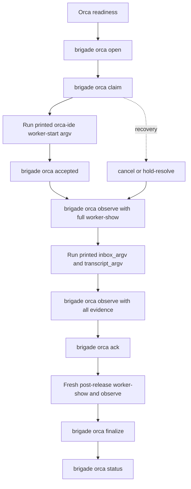

# Governed Orca delegation

Brigade governs coordinator-mediated launches to local Orca workers. The
coordinator runs Orca; Brigade records enrollment, launch claims, native
receipts, observations, acknowledgements and final state. This procedure was
checked against Orca 1.4.269.

On Linux, invoke Orca as `orca-ide`; `/usr/bin/orca` is the screen reader.
Follow the bundled [orca-governed-delegation skill](../src/brigade/templates/skills/orca-governed-delegation/SKILL.md)
for all recovery rules.



## Before the first claim

Run the [Orca readiness check](roster-readiness.md#route-orca) on the
coordinator, using the workspace, seat, and PATH that will be used for launch.

```console
brigade roster ready --route orca --worker <seat> --target <workspace> --json
```

Proceed to the initial claim only after readiness reports `ready`. After an
Orca upgrade, update `[orca_targets.<seat>].orca_version` to the exact installed
version, then rerun readiness and use a fresh enrollment for new work. Keep
the original enrollment and retry keys for retained work. Repeat the
preflight if the executable, PATH, or roster changes before launch.

The registry confirms command and flag availability. Brigade still validates
the returned worker receipts against the existing wire contract.

## Observe and acknowledge

After accepting all worker starts in the batch, the coordinator may run the
closeout chains for different tasks concurrently. Within each task, follow
the proof steps in order and use that task's own evidence files. Once every
chain finishes, run `brigade orca finalize <run> --target <workspace>` once,
then run `brigade orca status <run> --json --target <workspace>` once to
confirm that the run closed with zero live capacity.

After `accepted`, run its exact printed `observe_argv` to collect full
`worker-show --json --full` evidence. Submit the show with
`brigade orca observe <run> <task> --native-json <show.json> --target <workspace>`.
That result prints the exact `observe_argv`, `inbox_argv` and
`transcript_argv`. Run those printed Orca argv without reconstructing them.
The inbox argv carries `--run` and `--limit`; a hand-built
`orca-ide orchestration inbox --full --json` omits them. The transcript argv
uses `orca-ide orchestration worker-read --environment local --dispatch <id> --source transcript --json`.
If `result.transcript.limited` is true, run the same transcript argv with
`--cursor` and the page's `result.transcript.nextCursor` as one argument.
Continue until a page returns `limited: false`. Save the full replies in one
JSON array in read order, including an empty final page. `--transcript-json`
accepts one full reply or an array of up to eight full replies. Restart from
the first page if the transcript source changes.

Then submit all evidence with
`brigade orca observe <run> <task> --native-json <show.json> --worker-done-json <inbox.json> --transcript-json <transcript.json> --target <workspace>`.
Without both the matching worker_done report and a complete transcript,
observation remains `result-transfer-missing`, no terminal result is available
to acknowledge, and the slot stays occupied.

Orca can clip oversized transcript text as `transcript_payload`. Brigade
accepts that clipping when the exact transcript ends with a non-empty assistant
text block. The terminal observation receipt then includes
`transcript_clipped: true`.

Read mail with `inbox --full`, never `check`, because `check` marks mail read.
`worker-show` alone is not acceptance. The 1.4.269 "brief may not have been
submitted" notice is not acceptance or acknowledgement.

Each definite start refusal (`start-refused`, `circuit-broken` or
`start-failed`) returns a `result_id`. Acknowledge it using
`brigade orca ack <run> <task> --result-id <result-id> --target <workspace>`.
Until ack, it holds capacity as `awaiting-ack`.

After acknowledging a terminal result, wait for Orca to release its worker.
For a normally completed or failed worker, run a fresh full `worker-show`
using the printed `observe_argv`, then repeat `observe` with the fresh show
and the matching worker_done report and transcript. For a cancelled worker,
after a confirmed stop, use the fresh full show alone to verify release with
`brigade orca observe <run> <task> --native-json <show.json> --target <workspace>`.
A cancelled worker may not produce a worker_done report or transcript.
Finalization is blocked by `release-unverified` until the post-release
observation proves release.

## Cancellation and recovery

Request cancellation with `brigade orca cancel <run> <task> --target <workspace>`
and run its printed worker-stop argv. A `stop_unknown` outcome stays open. To
recover, run that same printed argv again with the same `--retry-request`, then
report again with
`brigade orca cancel <run> <task> --native-json <stop.json> --exit-code <code> --show-json <show.json> --target <workspace>`.
`--native-json` and `--exit-code` must be supplied together. A stop request
alone does not prove cancellation. `hold-resolve` cannot settle a stop.

After a lost start reply, reuse the same `--retry-request` id and exact printed
worker-start argv. Never start a new Orca Run or Task to get around the circuit
breaker. For `outcome_unknown`, recover the original start receipt and use
`hold-resolve`; it can also clear an `accept-conflict` hold when evidence
matches the retained worker. `hold-resolve --abandon` writes a permanent
`abandoned-unknown` hold: it frees no slot, `finalize` refuses it, and an
operator must follow up. `stop_unknown` and `outcome_unknown` both keep tasks
open and capacity occupied.

If a full worker-start receipt reports `failed` with residual resources,
keep that receipt and its exit code. Once Orca releases the worker, capture a
fresh `worker-show --json --full` for the same dispatch. Pass the original
receipt with `--native-json` and the new snapshot with `--show-json` to
`accepted` or `hold-resolve`. Brigade records `start-failed` only when the
snapshot proves resource release and exited liveness. Acknowledge the
returned result ID with `ack` to free the slot before `finalize`. If release
or exit is unverified, the claim stays `start-unknown` and holds capacity.

When the refusal response or task row in `brigade orca status --json` shows
`worktree_retained: true`, report the retained worktree to the operator. Status
keeps that flag after acknowledgement. Acknowledge the failed result as usual
to free the worker slot.

If `open` refuses a task as `orca-unsupported`, send it through
`brigade run batch`. Report every receipt to Brigade, refusals included. Use
`brigade orca status <run> --json --target <workspace>` to inspect state and
workspace capacity.
