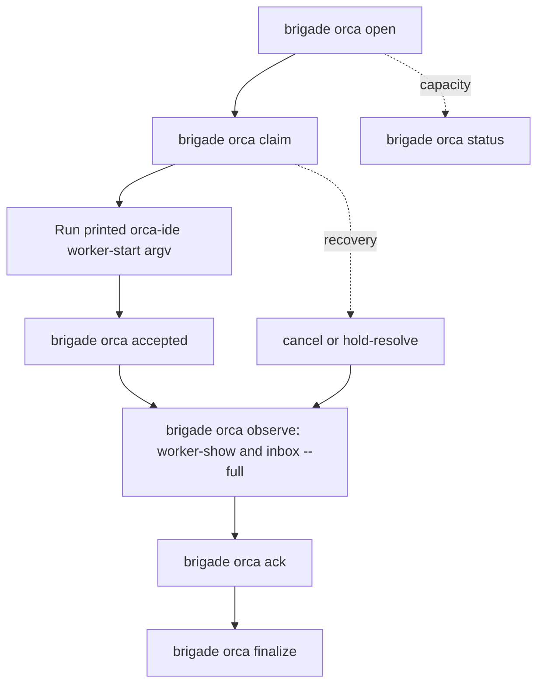

# Governed Orca delegation

Brigade's `orca` command governs coordinator-mediated launches to local Orca
workers. The coordinator runs Orca; Brigade records the enrollment, claim,
native receipts, observations, acknowledgements and final state. This guide is
checked against Orca 1.4.269.

On Linux, use the `orca-ide` command. `/usr/bin/orca` is the screen reader.
Follow the bundled [orca-governed-delegation skill](../src/brigade/templates/skills/orca-governed-delegation/SKILL.md)
for the complete procedure and recovery rules.

If `open` refuses a task as `orca-unsupported`, submit it through
`brigade run batch`. A lost worker-start reply must reuse the same
`--retry-request` id and printed argv. Never create another Orca Run or Task to
work around the circuit breaker. Read completion mail using `inbox --full`,
never `check`; report every receipt, including refusals, to Brigade. A
`worker-show` projection and the 1.4.269 "brief may not have been submitted"
notice are not acceptance. `stop_unknown` and `outcome_unknown` leave the task
open.
