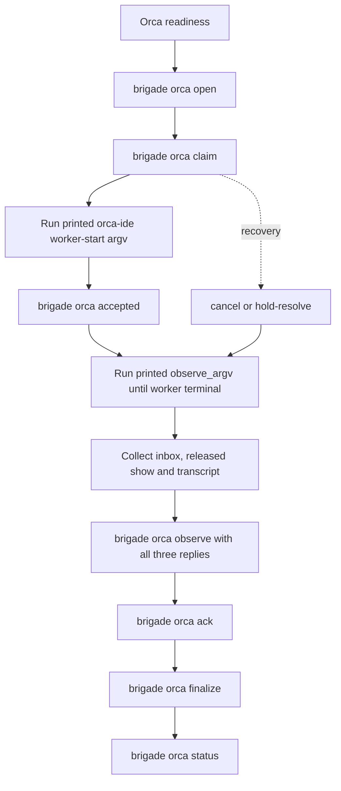

# Governed Orca delegation

Brigade governs coordinator-mediated launches to local Orca workers. The
coordinator runs Orca. Brigade records enrollment, launch claims, native
receipts, observations, acknowledgements and final state. This procedure was
checked against Orca 1.4.269.

On Linux, invoke Orca as `orca-ide`. `/usr/bin/orca` is the screen reader.
Follow the bundled [orca-governed-delegation skill](../src/brigade/templates/skills/orca-governed-delegation/SKILL.md)
for all recovery rules.



## Before the first claim

Run the [Orca readiness check](roster-readiness.md#route-orca) on the
coordinator, using the workspace, seat, and PATH that will be used for launch.

```console
brigade roster ready --route orca --worker <seat> --target <workspace> --json
```

Proceed to the initial claim only after readiness reports `ready`. After an
Orca upgrade, update `[orca_targets.<seat>].orca_version` to the exact installed
version, then rerun readiness and use a fresh enrollment for new work. Keep
the original enrollment and retry keys for retained work. Repeat the
preflight if the executable, PATH, or roster changes before launch.

The registry confirms command and flag availability. Brigade still validates
the returned worker receipts against the existing wire contract.

## Launch the workers

After `open`, the coordinator may run the launch chains concurrently across
tasks. Within each task, run `claim`, run the exact worker-start argv it prints,
then report the full receipt and exit code to `accepted`. Keep each task's
argv and receipt separate. Preserve the printed `--retry-request` so a lost
reply can be recovered against the same Orca Run and Task.

`claim` and `accepted` wait up to five seconds for the workspace run lock.
If either returns `run-busy`, let the other chains continue and retry just
that Brigade command with the same arguments. When retrying `accepted`, use
the saved receipt and exit code. `claim` also waits up to ten seconds for
the shared capacity lock. Retry the same claim on `capacity-lock` after
contention clears. If a claim is refused, stop that chain before worker-start.
On `capacity-denied`, retry only once capacity is available. Investigate other
refusals through `status` and the recovery rules.

Join the launch chains before closeout. Report every attempted start to
`accepted` and acknowledge any definite start refusal. A refused claim has
no worker-start receipt to report. An ambiguous start keeps its slot and
follows the recovery procedure below. Once the ambiguous receipt has been
reported, correlated siblings can close out while recovery continues.

## Observe and acknowledge

After the launch chains have joined, the coordinator may run the closeout
chains for different tasks concurrently. Within each task, follow
the proof steps in order and use that task's own evidence files. Per-task
verbs such as `observe`, `ack`, and `hold-resolve` may wait up to five
seconds for the workspace run lock and return `run-busy` if it is still held.
`finalize` fails immediately if the lock is held. Once every chain finishes,
run `brigade orca finalize <run> --target <workspace>` once, then run
`brigade orca status <run> --json --target <workspace>` once to confirm
that the run closed with zero live capacity.

After a successful correlation, `accepted` prints `observe_argv`,
`inbox_argv` and `transcript_argv`. Run the printed Orca argv as given.
Use `observe_argv` to collect a full `worker-show --json --full` snapshot.
If the worker is still active, poll for a terminal snapshot. To record an
interim state in Brigade, submit the snapshot with
`brigade orca observe <run> <task> --native-json <show.json> --target <workspace>`.
Once the dispatch is completed or failed, read the inbox with `inbox_argv`.
After Orca releases the worker, collect a fresh full show with `observe_argv`
and read the transcript with `transcript_argv`. If the first show already
proves release, reuse it.

The inbox argv carries the required `--run` and `--limit` arguments. The transcript argv
uses `orca-ide orchestration worker-read --environment local --dispatch <id> --source transcript --json`.
If `result.transcript.limited` is true, run the same transcript argv with
`--cursor` and the page's `result.transcript.nextCursor` as one argument.
Continue until a page returns `limited: false`. Save the full replies in one
JSON array in read order, including an empty final page. `--transcript-json`
accepts one full reply or an array of up to eight full replies. Restart from
the first page if the transcript source changes.

Submit the released show, inbox and transcript together with
`brigade orca observe <run> <task> --native-json <show.json> --worker-done-json <inbox.json> --transcript-json <transcript.json> --target <workspace>`.
Without both the matching worker_done report and a complete transcript,
observation remains `result-transfer-missing`, no terminal result is available
to acknowledge, and the slot stays occupied.

Use the returned `result_id` with
`brigade orca ack <run> <task> --result-id <result-id> --target <workspace>`.
The slot is free once Brigade records both the acknowledgement and proof of
release. Brigade can record release during the terminal observation or from
a later full show once it has a terminal result.

Orca can clip oversized transcript text as `transcript_payload`. Brigade
accepts that clipping when the exact transcript ends with a non-empty assistant
text block. The terminal observation receipt then includes
`transcript_clipped: true`.

Read mail with `inbox --full`, never `check`, because `check` marks mail read.
`worker-show` alone is not acceptance. The 1.4.269 "brief may not have been
submitted" notice is not acceptance or acknowledgement.

Each definite start refusal (`start-refused`, `circuit-broken` or
`start-failed`) returns a `result_id`. Acknowledge it using
`brigade orca ack <run> <task> --result-id <result-id> --target <workspace>`.
Until ack, it holds capacity as `awaiting-ack`.

If Brigade recorded a terminal result before release, wait for Orca to release
the worker. For a cancelled worker, after a confirmed stop, use the fresh full
show alone to verify release. Submit the fresh show with
`brigade orca observe <run> <task> --native-json <show.json> --target <workspace>`.
The retained terminal result lets Brigade check release with the show alone.
A cancelled worker may not produce a worker_done report or transcript.
Finalization is blocked by `release-unverified` until the post-release
observation proves release.

## Cancellation and recovery

Request cancellation with `brigade orca cancel <run> <task> --target <workspace>`
and run its printed worker-stop argv. A `stop_unknown` outcome stays open. To
recover, run that same printed argv again with the same `--retry-request`, then
report again with
`brigade orca cancel <run> <task> --native-json <stop.json> --exit-code <code> --show-json <show.json> --target <workspace>`.
`--native-json` and `--exit-code` must be supplied together. A stop request
alone does not prove cancellation. `hold-resolve` cannot settle a stop.

After a lost start reply, reuse the same `--retry-request` id and exact printed
worker-start argv. Never start a new Orca Run or Task to get around the circuit
breaker. For `outcome_unknown`, recover the original start receipt and use
`hold-resolve`. It can also clear an `accept-conflict` hold when evidence
matches the retained worker. `hold-resolve --abandon` writes a permanent
`abandoned-unknown` hold: it frees no slot, `finalize` refuses it, and an
operator must follow up. `stop_unknown` and `outcome_unknown` both keep tasks
open and capacity occupied.

If a full worker-start receipt reports `failed` with residual resources,
keep that receipt and its exit code. Once Orca releases the worker, capture a
fresh `worker-show --json --full` for the same dispatch. Pass the original
receipt with `--native-json` and the new snapshot with `--show-json` to
`accepted` or `hold-resolve`. Brigade records `start-failed` only when the
snapshot proves resource release and exited liveness. Acknowledge the
returned result ID with `ack` to free the slot before `finalize`. If release
or exit is unverified, the claim stays `start-unknown` and holds capacity.

When the refusal response or task row in `brigade orca status --json` shows
`worktree_retained: true`, report the retained worktree to the operator. Status
keeps that flag after acknowledgement. Acknowledge the failed result as usual
to free the worker slot.

If `open` refuses a task as `orca-unsupported`, send it through
`brigade run batch`. Report every receipt to Brigade, refusals included. Use
`brigade orca status <run> --json --target <workspace>` to inspect state and
workspace capacity.
