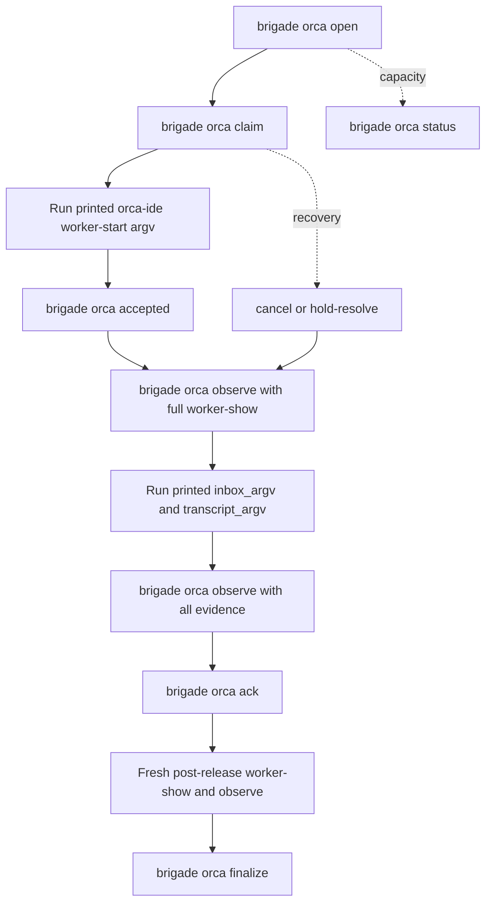

# Governed Orca delegation

Brigade governs coordinator-mediated launches to local Orca workers. The
coordinator runs Orca; Brigade records enrollment, launch claims, native
receipts, observations, acknowledgements and final state. This procedure was
checked against Orca 1.4.269.

On Linux, invoke Orca as `orca-ide`; `/usr/bin/orca` is the screen reader.
Follow the bundled [orca-governed-delegation skill](../src/brigade/templates/skills/orca-governed-delegation/SKILL.md)
for all recovery rules.

## Observe and acknowledge

After `accepted`, run its exact printed `observe_argv` to collect full
`worker-show --json --full` evidence. Submit the show with
`brigade orca observe <run> <task> --native-json <show.json> --target <workspace>`.
That result prints the exact `observe_argv`, `inbox_argv` and
`transcript_argv`. Run those printed Orca argv without reconstructing them.
The inbox argv carries `--run` and `--limit`; a hand-built
`orca-ide orchestration inbox --full --json` omits them. The transcript argv
uses `orca-ide orchestration worker-read --dispatch <id> --source transcript --json`.
Then submit all evidence with
`brigade orca observe <run> <task> --native-json <show.json> --worker-done-json <inbox.json> --transcript-json <transcript.json> --target <workspace>`.
Without both the matching worker_done report and a complete transcript,
observation remains `result-transfer-missing`, no terminal result is available
to acknowledge, and the slot stays occupied.

Read mail with `inbox --full`, never `check`, because `check` marks mail read.
`worker-show` alone is not acceptance. The 1.4.269 "brief may not have been
submitted" notice is not acceptance or acknowledgement.

Each definite start refusal (`start-refused`, `circuit-broken` or
`start-failed`) returns a `result_id`. Acknowledge it using
`brigade orca ack <run> <task> --result-id <result-id> --target <workspace>`.
Until ack, it holds capacity as `awaiting-ack`.

After acknowledging a terminal result, wait for Orca to release its worker.
Run a fresh full `worker-show` using the printed `observe_argv`, then repeat
`observe` with the fresh show and the matching worker_done report and
transcript. Finalization is blocked by `release-unverified` until this
post-release observation proves release.

## Cancellation and recovery

Request cancellation with `brigade orca cancel <run> <task> --target <workspace>`
and run its printed worker-stop argv. A `stop_unknown` outcome stays open. To
recover, run that same printed argv again with the same `--retry-request`, then
report again with
`brigade orca cancel <run> <task> --native-json <stop.json> --exit-code <code> --show-json <show.json> --target <workspace>`.
`--native-json` and `--exit-code` must be supplied together. A stop request
alone does not prove cancellation. `hold-resolve` cannot settle a stop.

After a lost start reply, reuse the same `--retry-request` id and exact printed
worker-start argv. Never start a new Orca Run or Task to get around the circuit
breaker. For `outcome_unknown`, recover the original start receipt and use
`hold-resolve`; it can also clear an `accept-conflict` hold when evidence
matches the retained worker. `hold-resolve --abandon` writes a permanent
`abandoned-unknown` hold: it frees no slot, `finalize` refuses it, and an
operator must follow up. `stop_unknown` and `outcome_unknown` both keep tasks
open and capacity occupied.

If `open` refuses a task as `orca-unsupported`, send it through
`brigade run batch`. Report every receipt to Brigade, refusals included. Use
`brigade orca status <run> --json --target <workspace>` to inspect state and
workspace capacity.
