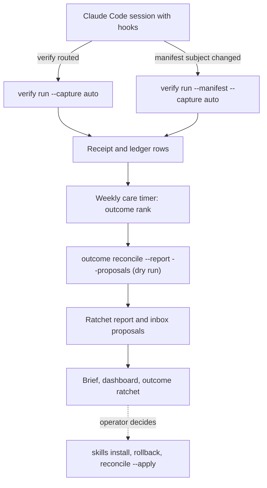

# Outcome scoring

Outcome capture classifies runs when it reads stored receipts and persists the resulting `signal_value` in the outcome ledger. Upgrading Brigade can change a new capture of the same historical `run.json` and `worker-results.json` files. Ranking reads the stored ledger signals and also builds current verification scorecards
([capture and ranking](../src/brigade/outcome_cmd.py), [scorecard projection](../src/brigade/scorecard.py)).

This is outcome-based skill scoring, promotion, and rollback from verification evidence.
[The default loop](#the-default-loop) below describes what runs without an operator command and what stays manual.
The scheduled memory reflection and verification described next run separately from this scoring loop.

Hub reflection opens pinned proposals for exact duplicate merges, near-duplicate
supersedes, broken-link repairs and anchors. Stale-newer-evidence and
opposite-polarity candidates are local only, and a contradicted card is a verify
verdict.

Scheduled reflect applies one class with no person on real memory. An
exact-duplicate merge applies when both cards share one writer with the
principal that proposes and applies it, the hub policy lists that principal in
`reflect_principals` and enables
`merge_exact_duplicates`, the workspace has opted in, and every preflight gate
passes. Each automatic apply can be rolled back by exact compensation. A merge
of cards written by different principals holds with
`retrieval_eval_merge_cross_writer` (`retrieval_eval_writer_changed` when the
cards are `agent-unreviewed`) and waits for a reviewer. Near-duplicate
supersedes and broken-link repairs are Tier 2 and wait for a reviewer. The fleet
policy writer rejects `anchor_blocks`, so no anchor applies automatically.
Scheduled reflect opens no evidence-append proposals, though the hub can apply
an attested evidence append when the policy enables it. A scope over 2,000 live
cards, 16 MiB or 500 judged retrieval uses holds every automatic reflection
apply, because the retrieval-history check cannot run on it. Local repository candidates stay proposal-only. The
`[reflect] scopes` setting limits where the job proposes, applies and watches.
Unlisted read scopes are still read, never changed. See
[memory operations](memory-operations.md) for the gates and limits.

The verify pass uses two seats and opens correction proposals. Per-class go or
no-go records gate `verify_auto_apply`, and without a current admin `go` record
on the hub it applies nothing. A scheduled run still opens correction proposals
because only their application is gated. Scheduled reflection also polls the
compensation watch over its own automatic applies. Automatic reversal needs two
independent verifier signals, or an attributable lexical regression. A watch
attempt that is not exact or is blocked ends `held`, or `stale` when a target
no longer matches its pins. See
[Automatic Tier 0 reflection](memory-care.md#automatic-tier-0-reflection)
for the `auto_apply` policy field, the switch and rollback.

## The default loop

This is the setup the rest of this page assumes, and it is one command. `brigade init` with the Claude harness (the default) writes the project-scope Claude Code work-loop hooks to `.claude/settings.json`, so verify routing and the Stop gate work from the first session. It also turns on extras and installs the care schedule, so scoring keeps running without anyone remembering to capture, rank or reconcile.

```bash
brigade init --target . --depth repo --harnesses claude   # hooks, extras on, care schedule installed
```

That is the same as running `brigade extras on` and `brigade care install --target .` after init. Pass `--no-care` to skip both, for example in CI where the pipeline is the trigger, and run the two commands later. The care step always leaves init at exit 0 and reports one status in `brigade init --json`: `installed`, `installed` with a `not_started` list (the timer files were written but no systemd user manager was reachable, as in a container, so the warning names the `systemctl --user` commands to run), `unsupported` (Windows, where care install does not write the scheduler in this release and nothing is scheduled), `skipped` (`--no-care`), or `failed` (a real install error, with the reason and the command to run later). `brigade operator quickstart` runs the same step. `brigade work hooks install --scope user` is optional: it adds the same hooks at user scope so every repository on the machine gets them. To schedule only the ratchet, use `brigade care install --target . --entry weekly-outcome-ratchet`. See [scheduled care](scheduled-care.md#weekly-outcome-ratchet) for what install writes and how to confirm it ran.

With the hooks and the schedule on, this happens with no operator command:

1. **Verify is routed with automatic attribution.** In a hook-enabled Claude Code session, the hook denies a raw test command and supplies the Brigade replacement: `brigade work verify run --target . --command "<check>" --capture auto`. The receipt records the real exit code. `auto` writes one `session_observed` row for each skill the session read or invoked. When nothing resolves, it writes one `caller_typed` `brigade-work` row instead. If the session state already holds an artifact id from an earlier typed capture, the replacement uses that id. Neither kind of row can promote a skill. See [Attribution sources](#attribution-sources).
2. **A manifest subject change gets the manifest verify.** When the working tree changes the exact `subject_path` of a tracked manifest, the same deny adds `brigade work verify run --manifest <manifest> --capture auto` beside the agent's own check. A match on `scope_globs` alone does not count. The Stop gate then holds closeout until a completed receipt from that manifest postdates the write. If the hook session wrote the subject itself and no other session did, that receipt can be a scoreable trial. See [Producer session for a manifest trial](#producer-session-for-a-manifest-trial).
3. **The weekly ratchet runs.** The `weekly-outcome-ratchet` care entry fires Monday at 07:00 local time and runs two steps from its shipped runbook: `brigade outcome rank --target .`, then `brigade outcome reconcile --target . --report --proposals`. Both are dry runs. Reconcile evaluates every scored artifact (it reloads records, scorecards and status itself and reads nothing `rank` writes). A verified regression produces `regression_hold` on a candidate or `regression_rollback` on a promoted artifact, and bounded session-observed hurt vetoes an install or bump as `observed_regression_hold`. Reconcile writes the [ratchet report](#weekly-ratchet-report) and files a skills inbox proposal for a verified regression on a Brigade-bundled skill, at most one per skill text, so a later regression on unchanged text reports `existing` (see [Regression proposals](#regression-proposals)).
4. **The report is shown.** `brigade work brief` prints an `outcome_ratchet:` line, the Center dashboard outcomes view shows a ratchet panel, and `brigade outcome ratchet --target .` prints the report. A report older than seven days is labeled stale on the dashboard.

To check that the loop ran, run `brigade care status --target .` and look for a completed receipt on `weekly-outcome-ratchet`, then run `brigade outcome ratchet --target .` and read its `generated_at`.



### What stays manual or proposal-only

- **Physical install and rollback.** No scheduled or hook step installs, rolls back or uninstalls a skill file. Reconcile lists the exact `brigade skills install` or `brigade skills rollback` command for each pending change, and the report and the brief count them. An operator runs them. See [Routing only](#routing-only).
- **Promotion.** The weekly run is a dry run and changes no status. A promotion needs a person to run `brigade outcome reconcile --apply`, and even then it sets only the status and route policy marker.
- **Regression response.** The weekly run reports the regression and files a review request. It does not roll anything back.

The reason is the trust model. A receipt from ordinary work carries attribution the scored agent chose, and the local state around it (receipts, status, git, session files) is writable by that agent on a single-user host. Forgeable evidence may veto or raise a flag, and it never authorizes a change. The same limit applies to manifest trials produced by a hook session, because their ownership proof is local session state. Treat them as input to ranking and proposals, and read the dry run before you run `--apply`. The scorecard reports `local_trials` and `attested_trials` beside `trials`, and `outcome rank` and the weekly ratchet report show the same split. Every trial is local until [#2591](https://github.com/escoffier-labs/brigade/issues/2591) lands, so `attested_trials` is zero today. The detail is in [Attribution sources](#attribution-sources), [Producer session for a manifest trial](#producer-session-for-a-manifest-trial) and [Routing only](#routing-only).

## Workflow

The default loop runs only the hook-routed verify commands, `outcome rank` and `outcome reconcile --report --proposals`. The other commands below are manual. Run them to score outside a hook-enabled session, to inspect a result, or to apply a decision.

```bash
# scoreable evidence: a git-tracked manifest under verify/manifests/ authors subject_binding
brigade work verify run --manifest verify/manifests/work-cmd-verification.json --capture auto

# audit-only evidence: a receipt a human can read, never a scoreable trial
brigade work verify run --target . --command "pytest -q" --capture auto

# a typed id is still allowed. It is recorded as caller_typed and never promotes a skill
brigade work verify run --target . --command "pytest -q" --capture brigade-work

# or, after a verify without --capture:
brigade outcome capture auto --run-id latest
brigade outcome capture brigade-work --run-id latest --kind skill

brigade outcome rank --target .
brigade outcome score --target .
brigade outcome reconcile --target .          # dry-run
brigade outcome reconcile --target . --apply  # routing only: status and route policy, no skill files
brigade outcome explain <skill-or-card-id> --target .
```

| Command | Role |
| --- | --- |
| `outcome capture` | Bind a verify/run receipt's real result to the skill or card that did the work (`+1` / `0` / `-1`) |
| `outcome rank` | Order artifacts by current score (Wilson lower bound) |
| `outcome score` | Recompute and show scores from stored receipts |
| `outcome reconcile` | Dry-run by default. `--apply` records status and the route policy for a proven or regressed registry skill (routing only) and lists the operator commands that would change the installed copies |
| `outcome reconcile --report` | Also write the advisory `.brigade/memory-care/outcome/ratchet-report.json` summary of this run |
| `outcome ratchet` | Print the last written ratchet report, read-only, without ranking or reconciling |
| `outcome explain` | Print the signal trail behind a score or reconcile decision |

### Routing only

`outcome reconcile --apply` is routing only ([owner decision on #2589](https://github.com/escoffier-labs/brigade/issues/2589#issuecomment-6965099265), 2026-11-18). It changes a skill's status and route policy marker and nothing else: it never installs, rolls back, uninstalls or otherwise writes a skill file, under any harness directory, receipt or rollback snapshot.

Why: every local input to a physical change is writable by the agent being gated. Install receipts, rollback snapshot pointers and fingerprints, and the registry all sit in a workspace that agent's own user controls, so a scheduled rollback could install bytes the agent chose. Forgeable state may veto a change, never authorize one, so no unattended path acts on it.

- **Promotion** rests on scorecard evidence alone. It sets the status to `promoted` and stamps the route policy marker. It does not wait for an install and never reads a receipt.
- **Demotion** sets the status to `demoted` and removes the route policy, so broad routing authority is withdrawn immediately.
- **The decision's `execution` is `routing-only`.** `--apply` text and JSON also list `pending_commands` (text prints each as an `operator:` line), computed read-only from current drift and never run: `brigade skills install <id> --target <harness> --force` for a promoted skill whose copy is missing or stale, `brigade skills rollback <id> --target <harness>` for a demoted skill whose copy still exists. Each command ends with `--workspace <workspace>`. A hand-edited copy gets no install command: review it with `skills diff` and repair it with `--discard-local-edits` when you decide to. The same commands are stored in the decision receipt.
- **Pending actions stay visible.** The ratchet report carries `summary.pending_physical_actions` and a bounded `pending_physical` list. Install commands for a promoted skill come from current drift, not history, so they are always listed. Rollback commands for a demoted skill are listed only when its last status change (`last_action_ts` in `status.json`) is within `pending_physical_window_days` (a `ReconcileConfig` field, default 14, compared by exact time) or was made in the current run, so a skill demoted months ago, before reconcile was routing only, never reads as a rollback to run. A demoted skill with no readable timestamp is treated as old. Older rollbacks are counted in `summary.stale_physical_actions` and listed under `stale_physical` (also bounded), which `outcome ratchet` prints under a separate `stale:` heading in text and JSON. Rows are ordered current run first, then newest status change, then artifact id, before the cap. Each listed command carries the age of its status: text prints `(demoted 3 days ago)` after it, each `pending_physical` and `stale_physical` row carries `status` and `status_changed_at`, and an `--apply` decision carries `status_changed_at` beside its `new_status` and `decided_status`. An install, a bump of an already promoted skill, and a rollback all list their pending commands in the reconcile output and the report alike. The session brief's `outcome_ratchet:` line shows `pending_physical_actions=<n>`, plus `stale=<n>` when nonzero, and `outcome ratchet` lists the commands.

The commands you run by hand keep their own guards (see `docs/skill-registry.md`): `install --force` and `rollback` refuse an installed copy with local edits unless `--discard-local-edits` is passed, in which case the edit is snapshotted first, and both re-verify the copy's bytes immediately before they remove it.

Prefer `--capture auto`, so Brigade names the skills the session actually read and nobody types an id. If you type an id, use one that guided the work, because an invented skill name pollutes the ranking. Capture failures too, because a `-1` row counts against the artifact in ranking and, for a card, in its reconcile cohort. A skill is held or rolled back only by the scorecard of a tracked-manifest receipt, and `--capture` cannot make a receipt scoreable. Ledger files live under `memory/outcome/` as plain JSON and markdown.

## Attribution sources

Every ledger row carries `attribution_source`:

| Source | Written by | Trust |
| --- | --- | --- |
| `caller_typed` | `--capture <id>`, `brigade outcome capture <id>`, the `--capture auto` fallback | The caller named the artifact. Rows without the field read as `caller_typed` and are never reclassified. |
| `session_observed` | `--capture auto`, `brigade outcome capture auto` | Brigade read the Claude Code hook session state ([session-state containment](claude-hook-session-state.md#skills-read-by-the-session)) and found a skill the session read (`SKILL.md`) or invoked (`Skill` tool). |

`--capture auto` resolves once, before the capture-before-retry gate, to the
ordered unique skill ids the current session read or invoked through the `Skill`
tool that the registry or an installed harness actually has. It writes one row
per skill and never persists the literal `auto`. When nothing resolves (no
session identity, no matching state, no known skill, as in a Codex repo or a plain
shell) it falls back to the previous default: one `brigade-work` row recorded as
`caller_typed`, plus one stderr note, so the loop never silently records nothing.
The verification result and exit code are unchanged.

Session-observed attribution is caller-side: the agent chooses what it reads,
so it is forgeable. It may only veto, never promote:

- `outcome rank` and `outcome score` count a `session_observed` row toward
  `hurt` only. It can lower a rank and never raises `helped`.
- One physical receipt scores once per artifact. A `session_observed` row and a
  later caller-typed row for the same receipt collapse to the caller-typed row.
- `outcome reconcile`, `outcome fork` and the fleet skills report (the dry-run
  projections) apply the same bounded veto, so they agree. It can turn a
  candidate install or a promoted bump into a hold with
  `reason_code: observed_regression_hold`. The hold is surfaced for any prior
  status and counted with the regression holds in the ratchet report. It never
  produces an install, a bump or a rollback from these rows, skills and cards
  alike: observed hurt is excluded from every rollback decision and from the
  decision core. Rollback policy for observed rows needs its own
  security-reviewed change.
- The veto is bounded so one noisy session cannot pin a skill forever. A
  `session_observed` failing row counts toward the hold only when all of these
  hold:
  - it is current content (not proven stale against the skill's fingerprint);
  - it is inside `observed_hurt_window_days` (default 30);
  - no later passing receipt for the same verify command or manifest exists in
    the same session, because a failure fixed later in that session is
    iteration, not regression;
  - the hold needs unresolved observed hurt from at least
    `observed_hurt_min_sessions` distinct sessions (default 2). A receipt whose
    session cannot be read counts as its own session and is never treated as
    fixed.

  The count is recomputed on every run, so the hold releases on its own once
  the hurt ages out of the window or a later pass in its session fixes it, in
  the spirit of the verified-regression hold that clears when clears outnumber
  hurts. Both thresholds are `ReconcileConfig` fields; `outcome fork` takes
  `--observed-hurt-window-days` and `--observed-hurt-min-sessions` to project
  other values.
- A `--capture auto` receipt stamps `outcome_capture.attribution_source`, every
  `observed_artifact_ids` entry and the `session_fingerprint`.
  `outcome_capture.artifact_id` still names only the first id, so the
  capture-before-retry hint reads the stamp and suggests
  `brigade outcome capture auto --run-id <run>` (which resolves skills again and
  writes `session_observed` rows) instead of a caller-typed
  `brigade outcome capture <observed-id>`.
- Route and capability breakdowns in `outcome explain` leave out
  `session_observed` helped rows, as the score does.
- Scorecards are built from receipts only, with verifier-authored
  `subject_binding`. They never read `session_observed` rows, and promotion
  stays verifier-only (see [skill scorecards](proposals/skill-scorecards.md)).

## Producer session for a manifest trial

A patch-backed manifest receipt scores only when it names the session that produced the edit
and that session's start-of-session dirty files, so a subject that was already dirty, or that
another session owns, is rejected (`subject_pre_existing_dirty`, `concurrent_session_ownership`).
`brigade work verify run --manifest ...` resolves that producer in this order:

1. The active `brigade work start` session, as before. It always wins.
2. Otherwise the single hook-enabled Claude session the verify runs in, named
   `claude-hook:<fingerprint>`. The hook records the target's dirty files in that session's state
   when it first creates it (`start.git.dirty_files`, see
   [session state](claude-hook-session-state.md#hook-session-as-the-producer-of-a-manifest-trial)).
   The session comes from `BRIGADE_CLAUDE_SESSION` or from Claude Code's own `CLAUDE_CODE_SESSION_ID`.
   It is never named from a bare `BRIGADE_AGENT_SESSION`, when that value disagrees with
   `CLAUDE_CODE_SESSION_ID`, or inside a `brigade run` worker.
3. Otherwise `producer_session_missing`, so a plain shell or a Codex repo scores nothing.

A hook session is a producer only for a subject it wrote. Its own Edit, Write or NotebookEdit write
events must name the subject since its start (otherwise `no_owned_work`). No other session in the target
may have a write event since then that names the subject or names no path, a Bash write the hooks
detected (`concurrent_session_ownership`). Events carry completion time, so a write that began before
this session and finished after it counts. When another session's bounded event list lost events inside
that window, when a state reports a write that has no event, or when any session state in the target
cannot be listed, read or parsed, the result is also `concurrent_session_ownership`. A task-epoch reset
(`/clear`) takes a fresh start, keeps up to three earlier starts, and a receipt records the
`hook_start_id` it was made under, so it keeps resolving after a later reset. A subject changed only
through Bash is never a hook-session trial. The check reruns against live hook state when the receipt is
projected.

Start snapshots, for hook sessions and for `brigade work start`, are NUL-separated porcelain status
(`status_format` `z1`), so quoted names and renames whose names hold ` -> ` cannot hide a dirty subject,
and a wholly untracked target reads as dirty. A snapshot in the older `--short` format reads as dirty for
every subject, so a work session started before this format fails closed.

The same resolver stamps the receipt's `harness_session` and the verifier id, so a verify typed in a
session counts as that session's own receipt for the Stop gate. A `worktree` patch has no
independent-verifier rule, so a session may verify its own edit and score it. Only a `generated`
patch must be verified by a different session. A session never counts as independent of its own
`claude-hook:<fingerprint>` producer id, and that holds when `BRIGADE_VERIFY_SESSION_ID` names the
session either as the bare fingerprint or as the `claude-hook:` form. An override naming any other
id is taken at its word, because it is as forgeable as the rest of the caller-side state.

## Weekly ratchet report

`outcome reconcile` prints its decisions and then forgets them. The weekly memory-care ratchet runs it as a dry run, so a skill held for "withheld: verified regression present" left no structured trace. `--report` writes one small file per run:

```bash
brigade outcome reconcile --target . --report
brigade outcome ratchet --target . --json
```

`.brigade/memory-care/outcome/ratchet-report.json` is versioned (`"version": 1`), written atomically, capped at 64 KiB, and written at most once per reconcile call. It holds `generated_at`, the `apply` flag, summary counts (`decisions`, `regression_holds`, `regression_rollbacks`, `local_trials`, `attested_trials`, plus the first `regression_hold_ids` and `pending_physical_actions`, the count of operator install or rollback commands still pending), decision counts by action, `stale_physical_actions` (the count of rollback commands older than the window, listed in `stale_physical` unless the size cap drops that list, which sets `stale_physical_truncated`), a bounded `pending_physical` list and a bounded `stale_physical` list, each of `{artifact_id, status, status_changed_at, commands}`, a `regressions` list of `{artifact_id, prior_state, reason_code, reason, helped, hurt, local_trials, attested_trials}`, the receipt ineligibility rate, and the leading ineligibility reason. Only counts, ids and decision reasons are stored: no card body, handoff text or receipt payload. If a run produces more regression rows than the cap allows, trailing rows are dropped and `truncated` plus `regressions_omitted` say how many; the counts and the hold ids still describe the whole run. A `helped`/`hurt` pair in a row is the one the decision used: a skill reports its scorecard effectiveness counts, a card its fingerprint cohorts.

Two counts read differently from `reconcile --json`. The report's `decisions` counts every artifact the run evaluated, including `no change` and `cooldown active` holds, while the reconcile JSON lists only changes and reported holds. A candidate inside its cooldown window reports `cooldown active` even when it has verified hurt, so a zero `regression_holds` count does not by itself mean no regressions. When a write is skipped (an unwritable or symlinked path, or a report still over the cap), reconcile prints a warning and the previous report stays in place. Its `generated_at` shows how old it is.

The report also carries a `skill_drift` block written by the scheduled, read-only `brigade skills fleet drift --report` step that follows `reconcile` in the weekly runbook (see [scheduled care](scheduled-care.md#installed-skill-drift-check)): `generated_at`, `counts` of `current`, `refreshable`, `flagged` and `skipped` installed skill copies, a `flagged` list and a `refreshable` list each capped at 20 rows, and `flagged_omitted` and `refreshable_omitted` for rows the cap dropped. A flagged row is `{skill_id, harness, path, reason}` and a refreshable row is `{skill_id, harness, path, command}`. The weekly job lists a copy byte-identical to a released version as refreshable and flags every other drifted, edited, linked or receiptless copy. It never writes a skill copy, because a workspace receipt cannot authorize a write. Refresh stays with `brigade init` and `brigade skills install`, and filing an inbox proposal for an edited copy is a later slice of #2590. A row path must be a normalized workspace-relative POSIX path, and a reader drops any other row while keeping the counts. A later `reconcile --report` keeps the last `skill_drift` block. The block counts against the report's byte cap: a capped report drops regression rows first and then the listed drift rows, never the counts. When the ratchet has not run yet the file holds only `version` and `skill_drift`, and every surface says the ratchet report is absent while it shows the drift result.

`reason_code` comes from the decision itself (`regression_hold` or `regression_rollback`), never from reason prose, so rewording a reason cannot silently recategorize a decision.

The report is advisory:

- `--apply` never reads it. Promotions and demotions come from receipts and status, exactly as before. A report path that cannot be written (read-only directory, full disk, a directory in place of the file) warns once on stderr and leaves the reconcile run's own exit code and output alone.
- An absent, unreadable, oversized, wrong-version or symlinked file is a normal empty state. The loader refuses a symlinked path rather than following it, including between its check and its open.
- Readers never recompute `rank` or `reconcile`, so an old file reads as old instead of being silently refreshed.

Three surfaces read it, all read-only:

- `brigade work brief` prints one bounded line: `outcome_ratchet: generated_at=... mode=dry-run regression_holds=4 (a, b, c, d) ineligibility_rate=1.0 leading=unattributed`, or `outcome_ratchet: no report yet`. The mode comes from the report's `apply` flag, so a dry-run rollback row never reads as a completed rollback. When the hold count exceeds the listed ids the line ends `+N more`.
- `brigade work brief` also prints one `skill_drift:` line with the current, refreshable and flagged counts and the flagged and refreshable skills with their paths, or `skill_drift: no report yet`. It shows a stored drift result even when the ratchet report itself is absent.
- `brigade outcome ratchet` prints the file with the same `mode=` stamp and row counts, or `report: none` when the ratchet has not run with `--report`.
- The Center dashboard outcomes view adds a panel below the ranking with the report age, mode, summary counts, ineligibility rate and the regression rows. A report older than seven days is labeled stale.

The report file lives under the target workspace, so the scored agent can write it. Its trial counts are reported values and are never recomputed at read time. `brigade outcome ratchet` and the Center panel label them as coming from the report file, and show `not recorded` when a key is absent. `outcome rank` reads receipts directly and is not subject to this limit.

## Regression proposals

`brigade outcome reconcile --proposals` turns a verified regression into a skills inbox review request (#2590, criterion 1). The weekly ratchet runbook passes it with `--report`.

```bash
brigade outcome reconcile --target . --report --proposals
brigade skills inbox list --target .
```

The trigger is a decision coded `regression_hold` or `regression_rollback`, read from the live reconcile run and its scorecard receipt trail, not from the persisted report, which deliberately carries no receipt data. `observed_regression_hold` files nothing in this slice, because its session attribution is not verified. Each decision becomes one of:

| Result | Meaning |
| --- | --- |
| `filed` | A new inbox proposal, marked `requires_revision`, with a behavioral contract. |
| `existing` | The dedupe key already names a proposal in any status but `superseded`. Nothing is written, and a rejected proposal stays muted until the skill text changes. |
| `flagged` | `registry`: the staged copy's install receipt says it came from the registry. `mixed-source`: the skill's copies in different harnesses were installed from different sources (for example the registry in one and the bundle in another), so no single copy can stand for the skill. `local-edit`: the staged bundled copy no longer matches its install receipt, so the regression is not evidence about the bundled text. No proposal in any case. Brigade never guesses an upstream. |
| `skipped` | The skill is unclassified (the staged copy's receipt is a path source or missing, or no longer satisfies the receipt contract so it cannot prove what was installed), its text or scorecard is unavailable, or filing failed (a warning names it). |

Only a skill whose staged copy has an install receipt recording a reviewed `brigade-bundle` source, with no other source among its receipts, and whose files still match that receipt, gets a proposal. The staged copy is the one the scorecard fingerprints, so the receipt checked is the receipt of the text that gets staged. Its harness is the one whose adapter `install_path` holds the copy, and a copy that resolves outside the target (a linked worktree can return the parent clone's) is never staged. The proposal stages the current skill text unchanged. Brigade drafts no text and calls no model, and `brigade skills inbox accept` refuses the proposal until the operator files a revised candidate (see [Skill revision contracts](skill-revision-contracts.md#outcome-regression-proposals)). It is a review request, never authorization, and it never writes a SKILL.md, the registry or any installed copy.

`--proposals` also files in a dry run: without `--apply` the run changes no status or decision, and its output says the proposals were filed because the flag was passed. A failure to file warns on stderr and never changes the exit code. Reconcile prints the counts and up to 20 rows (artifact id, reason code, status, proposal id), and `--json` carries the same under `outcome_proposals`. With `--report` the four counts are stored in the ratchet report summary as `outcome_proposals`. `brigade work brief` prints `outcome_proposals: filed=1 existing=0 flagged=0 skipped=0` (or `not requested` when the last run did not pass the flag), and the dashboard ratchet panel shows the same counts.

## Which receipts are scoreable

`--capture` does not make a receipt scoreable. Scorecard eligibility is projected only from a verifier-authored `subject_binding`, and only a tracked manifest under `verify/manifests/` can author one. Ad-hoc `--command` and `--argv-json` runs are audit-only: real evidence for a human reader, never a trial for `outcome rank` or the promotion ratchet. The artifact id passed to `--capture` is caller-supplied and is deliberately not trusted as the scored subject (`docs/proposals/skill-scorecards.md`, core contract 2 and 3).

Every `--capture` run now prints its verdict, so an ineligible receipt is visible on the run that produced it rather than only in `brigade work brief`:

```
scoreable: yes
```

```
warning: scoreable: no (reason=unattributed); this receipt cannot score the captured artifact
  ad-hoc --command/--argv-json receipts are audit-only evidence and never score an artifact; run
  `brigade work verify run --manifest <id>` against a manifest tracked under verify/manifests/ to
  produce a scoreable receipt
  registered manifests: none tracked under verify/manifests/ in this target
```

`--json` carries the same verdict as `outcome_scoreability` on the printed payload. `brigade work brief` lists the ids this target has as `outcome_verify_manifests`, and the `outcome_loop_half_fed` warning names them inline.

A repo with no tracked manifest cannot produce an eligible receipt at all. That is the expected state until someone declares one. `ineligibility_rate=1.0` there means "nothing has been declared scoreable yet", not "the checks were untrustworthy".

## Tracked manifests in this checkout

For a change to a manifest's subject, the work loop calls:

```bash
brigade work verify run --manifest <path> --capture auto
```

In a hook-enabled Claude Code session the hook names this command for you (see [The default loop](#the-default-loop)).

`--manifest` accepts a registered `manifest_id` or the workspace source path (`verify/manifests/<id>.json`). Both resolve through `verify_manifest.resolve_manifest`. Untracked files under that directory are refused.

This checkout ships patch-backed manifests for the focused suites agents actually run here. Each binds the file `subject_hash` can read (a concrete module, not a directory) and uses `scope_globs` for the package or sibling files the suite covers:

| Manifest | Tests | `subject_path` |
| --- | --- | --- |
| `verify/manifests/work-cmd-verification.json` | `tests/test_work_cmd_verification.py` | `src/brigade/work_cmd/verification.py` |
| `verify/manifests/guard.json` | `tests/guard` | `src/brigade/guard/engine.py` |
| `verify/manifests/fleet-claims.json` | `tests/test_fleet_claims.py`, `tests/test_fleet_claim_release.py` | `src/brigade/fleet_hub.py` |
| `verify/manifests/run-resume.json` | `tests/test_run_resume.py` | `src/brigade/run_resume.py` |
| `verify/manifests/verify-manifest.json` | `tests/test_verify_manifest_tracked.py` | `src/brigade/verify_manifest.py` |
| `verify/manifests/outcome-attribution.json` | `tests/test_outcome_attribution.py` | `src/brigade/outcome_attribution.py` |

Every `*.json` under `verify/manifests/` must resolve through `verify_manifest.resolve_manifest` by id and by source path. `tests/test_verify_manifest_tracked.py` walks that directory and asserts both lookups.

Write check commands as the argv the receipt will record. Do not prefix `PYTHONPATH=src`: receipts store env assignments separately, and a plan mismatch makes the trial `verifier_manifest_mismatch`.

When the working tree changes a tracked manifest's exact `subject_path`, the Claude Code hook adds the manifest verify to its verify deny and to the Stop gate:

```text
brigade work verify run --target <target> --manifest "<manifest source path>" --capture auto
```

Only the `subject_path` triggers the hint. A change that matches `scope_globs` alone does not. Outside a hook-enabled Claude Code session nothing suggests the manifest, so name it yourself.

When a patch-backed manifest declares `scope_globs`, every path in the receipt's `changes.patch` must be the `subject_path` or match one of the globs. A receipt whose patch touches any other path, or whose patch headers cannot be parsed, is ineligible with reason `out_of_scope_changes` and counts under that key in `brigade outcome backfill scorecard --json` `ineligible_by_reason`. Manifests without `scope_globs` keep scoring the whole patch. This check only sees changed files: a check that reads an unchanged file outside the scope, such as a repository-wide scan, can still fail on state the subject did not cause, so keep check commands narrowed to the scope.

## Read-time recomputation

`brigade outcome capture` loads the run receipt, worker results, and any linked verify receipt, then applies the current classifier in `worker_failure.py` and `outcome_cmd.py`. The `signal_value` on the outcome record reflects that read-time classification, not the wording stamped on the receipt at run completion.

Reinstalling or upgrading Brigade applies the current classifier to later captures. Ranking does not rewrite prior ledger signals from historical run files. It canonicalizes reused verify evidence and recomputes verification scorecards under the current policy.

## Verdict rules

For failed or incomplete runs:

- `infrastructure_only=True` with no verifier failure scores **0** (neutral).
- `infrastructure_only=False` scores **-1** (negative).
- Successful runs score **+1**.

Verifier failure on a completed verify receipt after the run started forces **-1** even when worker failures are infrastructure-only.

## Kind to domain to verdict

Run-level classification uses `run_failure_is_infrastructure_at_read_time`. Worker-level classification uses `normalized_failure` / `worker_result_failure` and the `domain` field on structured failures. Capture consults run level first. When run level defers (`worker-failure` or no kind), it aggregates failed workers by domain.

### Run-owned failure kinds (nested `failure.kind` or legacy top-level `failure_kind`)

| Kind | Infrastructure at run level | Capture verdict (failed/incomplete, no verifier failure) |
| --- | --- | --- |
| `invalid-plan`, `non-final-output`, `empty-output`, `malformed-final-output`, `tool-only-output`, `suspected-noop-run` | no | -1 |
| `branch-head-drift`, `owner-process-exited`, `transport-error`, `provider-error`, `unsupported-sandbox`, `unexpected-error` | yes | 0 |
| `worker-failure` | defer to workers | see worker table |
| `agent-error`, `orchestrator-error` | yes only when `failure.phase` is `startup`, `run-isolation`, `stale-lock-recovery`, or `dispatch` | 0 or -1 by phase |
| `planning`, `inference`, `output-validation` with catch-all kinds above | no | -1 |
| missing or unknown `failure.phase` with catch-all kinds above | no | -1 |
| Other run-owned kinds (`interrupted`, `spawn-error`, `planner-failure`, etc.) | same catch-all phase rule | 0 or -1 by phase |
| Unknown string kind | no | -1 |
| No failure kind present | defer | -1 if no qualifying worker infra |

### Run-level `FailureClass` values (`failure.kind` equals class name)

| Class | On infrastructure allowlist | Capture verdict |
| --- | --- | --- |
| `configuration-invalid`, `executable-unavailable`, `auth-required`, `entitlement-denied`, `version-gate`, `model-unavailable`, `capacity-exhausted`, `network-unavailable`, `transport-unavailable`, `transport-hang`, `interactive-blocked`, `worker-crash`, `timeout`, `provider-rejected` | yes | 0 |
| `output-contract-violation`, `unclassified`, `isolation-breach` | no | -1 |

### Worker adapter kinds (legacy `failure_kind` on worker-results entries)

| Kind or input | `FailureClass` | Domain | Capture verdict when this worker failed |
| --- | --- | --- | --- |
| `empty-output`, `malformed-final-output`, `tool-only-output`, `non-final-output`, `non-final-stop`, `malformed-transport`, `grok-session-missing`, `suspected-noop-run` | `output-contract-violation` | `model-output` | -1 |
| Unknown adapter kind (not in `LEGACY_FAILURE_KIND_MAP`) | `unclassified` | `model-output` | -1 |
| `auth-status-unavailable`, `auth-status-unrecognized` | `unclassified` | `infrastructure` | 0 when all failed workers are infrastructure |
| Other mapped adapter kinds (e.g. `timeout`, `decode-failure`, `network-error`) | mapped class | `infrastructure` | 0 when all failed workers are infrastructure |
| Structured `brigade.worker_failure.v1` payload | from payload | from payload (`infrastructure` default when omitted) | 0 if all failed workers have `domain=infrastructure`, else -1 |

The two `auth-status-*` kinds are mapped to `unclassified` deliberately: they record a probe Brigade could not run, not output a seat produced. Only kinds absent from `LEGACY_FAILURE_KIND_MAP` fall to the `model-output` domain.

### Suspected no-op runs

A run whose seats all exited ok but produced no non-`.brigade` file changes is recorded on the run receipt as `suspected_noop: true`. Capture reads that flag and scores the run **-1** even though its status is `ok`, because a seat that ships no deliverable did not do the work. Dry runs and read-only runs are exempt and keep their neutral **0**. Receipts that name the failure kind `suspected-noop-run` directly reach the same verdict through the model-quality kind set.

### Status-only outcomes

| Run status | Capture verdict |
| --- | --- |
| `ok` | +1 |
| `error` | -1 |
| `failed` / `incomplete` without infrastructure-only attribution | -1 |

## Failed card verification review

A registered manifest-backed failed effectiveness check can produce a
`negative-outcome` reflection log row after durable card outcome capture.
Admission requires an eligible trial with verification failure attribution,
retained receipt integrity, and the current card and linked-card fingerprint.
Infrastructure failures, unknown failure taxonomy, reused receipts and
utility-only checks do not qualify. Successful outcomes retain their existing
support contract.

`memory reflect run` revalidates these bindings and the original receipt time.
Pending eligible failures produce a `negative-outcome-review` candidate with
receipt pointers and manifest/artifact bindings, `semantic_contradiction:
unadjudicated`, tier 2, zero proof count and sources, and an empty diff.
Repeated captures of one receipt supply one signal. Independent receipts remain
distinct. Historical signals are excluded. A pending row whose receipt or
linked-card binding no longer validates remains unresolved review evidence. It
does not establish an eligible failure, and it cannot clear the review blocker.

Failed verification receipts never supply positive proof or consolidation
support, including when cited in card metadata or appended through a proposal.
This check also applies before capture or when the optional review-log append
fails. Malformed verification receipts remain subject to validation after
corruption. Intact passing command and skill receipts retain their existing
generic citation support. Completed native receipts need a matching run identity,
valid command results and an intact digest. An erased or malformed binding does
not make a card receipt generic. Pending negative rows, including
unresolved rows, keep same-card candidates at tier 2 with an empty diff and block
retained proposals at propose, review and apply. Missing or invalid review dates
do not dismiss negative rows. Pending negatives outside the newest-64 receipt
validation window remain unresolved blockers without additional receipt reads.
Manual consolidation cannot
advance its cutoff past a pending negative row. Other cards can still produce
deterministic candidates. Proposal admission refuses translation of the negative
review candidate.
A failed check does not establish that a claim is false. This workflow adds no
semantic adjudication or card mutation operation.

### Failure signals for automatic memory verification

Failed `brigade run` receipts retain the recalled cards as bounded
`evidence_brief.memory_refs` entries with `scope`, `card_id`, and `hash`.
The receipt omits `memory_refs` when there are no citations.
File-backed cards cited through `outcome capture --kind card --run-receipt`
also produce a negative row on failure. Review findings may supply the same
`memory_refs` list. Completed reviews log
new findings automatically, and `work review import-findings` retries logging
without adding duplicate rows. Dry imports and dry runs write no failure rows.

Each producer writes at most one `negative-outcome` row per receipt and scoped
card through `.brigade/memory/reflect/lesson-signals.jsonl`. Rows contain identifiers and digests,
with a synthetic card path keyed by the scope and card identity. They contain
no card body or finding prose. The `.brigade/memory/lesson-cards/` directory
is reserved for these synthetic identifiers. Do not store file-backed cards
there. A shared append lock serializes deduplication.
The lock waits up to 30 seconds. Deduplication scans the complete signal log
with bounded memory, so its runtime grows with retained history.
An unreadable or truncated scan refuses the optional append with a fixed
warning rather than admitting duplicates.

The verify pass reads its own log and the logs under its revalidated workspace
roots. A workspace that is neither the controller nor a configured verify
workspace records signals that no verify pass reads. Citations in a configured
workspace log can prioritize cards from any bound scope. Legacy file rows
inherit only the configured workspace scope. The log schema has no optional
`scope` field, which keeps it compatible with older readers.
Pending negative cards get the first half of a batch, rounded up.
Remaining slots follow the existing staleness and score order. A one-slot
batch gives previously verified negatives priority only when no eligible card
has an older verification day. Existing
eligibility rules and minimum intervals still apply, so repeated failures
cannot force a card into every run. Review or consolidation timestamps clear
older priority signals. These rows supply scheduling priority, never positive
proof or a drafted lesson card. Reflection reads only `evidence-log.jsonl`,
which retains eligible verification outcomes. File-backed run citations also
write to the scheduling log because their hashes are not verification receipts.

Verification consumes signals through its recorded UTC day, including failures
later that day. Selection reads the newest 4 MiB of each log, so an unconsumed
signal can expire by signal-log volume. Unrelated reflection evidence cannot
push signals out of this window. Digest-addressed retractions belong in the
same log as the original row. No supported command writes signal-log
retractions today. Retries retain original rows as deduplication
tombstones and cannot restore a withdrawn signal.
