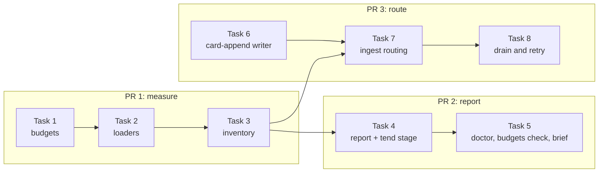

# Instruction budget care, slice 1: measure and route. Implementation Plan

> **For agentic workers:** implement this plan task by task. Steps use checkbox (`- [ ]`) syntax for tracking.

**Goal:** Brigade measures every always-loaded instruction file against one limit taken from its loaders and its own target, reports it to tend, doctor, `budgets check` and the work brief, and sends a handoff aimed at a capped file into a private, journaled overflow card named by handoff type instead of holding it for a person.

**Architecture:** Two read-only modules find the files and their limits: `instruction_loaders.py` reads the OpenClaw configuration and the Codex cap, and `instruction_inventory.py` resolves every path to its real file, classifies it and computes limit, act-at and trim-to. `memory_care_instructions.py` turns the inventory into the tend stage report and the alert lines that doctor, `budgets check` and the brief print. Ingest asks `instruction_overflow.py` whether a document append should go to an overflow card, and both ingest paths publish that card through a new `card-append` writer on the existing journal.

**Tech Stack:** Python 3.11+ standard library only (`json`, `tomllib`, `dataclasses`, `pathlib`), pytest, ruff, mypy. OpenClaw caps as read from OpenClaw 2026.10.5.

**Spec:** `docs/superpowers/specs/2026-11-13-instruction-budget-care-design.md` (sections "Scope and discovery", "Budgets", "Classes of file", "Handoffs aimed at a full or capped file", "Alerting and reporting", "Rollout" item 1). Parent: `docs/superpowers/specs/2026-11-12-brigade-stack-trim-design.md`, Stage A.

## Global Constraints

- Python floor `>=3.11` (`pyproject.toml`). No new runtime or test dependencies. JSON5 is not parsed: a configuration that fails strict JSON is unreadable with reason `config-not-strict-json`.
- Module ceiling 2,000 lines (`tests/test_module_size_ratchet.py`). `src/brigade/doctor.py` is 1,982 lines on the base and must end every PR at or below that. `src/brigade/harness_profile_cmd.py` is not touched in this slice.
- Unit is UTF-8 bytes everywhere. A character cap (OpenClaw counts UTF-16 code units after removing trailing whitespace) is used as the same number of bytes, with no whitespace stripping. That is never looser, so a file of 4,000 characters of `é` measures 8,000 bytes and is over a 4,000 cap on purpose.
- Pinned values: act-at 85% and trim-to 70% of the limit, computed as `limit * percent // 100`. `default_limit_bytes` 20,000. OpenClaw per-file default 20,000, total default 60,000, fixed `USER.md` cap 4,000. Codex `project_doc_max_bytes` default 32,768. Inspection ceiling 1 MiB (`context_preview.RESOURCE_MAX_BYTES`). `max_card_bytes` from memory care config, default 12,000.
- Overflow card path: `memory/cards/instructions/<file-key>--overflow-<type>.md`, rolling to `-2`, `-3`. `<type>` is one of `setup`, `workflow`, `bugfix`, `decision`, `security`, `preference`, `research`, `project-context`, else `project-context`. Every overflow card is `visibility: private`, `archive: never`, tagged `moved-instructions`.
- New outcome code `document-routed-to-card`, outcome kind `routed-card`. New alert reason `report-only`. Next command in every slice-1 alert: `brigade memory care tend --stage instructions --dry-run --json`.
- No test reads a real home directory or sends an agent turn. Fixtures are files under `tmp_path`, and every discovery call in tests passes `home=` and `environ=` explicitly. Symlink tests carry `pytest.mark.skipif(os.name == "nt", reason="POSIX symlinks")`.
- Checks run through Brigade, never raw. `VERIFY pytest <selector>` means exactly: `brigade work verify run --target . --command "env PYTHONPATH=src $BRIGADE_PY -m pytest <selector> -q -p no:cacheprovider" --capture brigade-work`, where `$BRIGADE_PY` is the absolute path of the main checkout's `.venv/bin/python` (worktrees have no `.venv`), written out literally because the wrapper runs no shell. `VERIFY lint <paths>` means the same wrapper with `-m ruff check <paths>`, then `-m ruff format --check <paths>`, then `-m mypy <paths>` in place of `-m pytest ...`. `VERIFY fragments` means the wrapper with `scripts/changelog_fragments.py check`.
- Each user-visible PR adds one changelog fragment `changelog.d/<slug>.md` with `- ` bullets only, never touching `CHANGELOG.md`, and no attribution line inside it.
- Conventional commits. Each commit ends with the co-author trailer AGENTS.md names for the tool that did the work.
- All PRs target `overhaul`. Open every PR ready for review, never as a draft.
- Public repository: no em dashes, no private host names, no real home paths in fixtures or docs.

## Review Focus

1. **An OpenClaw configuration written as JSON5** (a `//` comment or a trailing comma), which OpenClaw accepts. Expected: the per-agent caps fall back to the target budget with `limit_reason: config-not-strict-json`, and `USER.md` still gets 4,000 when an `openclaw` install-state file names the target. Pinned by `test_json5_config_falls_back_but_keeps_user_md_cap` (Task 2) and `test_finding_1_user_md_limit_survives_unreadable_config` (Task 3).
2. **An agent workspace written with `~`, or reached through a symlinked folder**, and an agent with no workspace when no default is set. Expected: matching compares real paths after home expansion, and an unmatched agent adds no loader. Pinned by `test_agent_workspace_matches_by_real_path` (Task 2).
3. **A known instruction file reached through a symlink, a dangling symlink, or a symlinked card folder.** Expected: the first routes to the overflow card and never writes through the link, the other two stay `document-destination-unsafe` and write nothing. Pinned by `test_symlinked_user_md_routes_to_card_without_writing_through` and `test_dangling_link_and_linked_card_folder_stay_unsafe` (Task 7).
4. **Multi-byte, non-UTF-8 and over 1 MiB instruction files.** Expected: sizes are bytes, a non-UTF-8 or oversized file is listed with a `skip_reason` and still alerts when over its limit, and nothing raises. Pinned by `test_odd_files_are_reported_not_dropped` (Task 3).
5. **Cap values of the wrong type** (`true`, `"3000"`, `0`, `-1`, `1e999`, a list for `agents.entries`). Expected: each is ignored with reason `config-key-invalid` and no exception escapes. Pinned by `test_wrong_type_caps_are_ignored_with_a_reason` (Task 2).

## Planner decisions

These fill gaps the design leaves open or correct places where the code contradicts it. Each is repeated in the owning task.

1. **Lint and draft change too.** `handoff lint` and `handoff draft` refuse an append over budget and a symlinked target today (`src/brigade/handoff_cmd/issue_ops.py:596-602`, through `bootstrap_budget_problem`). The design does not mention them. Left alone, the writer would refuse a handoff the reader now routes, so Task 7 removes that refusal for known instruction files.
2. **Alert reason `report-only`.** The design's reason table has no code for a file over its limit that the pass cannot move. In slice 1 no file can be moved, so every file over its limit is `could-not-trim` with reason `report-only`. Slice 2 narrows it to `report`-class files and repository-depth targets.
3. **The alert fires only over the limit.** Between act-at and the limit nothing is cut yet and appends already go to cards, so that band reports state `reported` with no alert.
4. **`discover` returns an `Inventory`**, not the design's `list[InstructionFile]`, because the total-over-cap alert needs per-loader totals beside the files.
5. **OpenClaw loads every per-name file.** Brigade has no list of the files OpenClaw loads, so each per-name file at the target root lists every matched OpenClaw agent as a loader. The design's own rule applies: counting one loader too many is never looser.
6. **Two more workspace matches.** An agent with no `workspace` of its own also matches `<state>/workspace` when no default is set, by the same never-looser rule. A workspace value that is still relative after `~` expansion is invalid (`config-key-invalid`) and matches nothing.
7. **The Codex cap applies only to `<target>/AGENTS.md`**, the one project-chain file at `cwd = target`. The repository row needs no `context_preview` walk, since the target is the chain's only directory.
8. **User-level files are reported in every target.** Ownership by install state is slice 3. Until then every target lists the user-level rows so finding 2 reaches every agent, and doctor rates a user-level file over its limit `warn`, not `fail`, so no repository's doctor fails for a file it cannot fix.
9. **Non-UTF-8 and over-1-MiB files stay in the report.** The design puts them out of scope for tending. The report keeps them with a `skip_reason`, so a 2 MiB `USER.md` stays visible.
10. **An invalid `[instructions]` table never loses a handoff.** Ingest then routes every known instruction file's appends to its overflow card (reason `config-invalid`), tend raises `ValueError` as tend config does, doctor fails one row, and the brief prints one `config-invalid` line.
11. **Undo of the append that created an overflow card keeps the frontmatter** when later appends exist. Plain exact-block removal would leave a card with no frontmatter. The plan item records `header_bytes`, and undo then removes only the body part of that block.
12. **Deferred to slice 2, with reason:** the memory operations graph node and `care status` line (the stage only runs on a schedule from slice 2), `routed_handoffs` in the stage payload, pointers to overflow cards (the report lists them as `pending_pointers` meanwhile, and search finds the cards), and the append provenance row. The design's Rollout places the provenance row in no slice, and its only reader is slice 2's planner, which falls back to bottom-up order without it.

## File structure

| File | Responsibility | Task |
| --- | --- | --- |
| `src/brigade/budgets.py` | Thresholds, `limit_for`, corrected comment. Later loses `route_would_exceed_budget` | 1, 7 |
| `src/brigade/harness_profiles.py` | OpenClaw cap constants and config key names, with the release they were read from | 1 |
| `src/brigade/instruction_loaders.py` (new) | OpenClaw config path, strict parse, agent matching, per-agent caps, install-state fallback, Codex cap | 2 |
| `tests/_instruction_fixtures.py` (new) | Fixture builders shared by every test file in this slice. Read-only after Task 2 | 2 |
| `src/brigade/instruction_inventory.py` (new) | `[instructions]` config, discovery, real-path grouping, classes, file keys, limits, totals | 3 |
| `src/brigade/memory_care_instructions.py` (new) | Per-file state, report rows, alert lines, the `instructions` tend stage, brief payload | 4, 5 |
| `src/brigade/memory_care_tend.py`, `src/brigade/cli/memory.py` | `instructions` stage wiring and `--stage` choice | 4 |
| `src/brigade/doctor_instruction_budget.py` (new) | Doctor rows from the inventory | 5 |
| `src/brigade/doctor.py` | Calls the new doctor module, drops `_check_bootstrap_budgets` | 5 |
| `src/brigade/budgets_cmd.py` | `budgets check` from the inventory | 5 |
| `src/brigade/work_cmd/session/briefing.py` | `instruction_budget` payload and lines | 5 |
| `src/brigade/memory_inbox_append.py`, `src/brigade/memory_care_journal.py` | `card-append` writer, its undo, lock and read-only checks | 6 |
| `src/brigade/instruction_overflow.py` (new) | Handoff type, overflow card name and rolling, routing decision, card bytes | 7 |
| `src/brigade/ingest.py` | Reordered no-card branch, `routed-card` outcome, journaled direct path | 7 |
| `src/brigade/handoff_ingest_rules.py`, `src/brigade/handoff_cmd/issue_ops.py` | Budget refusal removed, lint uses the routing decision | 7 |
| `src/brigade/memory_cmd.py` | Scan skips `orphaned-card` and `undersourced` for `moved-instructions` cards | 7 |
| `src/brigade/memory_inbox_drain.py`, `src/brigade/memory_inbox_retry.py` | Budget hold becomes a retry with route on, new kind and lock | 8 |
| `docs/memory-care.md` | "Instruction budgets" subsection (Task 5), review-inbox rows (Task 8) | 5, 8 |

## Build order, lanes and pull requests



- **Lane A:** Tasks 1, 2, 3 (PR 1), then 4, 5 (PR 2).
- **Lane B:** Task 6 can start at once, since it touches only `memory_inbox_append.py`, `memory_care_journal.py` and its own test file. Tasks 7 and 8 start once PR 1 is merged and finish PR 3.
- PR 2 and PR 3 run in parallel after PR 1. They share only `docs/memory-care.md`, in disjoint hunks: Task 5 appends a subsection after line 415, Task 8 edits lines 373 and 399.
- PR 1 changes no behavior and needs no changelog fragment. PR 2 adds `changelog.d/instruction-budget-report.md`. PR 3 adds `changelog.d/instruction-overflow-cards.md`.

---

## PR 1: `feat(memory): measure always-loaded instruction files`

### Task 1: Thresholds and one limit

**Files:**
- Modify: `src/brigade/budgets.py:18-21` (comment), append new names after `:42`
- Modify: `src/brigade/harness_profiles.py`, new constants after `:25`
- Test: `tests/test_budgets.py`

**Interfaces:**
- Produces: `budgets.ACT_AT_PERCENT = 85`, `budgets.TRIM_TO_PERCENT = 70`, `budgets.DEFAULT_LIMIT_BYTES = 20_000`, `budgets.threshold(limit: int, percent: int) -> int`, `budgets.limit_for(target_budget: int, target_source: str, caps: Sequence[tuple[str, int]]) -> tuple[int, str]`.
- Produces: `harness_profiles.OPENCLAW_CAPS_RELEASE = "2026.10.5"`, `OPENCLAW_BOOTSTRAP_MAX_CHARS = 20_000`, `OPENCLAW_BOOTSTRAP_TOTAL_MAX_CHARS = 60_000`, `OPENCLAW_USER_BOOTSTRAP_MAX_CHARS = 4_000`, `OPENCLAW_PER_FILE_KEY = "bootstrapMaxChars"`, `OPENCLAW_TOTAL_KEY = "bootstrapTotalMaxChars"`, `OPENCLAW_CONFIG_ENV = "OPENCLAW_CONFIG_PATH"`, `OPENCLAW_STATE_DIR_ENV = "OPENCLAW_STATE_DIR"`, `OPENCLAW_CONFIG_NAME = "openclaw.json"`.

- [ ] **Step 1: Write the failing tests** in `tests/test_budgets.py`

```python
def test_thresholds_match_the_design_examples():
    assert budgets.threshold(4000, budgets.ACT_AT_PERCENT) == 3400
    assert budgets.threshold(4000, budgets.TRIM_TO_PERCENT) == 2800
    assert budgets.threshold(12_000, budgets.TRIM_TO_PERCENT) == 8400
    assert budgets.threshold(20_000, budgets.ACT_AT_PERCENT) == 17_000


def test_limit_for_takes_the_smallest_cap_and_names_it():
    caps = [("loader:openclaw:defaults-max-chars", 40_000), ("loader:openclaw:user-md-fixed-cap", 4000)]
    assert budgets.limit_for(8000, "target:table", caps) == (4000, "loader:openclaw:user-md-fixed-cap")
    assert budgets.limit_for(12_000, "target:table", caps[:1]) == (12_000, "target:table")
    assert budgets.limit_for(20_000, "target:default", []) == (20_000, "target:default")
    # A tie goes to the loader, since a harness enforces it.
    assert budgets.limit_for(4000, "target:config", caps[1:]) == (4000, "loader:openclaw:user-md-fixed-cap")
```

- [ ] **Step 2: Run and expect failure.** `VERIFY pytest tests/test_budgets.py`. Expected: `AttributeError: module 'brigade.budgets' has no attribute 'threshold'`.

- [ ] **Step 3: Implement** `threshold` and `limit_for` in `src/brigade/budgets.py`. Ties between loader caps go to the lexicographically smallest label. Rewrite the comment at `:18-21` to say the per-name table is Brigade's target budget, which no harness enforces, and that loader caps come from `instruction_loaders`. Keep `DEFAULT_BOOTSTRAP_SOFT_LIMIT`, `DEFAULT_BOOTSTRAP_HARD_LIMIT` and `BOOTSTRAP_HARD_LIMIT_CEILING`, and mark them in their comment as read only by the external size checker the design retires. Add the `harness_profiles` constants with a comment naming OpenClaw 2026.10.5 bootstrap module constants as their source.

- [ ] **Step 4: Run and expect pass.** `VERIFY pytest tests/test_budgets.py`, then `VERIFY lint src/brigade/budgets.py src/brigade/harness_profiles.py`.

- [ ] **Step 5: Commit**

```bash
git add src/brigade/budgets.py src/brigade/harness_profiles.py tests/test_budgets.py
git commit -m "feat(budgets): act-at and trim-to thresholds and one limit per file"
```

### Task 2: Loader caps from the harness configuration

**Files:**
- Create: `src/brigade/instruction_loaders.py`
- Create: `tests/_instruction_fixtures.py`
- Test: `tests/test_instruction_loaders.py`

**Interfaces:**
- Consumes: Task 1's `harness_profiles.OPENCLAW_*` constants. `harness_profiles.resolve_user_profiles(harness="openclaw", home=..., workspace=...)` for the install-state path (`src/brigade/harness_profiles.py:75`, `:128-132`). `codex_user_config.read_user_base_cap() -> UserBaseCap` (`src/brigade/codex_user_config.py:52`).
- Produces:

```python
@dataclass(frozen=True)
class LoaderCap:
    loader: str          # "openclaw:main", "openclaw:unknown-agent", "codex:project"
    label: str           # "loader:openclaw:agent-max-chars" and so on, see below
    cap: int | None      # None when unreadable
    reason: str | None   # set when cap is None

@dataclass(frozen=True)
class OpenClawLoaders:
    per_file: tuple[LoaderCap, ...]   # one per matched agent, sorted by loader
    totals: tuple[LoaderCap, ...]     # one per matched agent, sorted by loader
    reason: str | None                # whole-config reason, or None

def openclaw_config_path(home: Path, environ: Mapping[str, str]) -> Path
def openclaw_state_dir(home: Path, environ: Mapping[str, str]) -> Path
def openclaw_loaders(target: Path, *, home: Path, environ: Mapping[str, str]) -> OpenClawLoaders
def user_md_caps(loaders: OpenClawLoaders) -> tuple[LoaderCap, ...]
def codex_project_cap() -> LoaderCap
```

- Labels: per-file `loader:openclaw:agent-max-chars` (agent entry), `loader:openclaw:defaults-max-chars` (`agents.defaults`), `loader:openclaw:default-max-chars` (the 20,000 constant). Totals the same with `total-max-chars`. Fixed cap `loader:openclaw:user-md-fixed-cap`. Codex `loader:codex:project-doc-max-bytes`.
- Whole-config reasons: `config-missing`, `config-unreadable`, `config-too-large` (over 1 MiB), `config-not-strict-json`, `config-key-invalid` (`agents`, `agents.entries`, `agents.list` or `agents.defaults` of the wrong type).
- `tests/_instruction_fixtures.py` produces `openclaw_home(tmp_path: Path, config: dict | str | None, *, install_workspace: Path | None = None) -> tuple[Path, dict[str, str]]` (a fake home and an `environ` with neither OpenClaw variable set, writing a `str` config verbatim), `sized(path: Path, size: int, *, head: str = "") -> Path` (creates parents, writes `head` then ASCII filler to exactly `size` bytes) and `refuse_subprocess(monkeypatch) -> None` (patches `subprocess.Popen.__init__` to raise `AssertionError`).

- [ ] **Step 1: Write the failing tests** in `tests/test_instruction_loaders.py`

```python
FIELD = {"agents": {"defaults": {"bootstrapMaxChars": 40000, "bootstrapTotalMaxChars": 120000},
                    "list": [{"id": "main"},
                             {"id": "lean", "workspace": "~/lean", "bootstrapMaxChars": 3000,
                              "bootstrapTotalMaxChars": 6000}]}}

def test_defaults_workspace_matches_main_only(tmp_path):
    ws = tmp_path / "ws"; ws.mkdir()
    home, env = openclaw_home(tmp_path, {**FIELD, "agents": {**FIELD["agents"],
                              "defaults": {**FIELD["agents"]["defaults"], "workspace": str(ws)}}})
    found = openclaw_loaders(ws, home=home, environ=env)
    assert [(c.loader, c.label, c.cap) for c in found.per_file] == [
        ("openclaw:main", "loader:openclaw:defaults-max-chars", 40000)]
    assert [(c.loader, c.cap) for c in found.totals] == [("openclaw:main", 120000)]
    assert [c.cap for c in user_md_caps(found)] == [4000]

def test_no_agents_means_implicit_main_with_harness_defaults(tmp_path):
    home, env = openclaw_home(tmp_path, {"agents": {}})
    ws = home / ".openclaw" / "workspace-main"; ws.mkdir(parents=True)
    found = openclaw_loaders(ws, home=home, environ=env)
    assert [(c.loader, c.label, c.cap) for c in found.per_file] == [
        ("openclaw:main", "loader:openclaw:default-max-chars", 20000)]
    assert [c.cap for c in found.totals] == [60000]

def test_agent_workspace_matches_by_real_path(tmp_path):            # Review Focus 2
    home, env = openclaw_home(tmp_path, FIELD)
    (home / "lean").mkdir(); (home / "alias").symlink_to(home / "lean")
    assert [c.loader for c in openclaw_loaders(home / "alias", home=home, environ=env).per_file] == ["openclaw:lean"]
    assert openclaw_loaders(home / "elsewhere", home=home, environ=env).per_file == ()
    no_default, env2 = openclaw_home(tmp_path / "b", {"agents": {"list": [{"id": "x"}]}})
    shared = no_default / ".openclaw" / "workspace"; shared.mkdir(parents=True)
    assert [c.loader for c in openclaw_loaders(shared, home=no_default, environ=env2).per_file] == ["openclaw:x"]

def test_config_path_and_state_dir_follow_the_environment(tmp_path):
    home = tmp_path / "h"
    assert openclaw_config_path(home, {}) == home / ".openclaw" / "openclaw.json"
    assert openclaw_config_path(home, {"OPENCLAW_STATE_DIR": str(tmp_path / "s")}) == tmp_path / "s" / "openclaw.json"
    assert openclaw_config_path(home, {"OPENCLAW_CONFIG_PATH": str(tmp_path / "c.json"),
                                       "OPENCLAW_STATE_DIR": str(tmp_path / "s")}) == tmp_path / "c.json"

def test_json5_config_falls_back_but_keeps_user_md_cap(tmp_path):    # Review Focus 1
    ws = tmp_path / "ws"; ws.mkdir()
    home, env = openclaw_home(tmp_path, '{ // comment\n "agents": {},\n}', install_workspace=ws)
    found = openclaw_loaders(ws, home=home, environ=env)
    assert found.reason == "config-not-strict-json"
    assert [(c.loader, c.cap, c.reason) for c in found.per_file] == [
        ("openclaw:unknown-agent", None, "config-not-strict-json")]
    assert [c.cap for c in user_md_caps(found)] == [4000]
    other, env3 = openclaw_home(tmp_path / "o", "{ ,}")          # no install state: OpenClaw not a known loader
    assert openclaw_loaders(ws, home=other, environ=env3).per_file == ()

@pytest.mark.parametrize("value", [True, "3000", 0, -1, 1e999, [3000]])
def test_wrong_type_caps_are_ignored_with_a_reason(tmp_path, value):  # Review Focus 5
    ws = tmp_path / "ws"; ws.mkdir()
    cfg = {"agents": {"list": [{"id": "main", "workspace": str(ws), "bootstrapMaxChars": value}]}}
    home, env = openclaw_home(tmp_path, cfg)
    (cap,) = openclaw_loaders(ws, home=home, environ=env).per_file
    assert (cap.cap, cap.reason) == (None, "config-key-invalid")
    bad, env4 = openclaw_home(tmp_path / "b", {"agents": {"entries": [1]}})
    assert openclaw_loaders(ws, home=bad, environ=env4).reason == "config-key-invalid"

def test_oversized_and_missing_configs_are_named(tmp_path):
    ws = tmp_path / "ws"; ws.mkdir()
    home, env = openclaw_home(tmp_path, None)
    assert openclaw_loaders(ws, home=home, environ=env).reason == "config-missing"
    big, env5 = openclaw_home(tmp_path / "big", '{"x": "' + "a" * (1024 * 1024) + '"}')
    assert openclaw_loaders(ws, home=big, environ=env5).reason == "config-too-large"
```


- [ ] **Step 2: Run and expect failure.** `VERIFY pytest tests/test_instruction_loaders.py`. Expected: `ModuleNotFoundError: No module named 'brigade.instruction_loaders'`.

- [ ] **Step 3: Implement** `src/brigade/instruction_loaders.py`. Agents come from `agents.entries` (object keyed by id) and `agents.list` (array of objects with a string `id`), unioned, else the implicit `main`. A value counts when it is an `int` or `float`, not a `bool`, finite and above zero, and is used as `math.floor(value)`. An invalid agent-level or defaults-level value gives that agent `cap=None, reason="config-key-invalid"` and does not fall through to the next level. An agent with no `workspace` matches the resolved `agents.defaults.workspace`, that path plus `/<id>`, or, with no default set, `<state>/workspace-<id>` or `<state>/workspace`. Every path expands a leading `~` against `home` and is compared with `Path.resolve()` of both sides. With any whole-config reason, read the `workspace` field of the openclaw profile's install-state JSON directly (no `load_profile_state`, whose same-workspace refusal is at `src/brigade/harness_profile_cmd.py:129-133`). When it resolves to the target, return one `openclaw:unknown-agent` entry with `cap=None` and the whole-config reason, else return no entries. `user_md_caps` returns one fixed 4,000 cap per OpenClaw loader present, or none. `codex_project_cap` wraps `read_user_base_cap()`, giving `cap=None` and its `reason` when the value is unknown. The module starts no subprocess and reads at most 1 MiB of configuration.

- [ ] **Step 4: Run and expect pass.** `VERIFY pytest tests/test_instruction_loaders.py`, then `VERIFY lint src/brigade/instruction_loaders.py tests/_instruction_fixtures.py tests/test_instruction_loaders.py`.

- [ ] **Step 5: Commit**

```bash
git add src/brigade/instruction_loaders.py tests/_instruction_fixtures.py tests/test_instruction_loaders.py
git commit -m "feat(memory): read OpenClaw and Codex instruction caps per agent"
```

### Task 3: The inventory

**Files:**
- Create: `src/brigade/instruction_inventory.py`
- Test: `tests/test_instruction_inventory.py`

**Interfaces:**
- Consumes: Task 1 `budgets.threshold`, `budgets.limit_for`, `budgets.BOOTSTRAP_BUDGETS`, `budgets.DEFAULT_LIMIT_BYTES`. Task 2 `LoaderCap`, `openclaw_loaders`, `user_md_caps`, `codex_project_cap`. `harness_profiles.resolve_user_profiles(harness="all", home=home, workspace=target)`, skipping profiles whose `instruction_mode` is `"managed-file"` (Cursor). `config.load_config(target)` for `selection.depth == "repo"` (`src/brigade/config.py:250-264`), treating a `ValueError` as not repository depth. `memory_cmd._config_or_default(target).index_paths` for the memory index. `context_preview.RESOURCE_MAX_BYTES`.
- Produces:

```python
REPORT_MARKER = "<!-- brigade:instructions report -->"
APPEND_NAMES = ("USER.md", "TOOLS.md", ".learnings/LEARNINGS.md", ".learnings/ERRORS.md",
                ".learnings/FEATURE_REQUESTS.md")

@dataclass(frozen=True)
class FileOverride:
    file_class: str | None = None     # "append" | "policy" | "report"
    limit_bytes: int | None = None

@dataclass(frozen=True)
class InstructionsConfig:
    enabled: bool = True
    act_at_percent: int = 85
    trim_to_percent: int = 70
    default_limit_bytes: int = 20_000
    exclude: tuple[str, ...] = ()
    files: tuple[tuple[str, FileOverride], ...] = ()

@dataclass(frozen=True)
class InstructionFile:
    key: str                          # "user-md", "codex-agents-md"
    display: str                      # display path of the real file
    real_path: Path
    paths: tuple[str, ...]            # display form of every path that resolves here, sorted
    level: str                        # "workspace" | "user" | "config"
    loaders: tuple[str, ...]          # sorted
    caps: tuple[LoaderCap, ...]
    file_class: str                   # "append" | "policy" | "report"
    target_budget: int
    target_source: str                # "target:config" | "target:table" | "target:default"
    limit: int
    limit_source: str
    limit_reason: str | None
    act_at: int
    trim_to: int
    size: int                         # bytes, 0 when missing
    exists: bool
    skip_reason: str | None           # "not-utf8" | "over-1-mib" | None

@dataclass(frozen=True)
class LoaderTotal:
    loader: str
    total: int                        # bytes across the files that list this loader
    cap: int | None
    label: str | None

@dataclass(frozen=True)
class Inventory:
    target: Path
    files: tuple[InstructionFile, ...]   # sorted by display
    totals: tuple[LoaderTotal, ...]      # sorted by loader
    repository_depth: bool

def load_instructions_config(target: Path) -> InstructionsConfig
def display_path(path: Path, *, target: Path, home: Path) -> str
def file_key(workspace_relative: str | None, harness: str | None, real_path: Path) -> str
def discover(target: Path, config: InstructionsConfig, *, home: Path | None = None,
             environ: Mapping[str, str] | None = None, include_missing: bool = False) -> Inventory
def find(inventory: Inventory, document: str) -> InstructionFile | None
```

- `load_instructions_config` reads the `[instructions]` table of `.brigade/memory-care.toml` the way `memory_care_tend.load_config` reads `[tend]` (`src/brigade/memory_care_tend.py:29-41`): unknown keys are ignored (slice 2 adds more), known keys are type-checked, percents are integers from 1 to 100 with `trim_to_percent < act_at_percent`, `limit_bytes` and `default_limit_bytes` are positive integers, `class` is one of the three classes. A problem raises `ValueError("invalid instructions.<key>")`.
- `display_path`: relative POSIX path when inside the target, `~/...` when under `home`, else absolute.
- `file_key`: slug of the workspace-relative path when there is one (lowercase, every run of characters outside `[a-z0-9]` becomes `-`, edges stripped: `USER.md` gives `user-md`), else `<harness>-<slug of the file name>` (`codex-agents-md`), else `external-<slug of the file name>-<first 8 hex of sha256 of the real path>`.
- `find` returns the row one of whose `paths` equals `document`.

- [ ] **Step 1: Write the failing tests** in `tests/test_instruction_inventory.py`. Fixtures come from `tests/_instruction_fixtures.py`.

```python
def _field_workspace(tmp_path, config=None, *, install=False):
    ws = tmp_path / "ws"; ws.mkdir()
    sized(ws / "USER.md", 8241, head="# User\n")
    sized(ws / "AGENTS.md", 12200, head="# Agents\n")
    cfg = {"agents": {"defaults": {"bootstrapMaxChars": 40000, "bootstrapTotalMaxChars": 120000,
                                   "workspace": str(ws)}, "list": [{"id": "main"}]}}
    home, env = openclaw_home(tmp_path, cfg if config is None else config,
                              install_workspace=ws if install else None)
    return ws, home, env

def test_finding_1_user_md_takes_the_loader_cap(tmp_path):
    ws, home, env = _field_workspace(tmp_path)
    inv = discover(ws, InstructionsConfig(), home=home, environ=env)
    user = find(inv, "USER.md")
    assert (user.key, user.file_class, user.size) == ("user-md", "append", 8241)
    assert (user.limit, user.limit_source, user.target_budget) == (4000, "loader:openclaw:user-md-fixed-cap", 8000)
    assert (user.act_at, user.trim_to, user.loaders) == (3400, 2800, ("openclaw:main",))
    agents = find(inv, "AGENTS.md")
    assert (agents.limit, agents.limit_source, agents.file_class) == (12000, "target:table", "policy")
    assert agents.loaders == ("codex:project", "openclaw:main")
    assert [(t.loader, t.total, t.cap) for t in inv.totals] == [("openclaw:main", 20441, 120000)]

def test_finding_1_user_md_limit_survives_unreadable_config(tmp_path):    # Review Focus 1
    ws, home, env = _field_workspace(tmp_path, config="{ // json5\n}", install=True)
    user = find(discover(ws, InstructionsConfig(), home=home, environ=env), "USER.md")
    assert (user.limit, user.limit_reason) == (4000, "config-not-strict-json")

def test_finding_2_one_row_per_real_file(tmp_path):
    home, env = openclaw_home(tmp_path, None)
    shared = sized(home / ".codex" / "AGENTS.md", 24500)
    (home / ".grok").mkdir(); (home / ".grok" / "AGENTS.md").symlink_to(shared)
    (home / "shared-opencode").mkdir(); (home / "shared-opencode" / "AGENTS.md").symlink_to(shared)
    (home / ".config").mkdir(); (home / ".config" / "opencode").symlink_to(home / "shared-opencode")
    ws = tmp_path / "ws"; ws.mkdir()
    rows = [f for f in discover(ws, InstructionsConfig(), home=home, environ=env).files if f.level == "user"]
    assert len(rows) == 1
    row = rows[0]
    assert (row.display, row.key, row.limit, row.limit_source) == (
        "~/.codex/AGENTS.md", "codex-agents-md", 20000, "target:default")
    assert row.paths == ("~/.codex/AGENTS.md", "~/.config/opencode/AGENTS.md", "~/.grok/AGENTS.md")
    assert row.loaders == ("codex:user", "grok:user", "opencode:user")

def test_classes_follow_the_first_matching_rule(tmp_path):
    ws, home, env = _field_workspace(tmp_path)
    sized(ws / "MEMORY.md", 100)
    sized(ws / "SOUL.md", 100, head="intro\n<!-- brigade:instructions report -->\n")
    (ws / ".brigade").mkdir()
    (ws / ".brigade" / "memory-care.toml").write_text(
        '[instructions.files."AGENTS.md"]\nclass = "report"\nlimit_bytes = 9000\n')
    inv = discover(ws, load_instructions_config(ws), home=home, environ=env)
    assert {f.display: f.file_class for f in inv.files if f.level == "workspace"} == {
        "AGENTS.md": "report", "MEMORY.md": "report", "SOUL.md": "report", "USER.md": "append"}
    assert (find(inv, "AGENTS.md").target_budget, find(inv, "AGENTS.md").target_source) == (9000, "target:config")

def test_include_missing_lists_absent_per_name_files_but_not_dangling_links(tmp_path):
    ws, home, env = _field_workspace(tmp_path)
    (ws / "TOOLS.md").symlink_to(ws / "nowhere.md")
    inv = discover(ws, InstructionsConfig(), home=home, environ=env, include_missing=True)
    assert find(inv, "SOUL.md").exists is False and find(inv, "SOUL.md").size == 0
    assert find(inv, "TOOLS.md") is None

def test_excluded_and_owned_files_are_left_out(tmp_path):
    ws, home, env = _field_workspace(tmp_path)
    sized(home / ".cursor" / "plugins/local/brigade-loop/rules/brigade-loop.mdc", 50000)
    inv = discover(ws, InstructionsConfig(exclude=("AGENTS.md",)), home=home, environ=env)
    assert find(inv, "AGENTS.md") is None
    assert not any("brigade-loop.mdc" in f.display for f in inv.files)

def test_odd_files_are_reported_not_dropped(tmp_path):                    # Review Focus 4
    ws, home, env = _field_workspace(tmp_path)
    (ws / "TOOLS.md").write_bytes(b"\xff\xfe" * 10)
    (ws / "SOUL.md").write_bytes(b"x" * (1024 * 1024 + 1))
    (ws / "IDENTITY.md").write_text("é" * 2500, encoding="utf-8")
    inv = discover(ws, InstructionsConfig(), home=home, environ=env)
    assert find(inv, "TOOLS.md").skip_reason == "not-utf8"
    assert (find(inv, "SOUL.md").skip_reason, find(inv, "SOUL.md").size) == ("over-1-mib", 1024 * 1024 + 1)
    assert find(inv, "IDENTITY.md").size == 5000        # bytes, over its 4000 target

def test_repository_depth_reports_every_file(tmp_path):
    ws, home, env = _field_workspace(tmp_path)
    install_selection(ws, Selection(depth="repo", harnesses=["claude"], owner="claude", includes=[]))
    inv = discover(ws, InstructionsConfig(), home=home, environ=env)
    assert inv.repository_depth and {f.file_class for f in inv.files if f.level == "workspace"} == {"report"}

def test_invalid_config_names_the_key(tmp_path):
    (tmp_path / ".brigade").mkdir()
    (tmp_path / ".brigade" / "memory-care.toml").write_text("[instructions]\nact_at_percent = 60\ntrim_to_percent = 70\n")
    with pytest.raises(ValueError, match="invalid instructions.trim_to_percent"):
        load_instructions_config(tmp_path)

def test_discovery_starts_no_subprocess(tmp_path, monkeypatch):
    ws, home, env = _field_workspace(tmp_path)
    refuse_subprocess(monkeypatch)
    assert discover(ws, InstructionsConfig(), home=home, environ=env).files
```

`install_selection` and `Selection` are imported the way `tests/test_doctor.py:653-657` imports them.

- [ ] **Step 2: Run and expect failure.** `VERIFY pytest tests/test_instruction_inventory.py`. Expected: `ModuleNotFoundError: No module named 'brigade.instruction_inventory'`.

- [ ] **Step 3: Implement** `src/brigade/instruction_inventory.py`. Candidate paths: each `BOOTSTRAP_BUDGETS` name at the target root (level `workspace`), each user profile's `instruction_path` (level `user`, harness from the profile), and each `[instructions.files]` key, with a relative key resolved against the target and `~` expanded (level `config`). Resolve each with `Path.resolve(strict=True)` and drop it when it is missing (unless `include_missing` and `os.path.lexists` is false, which gives a size-0 row at the unresolved path), when it is not a regular file, or when the real path or any of its paths matches an `exclude` entry after the same resolution. Group by real path. A group's level is `workspace` when any path is a per-name file at the root, else `config` when any is configured, else `user`. Loaders: every per-name path adds each `openclaw_loaders(target).per_file` loader, a root `AGENTS.md` adds `codex:project`, a user path adds `<harness>:user`. Caps: the matched OpenClaw per-file caps, plus `user_md_caps` when any path's name is `user.md` without case, plus `codex_project_cap()` for `codex:project`. Caps with `cap=None` take no part in the minimum and the first one's reason becomes `limit_reason`. Class, first match wins: config `class`, the marker in the first five lines, `report` for any path in the memory index or on a repository-depth target, `append` for `APPEND_NAMES` relative to the target, else `policy`. A file over 1 MiB is measured with `stat` only, and one that is not UTF-8 skips the marker check. Totals: one `LoaderTotal` per OpenClaw totals entry, summing the sizes of files that list that loader.

- [ ] **Step 4: Run and expect pass.** `VERIFY pytest tests/test_instruction_inventory.py tests/test_instruction_loaders.py`, then `VERIFY lint src/brigade/instruction_inventory.py tests/test_instruction_inventory.py`, then `VERIFY pytest tests/test_module_size_ratchet.py`.

- [ ] **Step 5: Commit**

```bash
git add src/brigade/instruction_inventory.py tests/test_instruction_inventory.py
git commit -m "feat(memory): inventory always-loaded instruction files by real path"
```

---

## PR 2: `feat(memory): report instruction budgets in tend, doctor and the brief`

### Task 4: States, report rows, alerts and the tend stage

**Files:**
- Create: `src/brigade/memory_care_instructions.py`
- Modify: `src/brigade/memory_care_tend.py:17` (`STAGES`), `:57-80` (stage dispatch)
- Modify: `src/brigade/cli/memory.py:91` (`--stage` choices)
- Test: `tests/test_memory_care_instructions.py`

**Interfaces:**
- Consumes: Task 3 `InstructionsConfig`, `InstructionFile`, `Inventory`, `load_instructions_config`, `discover`.
- Produces:

```python
NEXT_DRY_RUN = "brigade memory care tend --stage instructions --dry-run --json"
OVERFLOW_GLOB = "memory/cards/instructions/{key}--overflow-*.md"

def state_of(file: InstructionFile) -> tuple[str, str | None]
    # ("within", None) at or under act_at; ("reported", None) over act_at and at or under limit;
    # ("could-not-trim", "report-only") over limit
def file_row(file: InstructionFile, *, target: Path) -> dict[str, Any]
def alert_lines(inventory: Inventory) -> list[str]
def apply(target: Path, config: InstructionsConfig, *, today: date, dry_run: bool,
          home: Path | None = None, environ: Mapping[str, str] | None = None) -> dict[str, Any]
```

- `file_row` keys: `path` (display), `paths`, `level`, `loaders`, `class`, `bytes_before`, `bytes_after` (equal in slice 1), `limit`, `limit_source`, `target_budget`, `act_at`, `trim_to`, `state`, plus `reason` when the state has one, `limit_reason` and `skip_reason` when set, and `pending_pointers`: the workspace-relative paths of overflow cards matching `OVERFLOW_GLOB` for the file's key that do not occur in the file's text.
- Alert lines, one per `could-not-trim` file and one per total over its cap, in that order:
  - `instruction_budget: could-not-trim <display> <bytes>/<limit> reason=report-only next="brigade memory care tend --stage instructions --dry-run --json"`
  - `instruction_budget: total-over-cap <loader> <bytes>/<cap> next="brigade memory care tend --stage instructions --dry-run --json"`
- `apply` returns `{"enabled": False}` when disabled, else `{"files": [...], "totals": [{"loader", "bytes", "cap", "state"}], "alerts": [...]}` with total state `over-cap` or `within`. It writes nothing in slice 1, so `dry_run` changes nothing. `memory_care_tend.run` calls it for stage `instructions`, passing `load_instructions_config(target)`, and a `ValueError` from that load propagates like a bad `[tend]` table.

- [ ] **Step 1: Write the failing tests** in `tests/test_memory_care_instructions.py`

```python
def test_finding_1_report_row_matches_the_design_example(tmp_path):
    ws, home, env = _field_workspace(tmp_path)          # same builder as Task 3, copied locally
    row = next(r for r in apply(ws, InstructionsConfig(), today=date(2026, 11, 13), dry_run=True,
                                home=home, environ=env)["files"] if r["path"] == "USER.md")
    assert {k: row[k] for k in ("loaders", "class", "bytes_before", "limit", "limit_source", "target_budget",
                                 "act_at", "trim_to", "state", "reason")} == {
        "loaders": ["openclaw:main"], "class": "append", "bytes_before": 8241, "limit": 4000,
        "limit_source": "loader:openclaw:user-md-fixed-cap", "target_budget": 8000, "act_at": 3400,
        "trim_to": 2800, "state": "could-not-trim", "reason": "report-only"}

@pytest.mark.parametrize(("size", "state", "reason"), [(3400, "within", None), (3401, "reported", None),
                                                    (4000, "reported", None), (4001, "could-not-trim", "report-only")])
def test_states_at_the_boundaries(tmp_path, size, state, reason):
    ws, home, env = _field_workspace(tmp_path)
    sized(ws / "USER.md", size)
    user = find(discover(ws, InstructionsConfig(), home=home, environ=env), "USER.md")
    assert state_of(user) == (state, reason)

def test_finding_2_alert_names_the_real_file(tmp_path):
    payload = apply(ws, InstructionsConfig(), today=..., dry_run=True, home=home, environ=env)   # Task 3 finding 2 tree
    assert payload["alerts"] == ['instruction_budget: could-not-trim ~/.codex/AGENTS.md 24500/20000 '
                                 'reason=report-only next="brigade memory care tend --stage instructions --dry-run --json"']

def test_total_over_cap_raises_its_own_alert(tmp_path):
    # field files with agent "lean" sharing the workspace: totals cap 6000, total 20441
    assert 'instruction_budget: total-over-cap openclaw:lean 20441/6000 next="brigade memory care tend --stage instructions --dry-run --json"' in payload["alerts"]

def test_pending_pointers_list_overflow_cards_the_file_does_not_name(tmp_path):
    card = ws / "memory/cards/instructions/user-md--overflow-preference.md"
    card.parent.mkdir(parents=True); card.write_text("---\ntitle: t\n---\nx\n")
    assert row["pending_pointers"] == ["memory/cards/instructions/user-md--overflow-preference.md"]

def test_tend_runs_the_stage_and_saves_it(tmp_path, monkeypatch):
    refuse_subprocess(monkeypatch)
    payload = memory_care_tend.run(ws, stages=["instructions"], today=date(2026, 11, 13))
    assert "files" in payload["stages"]["instructions"]
    assert json.loads((ws / memory_care_tend.STATE_REL).read_text())["stages"]["instructions"]
    assert {f.read_bytes() for f in (ws / "USER.md", ws / "AGENTS.md")} == before   # nothing written

def test_disabled_stage_reports_nothing(tmp_path):
    # [instructions] enabled = false
    assert memory_care_tend.run(ws, stages=["instructions"], dry_run=True)["stages"]["instructions"] == {"enabled": False}
```

The tend test uses the fixture home through `set_home(monkeypatch, home)` from `tests/_home.py`, since `run` takes no `home` argument.

- [ ] **Step 2: Run and expect failure.** `VERIFY pytest tests/test_memory_care_instructions.py`. Expected: `ModuleNotFoundError: No module named 'brigade.memory_care_instructions'`.

- [ ] **Step 3: Implement** `src/brigade/memory_care_instructions.py` with the signatures above. Add `"instructions"` as the last entry of `STAGES` (`src/brigade/memory_care_tend.py:17`), add an explicit `elif stage == "instructions":` branch before the retire `else` at `:77`, and add `"instructions"` to the choices at `src/brigade/cli/memory.py:91`.

- [ ] **Step 4: Run and expect pass.** `VERIFY pytest tests/test_memory_care_instructions.py tests/test_memory_care_tend.py`, then `VERIFY lint src/brigade/memory_care_instructions.py src/brigade/memory_care_tend.py src/brigade/cli/memory.py tests/test_memory_care_instructions.py`.

- [ ] **Step 5: Commit**

```bash
git add src/brigade/memory_care_instructions.py src/brigade/memory_care_tend.py src/brigade/cli/memory.py tests/test_memory_care_instructions.py
git commit -m "feat(memory-care): instructions tend stage reports file states and alerts"
```

### Task 5: Doctor, `budgets check` and the work brief read the inventory

**Files:**
- Create: `src/brigade/doctor_instruction_budget.py`
- Modify: `src/brigade/doctor.py:18` (drop the `BOOTSTRAP_BUDGETS` import), `:1162` (call site), delete `:1245-1270` (`_check_bootstrap_budgets`)
- Modify: `src/brigade/budgets_cmd.py:44-82` (`check`)
- Modify: `src/brigade/work_cmd/session/briefing.py:418` (payload key), after `:1025` (print lines)
- Modify: `src/brigade/memory_care_instructions.py` (add `brief_payload`)
- Modify: `docs/memory-care.md`, new `### Instruction budgets` subsection after line 415
- Modify: `tests/test_doctor.py:658`, `:666`
- Create: `changelog.d/instruction-budget-report.md`
- Test: `tests/test_instruction_readers.py`

**Interfaces:**
- Consumes: Task 3 `discover`, `load_instructions_config`, `InstructionsConfig`. Task 4 `state_of`, `alert_lines`, `NEXT_DRY_RUN`. Doctor's `OK`, `WARN`, `FAIL`, `CheckResult` (imported from `doctor` the way `src/brigade/doctor_instruction_chain.py:12` does).
- Produces: `doctor_instruction_budget.check_instruction_budgets(target: Path) -> list[CheckResult]`, `memory_care_instructions.brief_payload(target: Path) -> dict[str, Any]` (`{"alerts": [str, ...]}`, never raises).
- Doctor rows are named `bootstrap-budget: <display>`, one per inventory file:
  - `within`: `OK`, detail `<bytes>/<limit> bytes, act-at <act_at> (limit from <limit_source>)`.
  - `reported`: `WARN`, detail `<bytes>/<limit> bytes, over act-at <act_at>; new handoff appends go to an overflow card`.
  - `could-not-trim`: `FAIL` for level `workspace` or `config` with the real file inside the target, `WARN` otherwise, detail `<bytes>/<limit> bytes, over limit; the loader cuts this file. next: brigade memory care tend --stage instructions --dry-run --json`.
  - an invalid `[instructions]` table: one `FAIL` row named `instructions: config`, with the `ValueError` text.
- `budgets check` rows from `discover(..., include_missing=True)`, keeping today's keys `name` (display), `path` (real path), `exists`, `size_bytes`, `budget_bytes` (the limit), `status` (`missing`, `ok`, `warn`, `fail`, with `fail` exactly where doctor fails), and adding `limit_source`, `act_at_bytes`, `trim_to_bytes`, `loaders`, `state`. Text line: `[<status>] <name>: <bytes>/<limit> bytes (act-at <act_at>, <limit_source>)`.
- Brief: payload key `"instruction_budget": memory_care_instructions.brief_payload(target)`. It prints each alert line as is. With an invalid table it prints one line, `instruction_budget: config-invalid detail="<ValueError text>"`. With `enabled = false` it prints nothing, and on `OSError` it prints nothing and stores `"error": "<exception class name>"`.

- [ ] **Step 1: Write the failing tests** in `tests/test_instruction_readers.py`

```python
def test_doctor_fails_an_over_limit_workspace_file_and_warns_a_user_file(tmp_path, monkeypatch):
    # finding 1 workspace plus finding 2 user tree, set_home(monkeypatch, home)
    rows = {name: (status, detail) for status, name, detail in check_instruction_budgets(ws)}
    assert rows["bootstrap-budget: USER.md"][0] == FAIL
    assert "8241/4000 bytes, over limit" in rows["bootstrap-budget: USER.md"][1]
    assert rows["bootstrap-budget: ~/.codex/AGENTS.md"][0] == WARN

def test_doctor_warns_between_act_at_and_limit(tmp_path, monkeypatch):
    # USER.md of 3500 bytes under the 4000 cap
    assert rows["bootstrap-budget: USER.md"] == (WARN, "3500/4000 bytes, over act-at 3400; new handoff appends go to an overflow card")

def test_doctor_stays_under_its_size(tmp_path):
    assert len(Path(doctor.__file__).read_text().splitlines()) <= 1982

def test_budgets_check_reports_limits_from_the_inventory(tmp_path, monkeypatch, capsys):
    assert budgets_cmd.check(target=ws, json_output=True) == 1
    user = next(r for r in json.loads(capsys.readouterr().out)["checks"] if r["name"] == "USER.md")
    assert (user["budget_bytes"], user["limit_source"], user["act_at_bytes"], user["status"]) == (
        4000, "loader:openclaw:user-md-fixed-cap", 3400, "fail")

def test_brief_prints_the_alert_lines(tmp_path, monkeypatch, capsys):
    # finding 2 tree; run the brief the way tests/test_work_brief*.py do
    assert ('instruction_budget: could-not-trim ~/.codex/AGENTS.md 24500/20000 reason=report-only '
            'next="brigade memory care tend --stage instructions --dry-run --json"') in out

def test_brief_survives_an_invalid_table(tmp_path, monkeypatch):
    # [instructions] act_at_percent = "high"
    assert brief_payload(ws) == {"alerts": ['instruction_budget: config-invalid detail="invalid instructions.act_at_percent"']}
```

Update `tests/test_doctor.py:658` to read the limit from `budgets.BOOTSTRAP_BUDGETS`, and `:666` to assert `"over limit"`. The existing `tests/test_budgets.py::test_budgets_check_fails_oversized_bootstrap_file` stays unchanged and must still pass.

- [ ] **Step 2: Run and expect failure.** `VERIFY pytest tests/test_instruction_readers.py`. Expected: `ModuleNotFoundError: No module named 'brigade.doctor_instruction_budget'`.

- [ ] **Step 3: Implement** the three readers and `brief_payload`. In `doctor.py`, replace the call at `:1162` with a lazy import of `check_instruction_budgets` and delete `_check_bootstrap_budgets`, so the file shrinks. In `briefing.py`, add the payload key after `"scheduled_care"` and print the lines right after the scheduled-care loop at `:1022-1025`. Write the `### Instruction budgets` subsection: how limits are chosen, act-at and trim-to, the three states, the alert lines and their next command, the `[instructions]` keys this slice reads (`enabled`, `act_at_percent`, `trim_to_percent`, `default_limit_bytes`, `exclude`, `files.<path>.class`, `files.<path>.limit_bytes`), and that moving sections comes in a later release. Write the changelog fragment as `- ` bullets covering the report, doctor, `budgets check` and the brief line.

- [ ] **Step 4: Run and expect pass.** `VERIFY pytest tests/test_instruction_readers.py tests/test_doctor.py tests/test_budgets.py tests/test_module_size_ratchet.py`, then `VERIFY lint src/brigade/doctor_instruction_budget.py src/brigade/doctor.py src/brigade/budgets_cmd.py src/brigade/work_cmd/session/briefing.py src/brigade/memory_care_instructions.py tests/test_instruction_readers.py`, then `VERIFY fragments`.

- [ ] **Step 5: Commit**

```bash
git add src/brigade/doctor_instruction_budget.py src/brigade/doctor.py src/brigade/budgets_cmd.py src/brigade/work_cmd/session/briefing.py src/brigade/memory_care_instructions.py docs/memory-care.md tests/test_doctor.py tests/test_instruction_readers.py changelog.d/instruction-budget-report.md
git commit -m "feat(doctor): doctor, budgets check and the brief read the instruction inventory"
```

---

## PR 3: `feat(ingest): route capped instruction appends to overflow cards`

### Task 6: The `card-append` writer

**Files:**
- Modify: `src/brigade/memory_inbox_append.py:45` (read-only check), `:55-56` (publish branch), `:63-76` (`undo_changes`), new `commit_card_append`
- Modify: `src/brigade/memory_care_journal.py:252` (`revert` lock), `:508-510` (`finish_prepared` read-only destinations)
- Test: `tests/test_memory_inbox_card_append.py`

**Interfaces:**
- Consumes: `journal.commit_phased` (`src/brigade/memory_care_journal.py:333-399`), `journal.serialized`, `plan_append` (`src/brigade/memory_inbox_append.py:13-21`), `ingest._append_document_nofollow` (`src/brigade/ingest.py:814-822`).
- Produces: `memory_inbox_append.DOCUMENT_WRITERS = frozenset({"document", "card-append"})` and

```python
@journal.serialized
def commit_card_append(owner: Path, card_rel: str, block: bytes, *, header_bytes: int, reason: str) -> journal.Decision
```

  A decision of kind `inbox` with no changes and no prepared paths, whose metadata holds `appends=[plan_append(card_rel, block, "card-append", created=<card absent>, header_bytes=header_bytes)]` and `append_guards={card_rel: kernel.content_digest(<card bytes or None>)}`. It raises `journal.JournalConflict` when the decision does not end committed.

- [ ] **Step 1: Write the failing tests** in `tests/test_memory_inbox_card_append.py`

```python
CARD = "memory/cards/instructions/user-md--overflow-preference.md"
HEAD = b"---\ntitle: USER.md overflow: preference\ncategory: instructions\ntags: [moved-instructions]\n---\n"

def test_first_append_creates_the_card_and_undo_removes_it(tmp_path):
    d = commit_card_append(tmp_path, CARD, HEAD + b"\nPrefer short replies.\n", header_bytes=len(HEAD), reason="ingest:document-routed-to-card")
    assert (tmp_path / CARD).read_bytes() == HEAD + b"\nPrefer short replies.\n"
    assert journal._payload(tmp_path, d.decision_id)["appends"][0]["writer"] == "card-append"
    memory_care_tend.undo(tmp_path, d.decision_id)
    assert not (tmp_path / CARD).exists()

def test_undo_of_the_creating_append_keeps_frontmatter_for_later_appends(tmp_path):
    first = commit_card_append(tmp_path, CARD, HEAD + b"\none\n", header_bytes=len(HEAD), reason="r")
    commit_card_append(tmp_path, CARD, b"\n\ntwo\n", header_bytes=0, reason="r")
    memory_care_tend.undo(tmp_path, first.decision_id)
    assert (tmp_path / CARD).read_bytes() == HEAD + b"\n\ntwo\n"

def test_undo_refuses_an_edited_block(tmp_path):
    d = commit_card_append(tmp_path, CARD, HEAD + b"\none\n", header_bytes=len(HEAD), reason="r")
    (tmp_path / CARD).write_bytes(HEAD + b"\nONE\n")
    with pytest.raises(journal.JournalConflict):
        memory_care_tend.undo(tmp_path, d.decision_id)

def test_read_only_cards_abandon_the_append(tmp_path):
    # .brigade/memory-care.toml: read_only_paths = ["memory/cards/instructions/**"]
    with pytest.raises(journal.JournalConflict):
        commit_card_append(tmp_path, CARD, HEAD + b"\nx\n", header_bytes=len(HEAD), reason="r")
    assert not (tmp_path / CARD).exists()

def test_interrupted_publish_is_recovered_once(tmp_path, monkeypatch):
    # make ingest._append_document_nofollow raise OSError on its first call only
    with pytest.raises(OSError):
        commit_card_append(tmp_path, CARD, HEAD + b"\nx\n", header_bytes=len(HEAD), reason="r")
    journal.resolve_prepared(tmp_path)
    journal.resolve_prepared(tmp_path)
    assert (tmp_path / CARD).read_bytes() == HEAD + b"\nx\n"
```

- [ ] **Step 2: Run and expect failure.** `VERIFY pytest tests/test_memory_inbox_card_append.py`. Expected: `ImportError: cannot import name 'commit_card_append'`.

- [ ] **Step 3: Implement.** Use `DOCUMENT_WRITERS` at `memory_inbox_append.py:45` and `:67`, and at `memory_care_journal.py:252` and `:508-510`, so a `card-append` item is read-only-checked, published through `_append_document_nofollow`, undone by exact block and reverted under the document lock. In `undo_changes`, a `card-append` item with `created` and a nonzero `header_bytes` whose live card starts with the whole block but holds more bytes after it becomes `data[:header_bytes] + live[len(data):]`. If the card holds exactly the block, the file is removed as for a created document. A block that occurs other than once, or a creating block not at the start, raises `JournalConflict`.

- [ ] **Step 4: Run and expect pass.** `VERIFY pytest tests/test_memory_inbox_card_append.py tests/test_memory_inbox_drain.py tests/test_memory_care_journal.py`, then `VERIFY lint src/brigade/memory_inbox_append.py src/brigade/memory_care_journal.py tests/test_memory_inbox_card_append.py`.

- [ ] **Step 5: Commit**

```bash
git add src/brigade/memory_inbox_append.py src/brigade/memory_care_journal.py tests/test_memory_inbox_card_append.py
git commit -m "feat(memory-care): journaled card-append writer with exact-block undo"
```

### Task 7: Ingest routes capped appends to the overflow card

**Files:**
- Create: `src/brigade/instruction_overflow.py`
- Modify: `src/brigade/ingest.py:394-402` (`Outcome`), `:530-580` (no-card branch of `decide`), new branch before `:941` in `_execute`
- Modify: `src/brigade/handoff_ingest_rules.py:25`, delete `:280-291` (`bootstrap_budget_problem`)
- Modify: `src/brigade/handoff_cmd/issue_ops.py:24`, `:596-602`
- Modify: `src/brigade/budgets.py:73-87` (delete `route_would_exceed_budget`)
- Modify: `src/brigade/memory_cmd.py:775`, `:819` (skip `moved-instructions` cards)
- Modify: `tests/test_budgets.py:24-33`, `tests/test_ingest.py:764-796`, `tests/test_handoff_ingest_contract.py:198-209`, `:881-882`
- Test: `tests/test_ingest_overflow_card.py`

**Interfaces:**
- Consumes: Task 3 `discover(..., include_missing=True)`, `find`, `load_instructions_config`, `InstructionsConfig`, `InstructionFile`. Task 6 `commit_card_append`. `handoff_ingest_rules.document_destination_problem` (`:262-277`), `safe_document_target` (`:53-54`). `card_fingerprint.ensure_card_id_frontmatter` (`src/brigade/card_fingerprint.py:392`), `memory_care_plan.derived_fresh_until`, `memory_cmd._config_or_default(target).max_card_bytes` and `.stale_after_days`.
- Produces:

```python
HANDOFF_TYPES = ("setup", "workflow", "bugfix", "decision", "security", "preference", "research", "project-context")
CARDS_REL = "memory/cards/instructions"

def handoff_type(sections: Mapping[str, str]) -> str        # first line of the "type" section, trimmed and lowercased, else "project-context"
def card_name(file_key: str, handoff_type: str, n: int) -> str   # n=1: "<key>--overflow-<type>.md", n>=2: "<key>--overflow-<type>-<n>.md"

@dataclass(frozen=True)
class OverflowRoute:
    file: InstructionFile
    card_rel: str              # "memory/cards/instructions/user-md--overflow-preference.md"
    reason: str                # "over-act-at" | "symlinked" | "config-invalid"
    card_problem: str | None   # document_destination_problem(card_rel, target)

def route(target: Path, document: str, content: str, handoff_type: str, *,
          home: Path | None = None, environ: Mapping[str, str] | None = None) -> OverflowRoute | None
def card_block(target: Path, overflow: OverflowRoute, content: str, handoff_type: str, *, today: date) -> tuple[bytes, int]
    # (bytes to append, header_bytes). Existing card: (b"\n\n" + content.strip() + b"\n", 0).
    # New card: frontmatter + b"\n" + content.strip() + b"\n", header_bytes = len(frontmatter).
```

  `Outcome` gains `overflow: OverflowRoute | None = None`, and its kind comment gains `routed-card`. Decide returns `Outcome("routed-card", code="document-routed-to-card", dest=target / card_rel, overflow=route)`.
- New card frontmatter, in this order, then passed through `ensure_card_id_frontmatter`: `title: <file display> overflow: <type>`, `category: instructions`, `tags: [moved-instructions, <file key>, overflow]`, `visibility: private`, `source_file: <file display>`, `archive: never`, `last_reviewed: <today>`, `fresh_until: <derived_fresh_until(today, stale_after_days)>`.
- `route` returns `None` when the document is not in the inventory. Otherwise its reason is `config-invalid` when `load_instructions_config` raised (then the defaults are used), else `symlinked` when any component of `<target>/<document>` is a symlink, else `over-act-at` when `file.size + len(b"\n\n" + content.strip().encode() + b"\n") > file.act_at`, else it returns `None`. The card is the first `card_name(key, type, n)` for `n = 1, 2, ...` that does not exist, or whose size plus that block stays at or under `max_card_bytes`.

- [ ] **Step 1: Write the failing tests** in `tests/test_ingest_overflow_card.py`

```python
def test_finding_9_preference_past_act_at_lands_in_the_preference_card(tmp_path, monkeypatch):
    ws, home, env = _field_workspace(tmp_path); set_home(monkeypatch, home)
    sized(ws / "USER.md", 3390)         # 3390 + 34 appended bytes passes act-at 3400
    _write_handoff(ws, type_="preference", document="USER.md", content="Prefer one-line status updates.")
    assert ingest.run(target=ws, promote_cards=True, route_documents=True) == 0
    assert (ws / "USER.md").stat().st_size == 3390
    card = (ws / "memory/cards/instructions/user-md--overflow-preference.md").read_text()
    assert "visibility: private" in card and "archive: never" in card and "moved-instructions" in card
    assert card.endswith("\nPrefer one-line status updates.\n")
    (decision,) = [d for d in journal.entries(ws) if d.reason == "ingest:document-routed-to-card"]
    assert journal._payload(ws, decision.decision_id)["appends"][0]["writer"] == "card-append"

def test_append_within_act_at_still_goes_to_the_file(tmp_path, monkeypatch):
    # USER.md 100 bytes: appended to USER.md, no card, code document-appended

@pytest.mark.parametrize(("raw", "expected"), [("Preference", "preference"), (" research \n", "research"),
    ("preferences", "project-context"), ("", "project-context"), (None, "project-context"), ("bugfix", "bugfix")])
def test_handoff_type_maps_to_the_template_values(raw, expected):
    assert handoff_type({} if raw is None else {"type": raw}) == expected

def test_injection_signal_still_goes_to_a_person(tmp_path, monkeypatch):
    # USER.md over act-at, content carrying an injection marker the existing tests use
    assert outcome.code == "document-injection-signal" and not (ws / CARDS_REL).exists()

def test_overflow_card_rolls_at_max_card_bytes(tmp_path, monkeypatch):
    # memory-care.toml: max_card_bytes = 600; existing user-md--overflow-preference.md of 590 bytes
    assert outcome.dest.name == "user-md--overflow-preference-2.md"

def test_symlinked_user_md_routes_to_card_without_writing_through(tmp_path, monkeypatch):   # Review Focus 3
    shared = sized(tmp_path / "shared" / "USER.md", 100); (ws / "USER.md").symlink_to(shared)
    # handoff to USER.md: routed-card with reason "symlinked"; shared file still 100 bytes

def test_dangling_link_and_linked_card_folder_stay_unsafe(tmp_path, monkeypatch):           # Review Focus 3
    # (a) USER.md -> missing file; (b) memory/cards/instructions -> another folder, USER.md over act-at
    assert {a.code, b.code} == {"document-destination-unsafe"}
    assert not any((tmp_path / "elsewhere").iterdir())

def test_invalid_instructions_table_routes_every_known_file(tmp_path, monkeypatch):
    # [instructions] act_at_percent = "x"; USER.md of 100 bytes
    assert route(ws, "USER.md", "note", "setup", home=home, environ=env).reason == "config-invalid"

def test_lint_and_draft_accept_an_append_past_act_at(tmp_path, monkeypatch):
    sized(ws / "USER.md", 3900)
    assert not linting.lint_text(_doc_handoff_text("USER.md", "y" * 200), workspace=ws).errors

def test_overflow_cards_skip_orphan_and_undersourced_checks(tmp_path, monkeypatch):
    # after the finding 9 ingest
    issues = memory_cmd._scan_payload(ws, memory_cmd._config_or_default(ws))["issues"]
    assert not [i for i in issues if i["card_path"].startswith("memory/cards/instructions/")
                and i["issue_type"] in ("orphaned-card", "undersourced")]

def test_routing_starts_no_subprocess(tmp_path, monkeypatch):
    refuse_subprocess(monkeypatch)
    assert ingest.decide(sections, ws, promote_cards=True, route_documents=True).kind == "routed-card"
```

Rewrite the four existing tests in place: `tests/test_budgets.py:24-33` is deleted with the function it tests. `tests/test_ingest.py:764-796` becomes `test_no_card_route_to_bootstrap_file_over_act_at_goes_to_overflow_card`: `TOOLS.md` is untouched and `memory/cards/instructions/tools-md--overflow-project-context.md` ends with the content. `tests/test_handoff_ingest_contract.py:198-209` become one test that lint and draft both accept the append. `:881-882` asserts that `over.errors` is empty.

- [ ] **Step 2: Run and expect failure.** `VERIFY pytest tests/test_ingest_overflow_card.py`. Expected: `ModuleNotFoundError: No module named 'brigade.instruction_overflow'`.

- [ ] **Step 3: Implement.** In `decide`, compute `overflow = instruction_overflow.route(target, document, content, instruction_overflow.handoff_type(sections))` right after the unsafe-name check at `ingest.py:535-536`. Keep the order missing target, unsafe name, destination problem, empty content, headings, dedupe, injection scan. The destination problem at `:537-539` returns `document-destination-unsafe` unless `overflow` has reason `symlinked`. The dedupe at `:551-566` also reads the overflow card's text when `overflow` is set. Delete the budget check at `:567-572`. After the injection scan at `:573-579`, return `document-destination-unsafe` (reason `overflow.card_problem`) when `overflow.card_problem` is set, else the `routed-card` outcome. In `_execute`, add a `routed-card` branch before `:941`: build `card_block(..., today=date.today())`, and unless `dry_run`, call `commit_card_append(target, card_rel, block, header_bytes=..., reason="ingest:document-routed-to-card")`, then `card_ids.register(card_rel, <card text>)` when `card_ids` is set, then `_archive`. On `OSError` or `JournalConflict`, re-enter `_execute` with `Outcome("inboxed", code="document-destination-unwritable", ...)` as `:949-965` does. Return `Action("routed", _summary("card-append", name, outcome.code))`. In `issue_ops.py:596-602`, report the destination problem only when `route(...)` returns `None`, and drop the budget error. Add `_moved_instructions(meta) -> bool` to `memory_cmd.py` (true when `moved-instructions` is among the card's `tags`) and guard the `undersourced` branch at `:775` and the `orphaned-card` branch at `:819` with it.

- [ ] **Step 4: Run and expect pass.** `VERIFY pytest tests/test_ingest_overflow_card.py tests/test_ingest.py tests/test_handoff_ingest_contract.py tests/test_budgets.py tests/test_memory_inbox_drain.py tests/test_memory_cmd.py tests/test_module_size_ratchet.py`, then `VERIFY lint src/brigade/instruction_overflow.py src/brigade/ingest.py src/brigade/handoff_ingest_rules.py src/brigade/handoff_cmd/issue_ops.py src/brigade/budgets.py src/brigade/memory_cmd.py tests/test_ingest_overflow_card.py`. `tests/test_memory_inbox_drain.py::test_all_ingest_codes_are_explicitly_classified` fails until Task 8 classifies the new code. Run Tasks 7 and 8 back to back in the same PR, and expect that single failure here.

- [ ] **Step 5: Commit**

```bash
git add src/brigade/instruction_overflow.py src/brigade/ingest.py src/brigade/handoff_ingest_rules.py src/brigade/handoff_cmd/issue_ops.py src/brigade/budgets.py src/brigade/memory_cmd.py tests/test_ingest_overflow_card.py tests/test_ingest.py tests/test_handoff_ingest_contract.py tests/test_budgets.py
git commit -m "feat(ingest): route capped instruction appends to private overflow cards"
```

### Task 8: Old budget holds drain, and retry journals the card append

**Files:**
- Modify: `src/brigade/memory_inbox_drain.py:38-46` (`RETRY_CODES`), `:49-67` (`HOLD_CODES`), `:71-106` (`NEEDS_EVIDENCE_PROOF`), `:116-119` (`retry_flags`)
- Modify: `src/brigade/memory_inbox_retry.py:66`, `:68-74`, `:125-133`, `:150-151`
- Modify: `docs/memory-care.md:373` (retry row) and after `:399` (one overflow paragraph)
- Create: `changelog.d/instruction-overflow-cards.md`
- Test: `tests/test_memory_inbox_overflow_retry.py`

**Interfaces:**
- Consumes: Task 7 `OverflowRoute`, `card_block`, `Outcome.overflow`, kind `routed-card`, code `document-routed-to-card`. Task 6 `plan_append` with writer `card-append` and `header_bytes`.
- Produces: `bootstrap-budget-exceeded` is in `RETRY_CODES` and not in `HOLD_CODES`. `document-routed-to-card` is in `HOLD_CODES`, beside `document-appended`, where the drain keeps success codes that appear in a draft header. `NEEDS_EVIDENCE_PROOF["document-routed-to-card"] is False`. `retry_flags(code, text)` returns `(False, True)` for `bootstrap-budget-exceeded` with no header, and the header still wins.

- [ ] **Step 1: Write the failing tests** in `tests/test_memory_inbox_overflow_retry.py`

```python
def _held(ws, *, flags=None):     # writes memory/handoff-inbox/<stamp>-pref.md with reason bootstrap-budget-exceeded
    ...

def test_retry_flags_route_old_budget_holds():
    text = "<!-- routed from a.md\n     reason: bootstrap-budget-exceeded\n     routed-at: 20261101T000000Z -->\n"
    assert drain.retry_flags("bootstrap-budget-exceeded", text) == (False, True)
    assert drain.classify("bootstrap-budget-exceeded", text) == "retry"

@pytest.mark.parametrize("flags", [None, "promote=true route=true"])
def test_old_budget_hold_lands_in_the_overflow_card_on_the_next_drain(tmp_path, monkeypatch, flags):
    ws, home, env = _field_workspace(tmp_path); set_home(monkeypatch, home)
    draft = _held(ws, flags=flags)                 # Type preference, USER.md, USER.md is 8241 bytes
    drain.drain(ws, today=date(2026, 11, 13), deadline_days=14, dry_run=False)
    assert (ws / "memory/cards/instructions/user-md--overflow-preference.md").is_file()
    assert not draft.exists() and (ws / "USER.md").stat().st_size == 8241

def test_old_budget_hold_with_an_injection_marker_stays_for_a_person(tmp_path, monkeypatch):
    assert drain.classify("bootstrap-budget-exceeded", _held_text_with_marker()) == "human"

def test_retry_waits_when_the_document_lock_is_busy(tmp_path, monkeypatch):
    # another thread holds ingest._document_lock(ws) for 3 seconds
    assert memory_inbox_retry.reprocess(ws, draft).summary == "document-publication-busy"
    assert not (ws / "memory/cards/instructions").exists()

def test_retry_decision_undoes_by_exact_block(tmp_path, monkeypatch):
    action = memory_inbox_retry.reprocess(ws, draft)
    memory_care_tend.undo(ws, action.summary)       # retry puts the decision id in summary, memory_inbox_retry.py:152
    assert not (ws / "memory/cards/instructions/user-md--overflow-preference.md").exists()
```

- [ ] **Step 2: Run and expect failure.** `VERIFY pytest tests/test_memory_inbox_overflow_retry.py`. Expected: `test_retry_flags_route_old_budget_holds` fails with `None != (False, True)`.

- [ ] **Step 3: Implement.** Edit the drain tables and `retry_flags` as listed. In `reprocess`: accept `routed-card` at `:66`, take the document lock for `routed` and `routed-card` at `:68`, and in the `else` branch at `:125-128` build the block with `card_block(owner, outcome.overflow, content, handoff_type(sections), today=...)` and append `plan_append(dest_rel, block, "card-append", created=before is None, header_bytes=header)`. Use the append-guard path at `:131-133` for both kinds, and register the card id at `:150-151` for `routed-card` too. In `docs/memory-care.md`, add `bootstrap-budget-exceeded` to the retry row at line 373, and after line 399 add one paragraph: a handoff aimed at a known instruction file past act-at, or reached through a symlink, goes to `memory/cards/instructions/<file-key>--overflow-<type>.md`, private and pinned, as an undoable `card-append` decision, and holds from earlier releases drain the same way. Write the changelog fragment.

- [ ] **Step 4: Run and expect pass.** `VERIFY pytest tests/test_memory_inbox_overflow_retry.py tests/test_memory_inbox_drain.py tests/test_ingest_overflow_card.py tests/test_memory_inbox_card_append.py`, then `VERIFY lint src/brigade/memory_inbox_drain.py src/brigade/memory_inbox_retry.py tests/test_memory_inbox_overflow_retry.py`, then `VERIFY fragments`.

- [ ] **Step 5: Commit**

```bash
git add src/brigade/memory_inbox_drain.py src/brigade/memory_inbox_retry.py docs/memory-care.md tests/test_memory_inbox_overflow_retry.py changelog.d/instruction-overflow-cards.md
git commit -m "feat(memory-care): drain budget holds into overflow cards with route on"
```

---

## Self-review

1. **Coverage of design slice 1.** Inventory with symlink resolution: Task 3. Loader caps per install and per agent: Task 2. One limit, act-at, trim-to: Tasks 1, 3. Report output: Task 4. Overflow routing after the injection scan, type-named, private, journaled on both paths: Tasks 6, 7, 8. Drain and retry change: Task 8. Brief alert, doctor and `budgets check`: Task 5. Gaps, all deliberate and listed in decision 12: the memory operations node, `care status`, `routed_handoffs`, overflow pointers, the provenance row.
2. **Steps.** Each code step names a signature, a file and the pinned values. No step leaves "edge cases" open. The longest test listings stand in for behavior the design pins with exact numbers.
3. **Names across tasks.** `InstructionsConfig`, `InstructionFile`, `Inventory`, `discover`, `find`, `load_instructions_config` (Task 3) are used unchanged in Tasks 4, 5 and 7. `OverflowRoute`, `card_block`, `handoff_type` (Task 7) are used unchanged in Task 8. `commit_card_append` and `DOCUMENT_WRITERS` (Task 6) are used unchanged in Task 7. `NEXT_DRY_RUN` and `state_of` (Task 4) are used in Task 5.
4. **Review Focus.** Lines 1, 2 and 5 are pinned in Task 2, line 1 also in Task 3, line 4 in Task 3, line 3 in Task 7.
5. **Proportion.** The plan carries signatures, values and test assertions, with function bodies left to the implementer.
