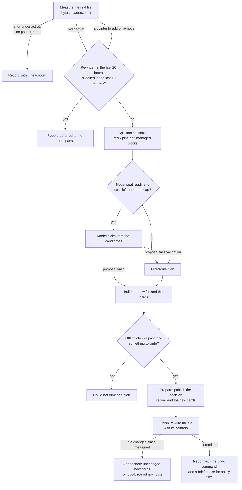
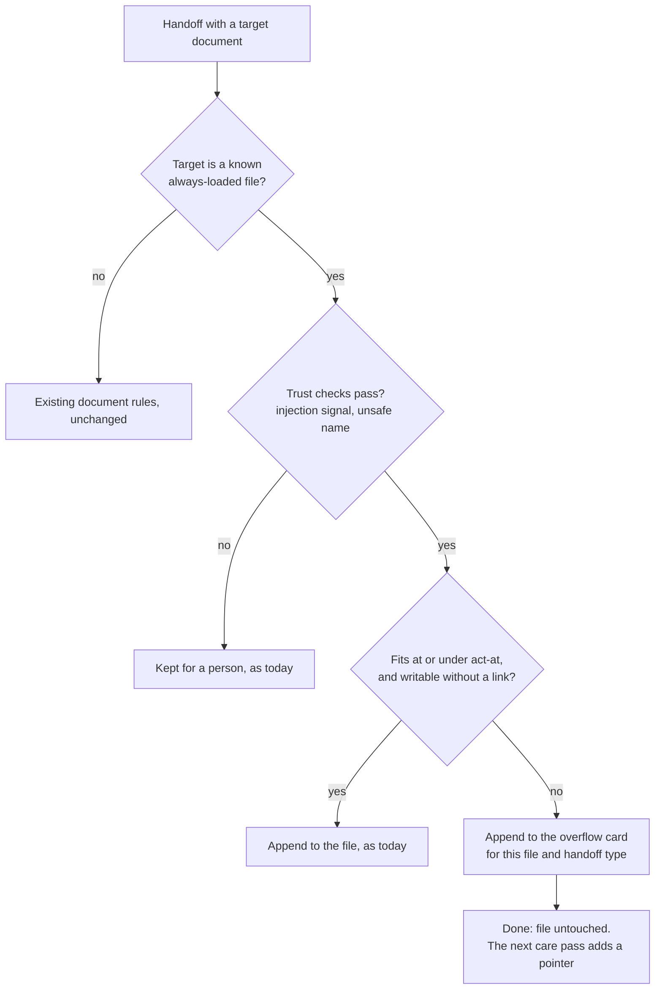
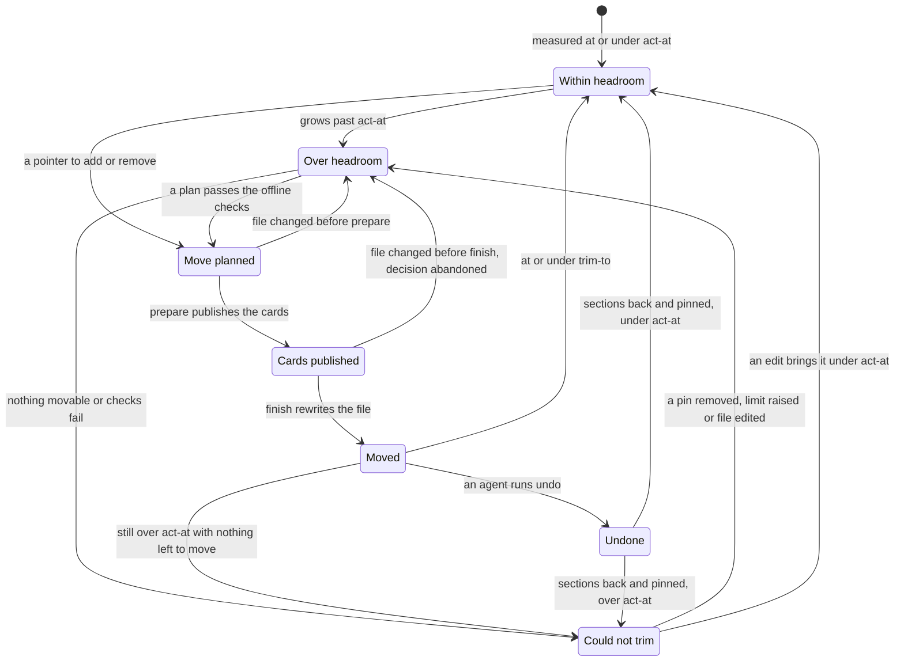

# Instruction budget care: design

Date: 2026-11-13. Status: draft, revised twice after review. Part of Stage A
("memory tends itself") in
`docs/superpowers/specs/2026-11-12-brigade-stack-trim-design.md`.

Lines marked **(decided)** restate a decision the owner already made. Lines
marked **(proposed)** are the author's calls. Each proposed decision gives its
reason and the alternative it rejects.

## Summary

Every agent session starts by loading a few instruction files in full: a
workspace `AGENTS.md` and `USER.md`, a shared rules file, a user-level
`CLAUDE.md`, and so on. Agents and handoffs keep adding to them. When one grows
past its size limit, the harness cuts text out or Brigade refuses further
additions, and the owner has trimmed these files by hand about a dozen times
in a year.

This design makes the trim part of Brigade's background memory care, with no
person involved:

1. Brigade finds the always-loaded files on its own, from the harness profiles
   it already installs and the workspace files its doctor already checks.
2. It measures each file in bytes against one limit: the smallest cap any
   loader of the file enforces, where Brigade can read it, and Brigade's own
   target budget.
3. When a file passes 85% of its limit, the daily care pass moves whole
   sections, byte for byte, into private memory cards and leaves a short
   pointer where each section was. It stops when the file is at 70% of its
   limit, so the next few additions fit without another rewrite. Policy files
   move their least risky text first, never their opening sections.
4. A handoff aimed at a file with no room goes into an overflow card for that
   file instead of waiting for a person. The next daily pass adds the card's
   pointer to the file, even when the file is under 85%.
5. Every move is a journal decision. `brigade memory care undo <id>` puts the
   section back. After a move in a policy file the work brief names the moved
   headings and the undo command.
6. A file Brigade cannot bring under its limit raises one alert in the work
   brief that every agent reads, naming the next command.

Nothing is reworded. A model may help choose sections when one is configured
and the quota cap allows it. Without a model, the same pass runs on fixed
rules.

## One care pass for one file



## Terms

- **Always-loaded file.** A file a harness reads into every session before the
  agent acts. Called a bootstrap file in `src/brigade/budgets.py`.
- **Loader.** A harness, or one agent of a harness, that loads a given file. A
  file shared through symlinks has several.
- **Real file.** The file a path resolves to after following every symlink.
  Brigade measures, journals and rewrites the real file only.
- **Loader cap.** The size at which a loader cuts a file. Read from the
  harness's own configuration where Brigade can read it.
- **Target budget.** The size Brigade wants a file to stay under, from its own
  table or config. Brigade chooses it, and no harness enforces it.
- **Limit.** The smaller of the loader caps and the target budget.
- **Act-at.** 85% of the limit. A care pass acts on a file above it.
- **Trim-to.** 70% of the limit. A pass moves sections until the file is at or
  under it.
- **Section.** A Markdown heading line and everything up to the next heading of
  the same or higher level.
- **Pin.** A mark that keeps a section, or a whole file, from being moved.
- **Managed block.** Text between a start and an end marker that another tool,
  or Brigade's own profile installer, owns.
- **Overflow card.** A memory card that collects handoff content aimed at one
  always-loaded file once that file has no room.
- **Pointer.** The line left where a moved section was. In a policy file the
  pointer is the original heading line followed by one pointer line.

## What exists today

Read on `origin/overhaul` at `a30e7f8f0`, and checked again at this pull
request's head after review.

- **Two budget tables in one module.** `src/brigade/budgets.py:22-33` gives
  per-name limits (`USER.md` 8,000 bytes, `AGENTS.md` 12,000).
  `src/brigade/budgets.py:40-42` gives a flat soft limit of 10,000 and a hard
  limit of 11,500, which no check reads: they appear only in the
  `budgets show` output (`src/brigade/budgets_cmd.py:16-18`). The comment at
  `src/brigade/budgets.py:19-21` ties both to one harness that truncates near
  12,000 characters. That is stale: see "Loader caps" below.
- **The append guard.** `bootstrap_budget_problem` in
  `src/brigade/handoff_ingest_rules.py:280-291` calls
  `route_would_exceed_budget` (`src/brigade/budgets.py:73-87`), which refuses
  any append that would pass the per-name limit. Ingest turns that into the
  outcome `bootstrap-budget-exceeded` (`src/brigade/ingest.py:570-572`), and
  the inbox drain classes that code as a hold
  (`src/brigade/memory_inbox_drain.py:58`, in `HOLD_CODES` at `:49-67`). It
  acts at the limit, with no headroom. The budget check runs before the
  injection scan (`src/brigade/ingest.py:573-579`).
- **Reports.** `brigade doctor` checks the same per-name table
  (`src/brigade/doctor.py:1245-1270`). `brigade budgets check` does too
  (`src/brigade/budgets_cmd.py:44-82`), but it is an extras-only command
  (`src/brigade/cli/_index.py:60`). A separate doctor check estimates the
  Codex project instruction chain against Codex's own byte cap
  (`src/brigade/doctor_instruction_chain.py:35`, default cap 32,768 bytes at
  `src/brigade/codex_user_config.py:18`). Doctor already opens the OpenClaw
  configuration file at a fixed home path and parses it as strict JSON,
  reporting anything else as invalid (`src/brigade/doctor.py:1706-1716`).
- **Loader caps.** Read from OpenClaw 2026.10.5, bootstrap module constants
  and the agent config resolver in the same build:
  - The per-file cap is `bootstrapMaxChars` on the agent's entry, else on
    `agents.defaults`, else `DEFAULT_BOOTSTRAP_MAX_CHARS` (20,000). The total
    cap is `bootstrapTotalMaxChars` the same way, else
    `DEFAULT_BOOTSTRAP_TOTAL_MAX_CHARS` (60,000). A value counts only when it
    is a positive finite number.
  - A file named `USER.md`, compared without case, gets the smaller of the
    per-file cap and `USER_BOOTSTRAP_MAX_CHARS` (4,000). Configuration can only
    lower that cap, never raise it.
  - Each file's budget is also cut to what is left of the total, in load
    order. Once fewer than 64 characters are left, the remaining files are
    skipped whole.
  - Characters are UTF-16 code units, counted after trailing whitespace is
    removed.
  - An over-limit file keeps a head of `BOOTSTRAP_HEAD_RATIO` (0.75) and a tail
    of `BOOTSTRAP_TAIL_RATIO` (0.25) of its budget, less a short marker, and
    loses the middle. `AGENTS.md` is cut differently: 45% head, up to 35% for
    a digest of rule-like lines from the rest (headings, list items, lines with
    words such as must or never), and 15% tail.
  - The configuration file is JSON or JSON5. Its path is
    `OPENCLAW_CONFIG_PATH`, else `openclaw.json` in `OPENCLAW_STATE_DIR`, else
    `.openclaw/openclaw.json` under the home directory.
  - Agents are listed under `agents.entries`, an object keyed by agent id, or
    `agents.list`, an array of entries with an `id`. With neither, one implicit
    agent `main` uses the defaults. An agent's workspace is its entry's
    `workspace`. With none, the one agent OpenClaw treats as the default owner
    gets `agents.defaults.workspace` itself, and every other agent gets that
    path plus `/<id>`, or a `workspace-<id>` folder in the state folder when no
    default is set. Every path goes through home expansion before use.

  On the field machine the defaults are set to 40,000 and 120,000, and one
  agent with its own workspace sets 3,000 and 6,000. So the cap is per install
  and per agent, and for `USER.md` it is stricter than Brigade's 8,000.
- **Harness projection knows the user-level files.** `harness_profiles.py`
  names the instruction file for each harness: Claude and Codex
  (`src/brigade/harness_profiles.py:110-111`), OpenClaw's workspace
  `AGENTS.md` (`src/brigade/harness_profiles.py:128-132`), Kimi, Grok and
  OpenCode (`src/brigade/harness_profiles.py:133-139`, `:162-171`). Cursor's
  rule file is a whole file Brigade owns (`src/brigade/harness_profiles.py:152`).
  The profile installer already detects one real file shared by several
  harnesses by resolving symlinks (`src/brigade/harness_profile_cmd.py:181-182`,
  `:202-228`). Each harness keeps one install-state file
  (`src/brigade/harness_profiles.py:75`) that records the workspace it was
  installed from (`src/brigade/harness_profile_cmd.py:67-77`, field at `:71`).
  `load_profile_state` refuses a state whose workspace differs from the caller
  (`src/brigade/harness_profile_cmd.py:129-133`).
- **Managed blocks.** Brigade writes its own hash-stamped block into foreign
  instruction files (`src/brigade/managed_block.py:1-28`). Other tools use
  their own marker pairs, such as `<!-- NAME:START -->` and `<!-- NAME:END -->`.
- **Imports.** Brigade's Claude hook classifier already treats an `@AGENTS.md`
  line in `CLAUDE.md` as an import (`src/brigade/claude_hooks/classify.py:35-37`).
- **Memory care.** `brigade memory care tend` runs four stages: hub, fixes,
  retire and inbox (`src/brigade/memory_care_tend.py:17`). It recovers
  interrupted decisions first (`src/brigade/memory_care_tend.py:49`).
- **The journal.** Two commit paths exist. `commit` saves before-images, then
  applies every change as one kernel plan whose operation id is the decision
  id (`src/brigade/memory_care_journal.py:150-228`). `commit_phased` publishes
  the decision record and any `prepared_paths` in a `prepare` plan, then the
  rest in a `finish` plan (`src/brigade/memory_care_journal.py:333-399`,
  `finish_prepared` at `:456-548`). Recovery only matches operation ids shaped
  `care-<id>-(prepare|finish|repair)` (`src/brigade/memory_care_journal.py:576-580`),
  so it never recovers a plan from `commit`. Every decision writer except
  `revert` for append-free decisions (`src/brigade/memory_care_journal.py:278`)
  uses `commit_phased`. `commit_phased` refuses a change whose path no longer
  holds the expected before-bytes, including a new card whose path already
  exists (`src/brigade/memory_care_journal.py:355-356`). When `finish_prepared`
  finds drift, it removes the unchanged new cards
  (`src/brigade/memory_care_journal.py:512-530`), except for an undo, where it
  reverses nothing (`:524-527`). Only a clean finish marks the undone decision
  undone (`:531-541`). When kernel recovery refuses, `_resolve_prepared_locked`
  marks the decision abandoned and supersedes the operation, and removes
  nothing (`src/brigade/memory_care_journal.py:600-631`). Undo refuses when any
  path changed after the decision
  (`src/brigade/memory_care_journal.py:268-275`) and an undo cannot itself be
  undone (`:259-260`). `safe_path` refuses any path with a symlink in it and
  any path outside the target (`src/brigade/memory_care_journal.py:92-102`),
  and every journal structure is keyed by relative path.
- **The kernel.** A plan applies its mutations one at a time, sorted by
  destination path (`src/brigade/projection/kernel.py:408`, `:420-428`). It
  either finishes or restores every destination when recovery can run.
  Recovery refuses when any destination is in neither its before nor its after
  state (`src/brigade/projection/kernel.py:322-328`). Its header states it gives no simultaneous visibility across paths
  (`src/brigade/projection/kernel.py:1-7`). It compares each destination's
  digest with the expected before-state at execute time
  (`src/brigade/projection/kernel.py:279`). It accepts absolute destinations
  and refuses a symlinked ancestor all the way to the root
  (`src/brigade/projection/kernel.py:220-223`, `:1055-1065`). Its protection
  against a parent folder being swapped during a plan is POSIX only
  (`src/brigade/projection/kernel.py:516-527`). Unfinished operations live under
  the target's own `.brigade/projection/operations` folder
  (`src/brigade/projection/kernel.py:183-184`), and overlap checks read only
  that folder (`src/brigade/projection/kernel.py:1011-1018`).
- **Existing rebasing.** The inbox undo removes exact appended bytes from a
  file that changed later and refuses unless they occur exactly once
  (`src/brigade/memory_inbox_append.py:63-76`). The archive finish rebases
  index-line removal on the live file and stores a `neighbor` anchor per line
  (`src/brigade/memory_care_journal.py:473-498`).
- **Locks.** The document lock is one lock per workspace with a 1-second
  deadline (`src/brigade/ingest.py:795-812`). `revert` takes it only when the
  payload has document appends (`src/brigade/memory_care_journal.py:252-253`),
  and recovery only when a pending row says `document`
  (`src/brigade/memory_care_pending.py:22`). Recovery decides on the lock
  before it recovers anything, and only from unfinished undo operations whose
  payload has `document_undo`, plus pending rows in phase `prepared` with that
  flag (`src/brigade/memory_care_journal.py:556-568`). Brigade keeps a
  user-level state folder (`src/brigade/authority_marker.py:61`). The profile
  installer's kernel operations live under the workspace it runs from
  (`src/brigade/harness_profile_cmd.py:1587-1595`).
- **Archive.** `archive: never` in a card's frontmatter pins it
  (`src/brigade/memory_archive.py:53-54`).
- **Card checks.** The fixes stage applies `missing-reviewed` and
  `missing-freshness` on its own (`src/brigade/memory_care_fixes.py:14-16`).
  The scan also raises `undersourced` (`src/brigade/memory_cmd.py:775`) and
  `orphaned-card` (`src/brigade/memory_cmd.py:819`), which the daily runbook
  files as issues. `max_card_bytes` defaults to 12,000
  (`src/brigade/memory_cmd.py:93`, `src/brigade/budgets.py:48`).
- **Hub visibility.** The hub publishes cards only. `_local_cards` reads every
  card search finds (`src/brigade/memory_hub_sync.py:708-733`), and `withheld`
  keeps any card marked `visibility: private` off the hub, failing closed on
  anything unrecognised (`src/brigade/memory_hub_sync.py:644-681`).
- **Search.** `brigade memory search` rebuilds its index on every call from the
  card roots (`src/brigade/memory_cmd.py:1817-1832`, `:448-468`), walking
  subfolders (`:456`), and indexes the card body
  (`src/brigade/memory_bm25.py:33-36`). A new card under
  `memory/cards/instructions/` is findable on the next search.
- **Ingest card publication.** It accepts only card names with no `/`
  (`src/brigade/handoff_ingest_rules.py:27`), writes to `memory/cards/<card>`
  (`src/brigade/ingest.py:462`), registers the id under `memory/cards/` plus
  the file name (`src/brigade/ingest.py:786`), takes the body from the
  handoff's suggested card content (`:762`), and only creates or replaces whole
  cards. The append writers the journal knows are `document`, `evidence` and
  `ledger` (`src/brigade/memory_inbox_append.py:45-56`). A direct
  `brigade ingest` appends a routed document block with no journal decision
  (`src/brigade/ingest.py:948`). Only the inbox retry path journals the append
  (`src/brigade/memory_inbox_retry.py:127`).
- **Handoff targets.** Ingest may append to `rules/*.md`
  (`src/brigade/handoff_ingest_rules.py:28`) and to `TOOLS.md`, `USER.md` and
  three fixed `.learnings` files (`src/brigade/handoff_ingest_rules.py:29-37`).
- **Handoff types.** The handoff template lists eight `Type` values: `setup`,
  `workflow`, `bugfix`, `decision`, `security`, `preference`, `research` and
  `project-context` (`.claude/memory-handoffs/TEMPLATE.md:7`, shipped as
  `src/brigade/templates/codex/memory-handoffs/TEMPLATE.md:7` and its peers).
  Lint requires the `Type` section to be present and non-empty but does not
  check its value (`src/brigade/handoff_cmd/linting.py:344-346`).
  `brigade handoff draft --type` is free text with default `workflow`
  (`src/brigade/cli/handoff.py:74-76`). The work ledger falls back to
  `project-context` (`src/brigade/work_cmd/ledger/queries_handoffs.py:557`).
  Ingest lists `type` as a known section (`src/brigade/ingest.py:65`) and never
  reads it.
- **Retry.** `retry_flags` gives every `RETRY_CODES` entry except
  `document-destination-unwritable` the flags promote and no route
  (`src/brigade/memory_inbox_drain.py:109-120`). Retry passes the route flag to
  `decide` (`src/brigade/memory_inbox_retry.py:62`), accepts only the outcome
  kinds `promoted`, `reinforced` and `routed` (`:66`), and takes the document
  lock only for `routed` (`:67-73`). A code missing from
  `NEEDS_EVIDENCE_PROOF` is treated as needing evidence (`:64`). A held draft
  from a run with both flags set carries a `retry-flags` header
  (`src/brigade/ingest.py:984-986`), and the header wins over these defaults
  (`src/brigade/memory_inbox_drain.py:111-115`). The CLI always sets both flags
  (`src/brigade/cli/ingest.py:33-35`). The document branch, where
  `bootstrap-budget-exceeded` comes from, runs only with routing on
  (`src/brigade/ingest.py:530`).
- **Model calls.** The memory verify pass already has an isolated way to call
  a model on private text: a roster seat run with no tools, no plugins and no
  memory loading, allowed only when its audience is this machine
  (`src/brigade/memory_verify_seat.py:1-40`, `call` at `:587`, `probe` at
  `:616`).
- **Schedule.** The shipped daily care runbook runs `memory care scan` and
  `memory care import-issues` only
  (`src/brigade/templates/memory-care/runbooks/daily-care-pass.json:8`, `:12`).
  The ingest sweep runs `brigade ingest`, which then runs the inbox stage of
  tend and nothing else (`src/brigade/cli/ingest.py:37-40`).
- **Alerts.** The work brief carries memory care health and repeated care-job
  failures (`src/brigade/work_cmd/session/briefing.py:409-418`), and the
  memory operations graph gives each failed care job a next command
  (`src/brigade/memory_operations.py:565-590`).

## Where the brief or the trim design does not match the code

1. **Finding 1 has two more causes.** The file was 16,480 bytes. Brigade's own
   append guard used the per-name limit of 8,000 bytes for `USER.md`
   (`src/brigade/budgets.py:27`), while the separate size checker used 17,000
   and called it fine. And the harness that loads it cuts `USER.md` at 4,000
   characters whatever its configuration says, so even the 8,241 bytes left
   after the hand fix are cut today, and the text lost is the middle of the
   file. This design takes the limit from the
   loader where it can and keeps one target table.
2. **Archiving is not yet automatic.** The trim design says the trim should
   work "the same way it already archives stale memory cards". No shipped
   schedule runs the retire stage: the daily runbook runs scan and
   import-issues, and ingest runs the inbox stage only. Archiving happens when
   something calls `brigade memory care tend`. Slice 2 below adds `tend` to
   the daily runbook, which schedules the existing stages too.
3. **"Least-used sections" has no signal to read.** The whole file is loaded on
   every turn, so nothing records which section an agent used. The design
   ranks sections by when Brigade appended them and by position, and lets a
   model judge among the same candidates when one is available.
4. **Exact-byte undo is only possible while the file is unchanged.** Today's
   undo refuses once any later edit lands, which for a file that agents append
   to daily means undo almost never works. The design adds an undo that puts
   each moved section back at its pointer and keeps later edits, built on the
   two rebasing precedents above.
5. **The journal cannot reach the shared rules file.** It refuses symlinked
   paths and paths outside the workspace, and keys everything by relative
   path. The design adds an external path type for the real file behind a
   known instruction path.
6. **There is no quota cap or background model step in the code.** The trim
   design describes both. This design defines the smallest shared version.
7. **There is no "configured route" for a memory care alert.** The work brief
   is the route agents read, so the alert goes there.
8. **Finding 9 is a routing gap.** Ingest never reads the handoff `Type`. It
   routes on `Recommended memory action` and `Target document`
   (`src/brigade/ingest.py:433`, `:530-532`), after a check for a memory
   proposal notification (`:427`).
9. **Symlinked targets wait for a person.** A handoff aimed at a document that
   is a symlink gets `document-destination-unsafe`, which the drain keeps for a
   person (`src/brigade/memory_inbox_drain.py:29`, in `HUMAN_CODES` at
   `:18-33`). For known instruction files the design routes to a card in the
   workspace instead.
10. **Setup does not install the schedule yet, and Windows needs a person.**
    `brigade init` does not call `care install`, and on Windows `care install`
    prints Task Scheduler commands for a person to run
    (`src/brigade/care_cmd.py:832-842`). This feature depends on the trim
    design's setup item closing both.
11. **One kernel plan is not all-or-none visibility.** The first draft of this
    design said a crash leaves all of a plan or none of it. The kernel applies
    destinations one by one in path order, and a workspace `AGENTS.md` sorts
    before `memory/cards/`. The design now publishes cards and the file in two
    plans, cards first.
12. **Doctor rejects a valid harness configuration.** OpenClaw accepts JSON5,
    with comments and trailing commas, but doctor parses the file as strict
    JSON and reports anything else as invalid
    (`src/brigade/doctor.py:1713-1716`). Care reads the same file, so the
    design states what happens when strict parsing fails (see Budgets).

## Decisions

### Scope and discovery

**(proposed)** Brigade builds an inventory of always-loaded files on every pass
from three sources it already has, plus optional config. Nobody lists files by
hand.

| Level | Source | Files |
| --- | --- | --- |
| User | Harness profiles (`harness_profiles.resolve_user_profiles`) | Each harness's user instruction file, plus files it imports with an `@path` line |
| Workspace | The per-name table (`budgets.BOOTSTRAP_BUDGETS`) | `AGENTS.md`, `USER.md`, `TOOLS.md`, `MEMORY.md` and the rest that exist in the target |
| Repository | The target's `CLAUDE.md` and `AGENTS.md` chain, as `context_preview` reads it | Reported only |
| Any | `[instructions.files."<path>"]` in `.brigade/memory-care.toml` | Extra files, or a different class or limit for a found one |

Rules:

- Every path is resolved to its real file, with every ancestor resolved too,
  because the kernel refuses a symlinked ancestor anywhere up the path. One
  inventory row per real file lists each path and each loader.
- A user-level file is tended by the workspace recorded in the install-state
  file of a harness that loads it. Brigade reads the `workspace` field of each
  install-state file directly, without the same-workspace refusal in
  `load_profile_state`, since it only needs to know the owner. When two
  harnesses record different workspaces, the install-state file written most
  recently wins. A target tends a user-level file only when it is that
  owner. A user-level file with no install state is only reported.
- Imports are followed one level, from a file already in the inventory.
- A repository-depth target (`brigade init --depth repo`, stored at
  `src/brigade/config.py:259`) reports its files and never rewrites them.
  Those files are tracked in Git and change through review, and a background
  rewrite would leave uncommitted changes in a working tree.

Out of scope: whole files Brigade owns (Cursor's rule file and generated
files), skills, files outside UTF-8, files over 1 MiB (the ceiling in
`src/brigade/context_preview.py:20`), and the `MEMORY.md` index, which is
reported only (see Classes).

Rejected: a config list the owner maintains. It is the manual step the owner
asked to remove, and harness projection already knows the paths.

### Budgets

**(proposed)**

- **Unit: UTF-8 bytes.** Codex enforces a byte cap, the journal and kernel work
  in bytes, and the existing budgets are bytes. A cap counted in characters is
  used as the same number of bytes, which is never looser: a file's UTF-8 byte
  count is never below its character count, counted as code points or as the
  UTF-16 code units OpenClaw counts. Rejected:
  tokens. Each vendor tokenises differently, counting needs a tokenizer per
  vendor, and the answer would change with model upgrades.
- **One limit per real file**: the smallest of every loader cap Brigade can
  read for that file, and the target budget.
- **Loader caps, read per install and per agent:**
  - OpenClaw: for each agent whose workspace is this target, its own
    `bootstrapMaxChars`, else the `agents.defaults` value, else the harness
    default of 20,000. For a file named `USER.md`, also the harness's fixed
    4,000. Read from the harness's own configuration file on every pass, found
    the way the harness finds it (see "Loader caps" above). The harness
    constants live in `harness_profiles.py` beside the file names already kept
    there, with the harness release they were read from.
  - Codex: `project_doc_max_bytes` for files in the Codex project chain,
    default 32,768, as the doctor check already reads it.
  - Any other harness: none known, so none applied.
  - **OpenClaw: matching an agent to this target.** Brigade lists agents from
    `agents.entries` or `agents.list`, or the implicit `main` when neither
    exists. For each, it takes the entry's `workspace`, expands a leading `~`
    to the home directory and resolves the result to a real path, then
    compares it with the target's real path. An agent with no `workspace` of
    its own matches when the resolved `agents.defaults.workspace` equals the
    target, or when that path plus `/<id>` does, or, with no default set, when
    the `workspace-<id>` folder in the OpenClaw state folder does. Brigade
    does not copy
    OpenClaw's rule for which agent owns the default workspace itself. Every
    agent that may load the file counts, and since the limit is the smallest
    cap among them, counting one too many is never looser.
  - **OpenClaw: parsing its configuration.** Brigade reads the file as strict
    JSON. When that fails, the file counts as unreadable with reason
    `config-not-strict-json`. Rejected: a new JSON5 dependency for one
    configuration file, and a hand-written comment stripper that could misread
    a string.
- **Target budget:** `limit_bytes` for the file in config, else the per-name
  table for workspace files, else `default_limit_bytes` (20,000). The per-name
  table is Brigade's target, and no harness enforces it. Slice 1 rewrites the
  stale comment at `src/brigade/budgets.py:19-21` to say so.
- **When no cap can be read** (config file missing, unreadable, over 1 MiB, or
  a key of the wrong type), the per-agent caps fall back to the target budget.
  The fixed `USER.md` cap still applies whenever OpenClaw is a known loader of
  the file, since no configuration can raise it. OpenClaw is a known loader
  without its configuration when an `openclaw` install-state file records
  this target as its workspace. The report shows `limit_source` and the
  reason, so a missing cap is visible. For the field `USER.md` with an
  unreadable configuration, the limit stays 4,000, not 8,000.
- **Act-at 85%, trim-to 70%.** A pass leaves at least 15% of the limit free.
  At a 20,000-byte limit that is 3,000 bytes, about ten typical handoff
  appends. The hand fix in finding 5 ended 54 bytes under its soft limit.
- **Totals across files** (`bootstrapTotalMaxChars`, or a harness that loads
  four files) are reported per loader where Brigade can compute the chain.
  They do not trigger moves in this design. A total over its cap raises its
  own alert (see Alerting), because OpenClaw cuts the files that load last
  and skips them whole once the total runs out.
- **Where the loader cuts, and what care does about it.** A head-and-tail
  loader drops the middle of an over-limit file, so text in the middle is what
  agents lose. Three rules follow:
  - Pins hold text in place, so a pinned section survives the cut only near
    the start or the end. The opening pin covers the head. When a file is over
    its limit, the report lists every pinned heading inside the range the
    loader drops, computed from the known ratios, and a `could-not-trim` alert
    names them.
  - New pointers that have no section to sit in, the overflow pointers, go at
    the very end of the file, which the tail keeps. A moved section's pointer
    stays where the section was, since exact undo needs that place.
  - None of this matters while the file is under its limit, when the whole
    file loads. Keeping files under the limit is the remedy, and the placement
    rules only cover the days a file spends over it.
- **The separate size checker's numbers are not imported.** Brigade's report
  becomes the one measure. The checker can be retired.

Rejected: keeping a soft and a hard limit as two numbers a person tunes. The
two thresholds here are derived from one limit, so they cannot drift apart.

### First pass on an existing install

**(proposed)** The release that ships slice 2 measures every file against the
new limits at once, so its first pass is a migration event. On the field
machine, measured 2026-11-13:

| File | Class | Bytes | Limit and its source | Trim-to | First pass moves |
| --- | --- | --- | --- | --- | --- |
| Workspace `USER.md` | `append` | 8,241 | 4,000, the loader's fixed cap | 2,800 | 5,945 bytes in seven sections and three cards, 5,525 net of the pointers, oldest appended sections first |
| Workspace `AGENTS.md` | `policy` | 12,200 | 12,000, the target (loader cap 40,000) | 8,400 | Enough sections to free 3,800 bytes net of the pointers, in the policy order below |

In general a file at twice its limit moves about 65% of its bytes.

- **One rewrite per file per pass.** All moves for a file land in one rewrite,
  up to `max_moves_per_file` (8). What is left waits for the next daily pass,
  at least 20 hours later, so a large first trim spreads over a few days and
  no file is rewritten twice in a day.
- **Cache cost.** Every file a pass rewrites changes in the same run, before
  the next session starts. Each loading agent therefore starts one session
  with one cold prompt prefix per pass, whether one file changed or several. On the field machine
  that is one cold start per agent on day one, and on later days only while a
  file still has moves left.
- **Afterwards.** Handoffs stop appending at act-at (see Handoffs), so a file
  grows again only through direct edits. It is rewritten when those edits add
  15% of its limit: 600 bytes for `USER.md`, 1,800 for `AGENTS.md`, or when a
  pointer is due (see Cache cost).
- **Notice.** The policy notice below tells every agent what moved, so a first
  pass that moved something the owner relies on is visible on the next
  session.

### Classes of file

**(proposed)** Four classes.

| Class | Meaning | What care may do |
| --- | --- | --- |
| `append` | Collects facts and preferences | Move whole sections into cards, one-line pointer |
| `policy` | Hand-tuned rules | Move whole sections verbatim into cards, keep the heading line as part of the pointer |
| `report` | Measured only | Nothing. Over the limit raises the alert |
| `owned` | A whole file another tool or Brigade owns | Not in the inventory |

How a class is set, first match wins:

1. `class` for the file in config.
2. A `<!-- brigade:instructions report -->` line in the first five lines.
3. `report` for the configured memory index (`MEMORY.md` by default) and for
   repository-depth targets.
4. `append` for `USER.md`, `TOOLS.md` and the three fixed `.learnings` files
   that ingest appends to (`src/brigade/handoff_ingest_rules.py:29-37`).
5. `policy` for everything else, including `rules/*.md`. Ingest may append to
   those (`src/brigade/handoff_ingest_rules.py:28`), but their text is rules,
   and the class only decides how care moves text. Appends past act-at go to
   an overflow card whatever the class.

`policy` is the default because it is the safer class: it only ever moves text
whole and keeps every heading visible.

Pins:

- **Section pin:** a line `<!-- brigade:keep -->` directly under the heading.
  It pins the section and its subsections.
- **Opening pin:** the first `pin_opening_sections` (2) level-2 sections of a
  `policy` file are pinned by default. Instruction files put precedence and
  authorization rules first.
- **File pin:** class `report`, by config or by the marker above.
- **Pins by config:** `pin_headings = ["## Git and publication"]` for a file.
- **Undo pin:** undo writes `<!-- brigade:keep until=YYYY-MM-DD -->` under each
  heading it restores, 30 days ahead. The pin sits in the file, so an agent
  sees it and can delete it, and it survives a heading rename or a body edit.
  The planner ignores an expired pin, and the next rewrite of that file
  removes it.

Any agent can add a pin. A pin costs one short line.

### What moves and where

**(proposed)**

**Parsing.** Sections are found from ATX headings (`#` to `######`) outside
fenced code and outside managed blocks. Setext headings are body text. These
parts never move: frontmatter, everything before the first heading, the level-1
heading and its own text up to the first subheading, any section that contains
or crosses a managed block, pinned sections, pointers, and any section that
contains another decision's pointer. A section moves with all of its
subsections. A subsection may move alone.

**Managed blocks** are any balanced pair of HTML comment markers that end in
`START`/`END` or begin with `BEGIN`/`END`, plus Brigade's own markers in both
styles (`src/brigade/managed_block.py`). If the markers do not balance, the
file is marked could not trim and nothing in it moves. Guessing where a block
ends could cut into text another tool owns.

**Candidates.** A section is a candidate only if moving it frees at least three
times its pointer's size. Smaller sections cost nearly as much as they save.

**Choosing sections, fixed rules:**

- `append` files: sections Brigade appended come first, oldest first, known
  from a provenance row ingest writes on each append from now on (digest of
  the appended bytes, date, handoff type). Then other sections from the bottom
  of the file up, since appends land at the end.
- `policy` files move the least risky text first, in three tiers, and within
  each tier from the end of the file toward the start:
  1. Sections that are mainly links: more than half of their non-blank body
     lines hold a Markdown link or a backticked path. Their substance already
     lives in another file, so moving them adds one hop and removes no rule
     from view.
  2. Subsections (level 3 and deeper). Their parent heading and its opening
     text stay loaded, so the topic stays visible.
  3. Whole level-2 sections.

  Why this order: size says nothing about importance, and in the field file
  the largest section is the one the owner tunes and relies on most. Position
  is a weak but honest signal, since authors put general rules first and
  specific ones later, and it is predictable, so an agent can tell what moves
  next. Rejected: largest first, which moved that most-relied-on section
  first.
- Stop when the new file is at or under trim-to, or after
  `max_moves_per_file` (8) sections.
- Sections whose text trips the content guard's secret scan
  (`src/brigade/guard/engine.py:41`) are not moved and are listed in the
  summary. A card sits in the workspace tree, which may be tracked, and the
  instruction file may not be.

**Grouping.** Only sections that sit next to each other in the file, under the
same parent heading, go into one card, split again if a card would pass
`max_card_bytes` (the existing key, 12,000 by default), so a moved card never
trips the `oversized-card` check. Rejected for the first slices: grouping
sections from different places by topic. One card would then need a separate
anchor for every section to make undo exact, and that belongs to a later
design if it is wanted at all. A model may group only what the fixed rule may.

**Where they go.** Cards in the owning workspace:
`memory/cards/instructions/<file-key>--<slug>.md`, where `<file-key>` names the
real file (for example `user-md`, `codex-agents-md`). A slug never starts with
`overflow-`, which is reserved for overflow cards. A section titled "Overflow"
gets `section-overflow`. When the name is taken, by another section with the
same heading in the same plan, by an existing card, or by a card an earlier
decision left behind, the planner adds `-2`, `-3` and so on, choosing the
first free name. It checks the live tree and the names already used in the
plan, so `commit_phased` never meets a card where it expects none. Policy text goes to cards too, not to a loose rules
file, so it is searchable. The card holds the section bytes unchanged after a
frontmatter block:

```yaml
---
title: Burn queue
category: instructions
tags: [moved-instructions, codex-agents-md]
visibility: private
source_file: <display path of the real file>
moved_on: 2026-11-13
moved_by: 20261113T061500Z-instructions-1a2b3c4d
last_reviewed: 2026-11-13
fresh_until: <derived as the fixes stage derives it>
archive: never   # policy class only
---
```

`last_reviewed` and `fresh_until` are written at creation, so the fixes stage
has nothing to add. The scan's `orphaned-card` and `undersourced` checks skip
cards tagged `moved-instructions`: their source is the decision named in
`moved_by`, and the daily runbook would otherwise file an issue per card.

**Pointers.**

- `append` class, one line per card, at the place of its first section:
  `- Moved to memory 2026-11-13: [Hub setup notes, 3 sections](memory/cards/instructions/user-md--hub-setup.md) (undo: <id>)`
- `policy` class, for each moved section, its original heading line, then one
  line:
  `Full text moved verbatim to memory/cards/instructions/codex-agents-md--burn-queue.md. Read it before acting on this topic. (undo: <id>)`
- A pointer line is at most 240 bytes. Titles are cut to fit. The path is
  relative to the instruction file when the card sits below its folder, and
  absolute otherwise. Each pointer is unique in its file, since it names its
  card and, for policy, sits under its own heading.
- When the retire stage later archives a moved `append` card, the next
  instructions pass removes its pointer as part of its one rewrite of that
  file, whether or not the file is over act-at.
- Each overflow card gets one pointer line at the very end of its file, in the
  `append` form, added by the first care pass after the card is created.
  Later appends to the same card need no new pointer. `policy` cards carry `archive: never`, because the rule still applies.
  It was moved for space, and staleness rules do not apply to it.

Rejected: shortening passages and keeping full text elsewhere, as the hand fix
did for the rules file. Rewording a rule can weaken it (finding 8), and
nothing offline can check that a summary kept a rule's meaning.

### Policy move notice

**(proposed)** After any move in a `policy` file, the work brief carries one
line for `notice_days` (7) or until the decision is undone:

`instruction_moved: <path> moved "## Burn queue", "### Lint rules" undo="brigade memory care undo <id>" pin="add <!-- brigade:keep --> under the heading"`

It is information and holds nothing back. An agent that disagrees runs the undo, which
puts the text back and pins it for 30 days, or adds a pin so the next pass
leaves the section alone. Moves in `append` files are listed in the tend report
only, since their text is facts and preferences.

### The model step

**(proposed)** A model is optional. The fixed rules above are a complete plan
on their own, so the pass never waits on a model (finding 3).

- **What a model may decide:** which candidates to move, and a title of at
  most 60 plain characters per card. Nothing else. It sees the same
  candidates, pins and grouping rule as the fixed rules.
- **What stays fixed:** what is movable, how sections group, all bytes written
  to the file and to cards, pointer format, limits and every check.
- **How it is called:** through a new `care_model` module that reuses the
  memory verify seat's isolated call (`src/brigade/memory_verify_seat.py`). The
  prompt carries private text, so only a seat whose audience is this machine
  is allowed.
- **The cap:** `[care.model] daily_call_cap` (10 by default), counted in a
  ledger at `.brigade/memory-care/model-calls.jsonl` that later Stage A model
  steps share. One instruction file costs at most one call per pass.
- **Seat choice:** `[care.model] seat`. When it is empty, setup fills it with
  the first local seat that passes the existing probe. When none passes, it
  stays empty and care runs on fixed rules.
- **Fallback, recorded in the summary:** no seat, cap spent, probe or call
  failed, timeout, or a reply that fails validation. Validation checks that
  each named section is a candidate, that no section appears twice, and that
  the result reaches trim-to.

Rejected: letting policy files wait for a model between act-at and the limit.
With no seat configured that wait never ends, which is finding 2 and finding 3
together.

### Safety and undo

**(proposed)**

- **One decision per file per pass**, kind `instructions`, holding the
  instruction file change and every card it creates, committed through
  `commit_phased` with the new cards as `prepared_paths`. The `prepare` plan
  publishes the decision record and the cards. The `finish` plan rewrites the
  instruction file and marks the record committed. Plain `commit` is never
  used: recovery does not match its operation ids, and a crash inside it
  would leave an unfinished plan that blocks every later plan on that file.
- **What an agent can see after a crash, before the next recovery.** A card
  with no pointer is harmless: the text is still in the file, the card is
  private, and search may show it twice. A pointer with no card is not, so
  every card is published by a committed `prepare` plan before the `finish`
  plan touches the file. The visible states are:
  - crash during `prepare`: some new cards, old file.
  - crash between the plans: every new card, old file.
  - crash during `finish`: every new card, and either the old file or the new
    one. The decision record sorts before the file, so the record may already
    say committed while the file is still old.

  None of them shows a pointer whose card is missing. The next pass runs the
  existing recovery first (`src/brigade/memory_care_tend.py:49`): it restores
  an unfinished plan, then finishes the decision from the pending index. If
  the file changed in between, the decision is abandoned, the unchanged new
  cards are removed, and the file is retried on the next pass.
- **When kernel recovery refuses.** An agent edit before recovery ran, to the
  old file or the new one, leaves the file in neither state, so kernel
  recovery refuses and the decision is abandoned with its committed
  destinations recorded. The decision is then marked for card repair, and a
  `care-<id>-repair` plan removes each new card that still holds exactly the
  bytes the decision wrote and that no pointer line in the live file names. A
  card a live pointer names stays, and undo accepts that decision. Without the
  repair, an edited old file would keep cards that no pointer names. No check
  would report them, since `orphaned-card` skips these cards, and the next
  pass would plan the same names and fail at `changed before preparation`
  every day. Each pass runs the same repair for any abandoned `instructions`
  decision whose cards are still present, so cards from an older crash clear
  too, and the slug rule above is the second guard.
- **A dangling pointer can still happen**, by a hand deletion or between a
  retire archive and the next instructions pass. Every pointer names its
  card's path, and the card's `moved_by` decision keeps the before-bytes, so
  every pointer line ends with the decision id, `(undo: <id>)`. An agent that
  finds no card runs `brigade memory care undo <id>`, which reads the saved
  section and refuses or names what to undo first (see the table).
- **External real files.** The journal gains one path type: `external:<n>`
  keys whose absolute real paths are stored in the decision payload. Every
  structure keyed by path (`paths`, `after_sha256`, `modes`, the read-only
  match) uses the key. Before writing one, `prepare`, `finish`, recovery and
  undo each check that the path is still in the current inventory for this owner,
  is a regular file and has no symlinked ancestor. Without that check a stale
  or edited decision record could write anywhere. Before-images go in the
  owning workspace's private journal folder. Links are never written through.
  The real file is rewritten and every link keeps pointing at it. The kernel's
  parent-swap protection is POSIX only, so on Windows external files are
  report-only until the kernel has an equivalent.
- **Locks, in this order:** the care lock, the workspace document lock, then
  for an external file a per-real-file lock in Brigade's user-level state
  folder, named by a digest of the real path. The profile installer takes the
  same per-real-file lock before it writes its managed block into a user
  instruction file, since the two writers' kernel operations live under
  different targets and cannot see each other's unfinished plans. A lock that
  times out after its 1-second deadline defers the file to the next pass. It
  is not a care-job failure.
- **Recovery across the two writers.** A lock alone orders the writes, not the
  recovery after a crash. So the per-real-file lock leaves a record beside it
  while the holder's kernel operation is unfinished: the holder's target and
  operation id. The holder removes the record once its plan commits or is
  restored. Before planning, the other writer reads the record. If that
  operation is still unfinished under the named target, it defers the file
  with `deferred_reason: other-writer-unfinished` and names
  `brigade projection recover <operation-id>` in the report. If the operation
  is finished or gone, the record is stale and is removed. A file deferred
  this way on three passes in a row raises the alert with reason
  `writer-unfinished`.
- **Recovery takes the document lock.** Every `instructions` decision and
  every undo of one sets `document_lock: true`. Recovery's lock check before
  recovering changes in two ways. It matches every unfinished
  `care-<id>-(prepare|finish|repair)` operation, not only undo ones, and takes
  the lock when the payload has `document_lock` or `document_undo`, failing
  closed on an unreadable payload as it does for undos today. The pending
  row's `document` flag reads `document_lock` too. Without the first change, a
  crash inside `finish` leaves a record that reads committed, neither check
  fires, kernel recovery puts the record back to prepared, and the pending
  loop (`src/brigade/memory_care_journal.py:641-646`) rewrites the file with
  no document lock.
- **Concurrency with agents.** Other agents' edits take no lock. The plan
  carries the digest the pass measured, and the kernel refuses if the file
  changed (`src/brigade/projection/kernel.py:279`). A refused file is retried
  on the next pass. A file modified in the last 10 minutes is skipped, since
  an agent is likely mid-edit. A write landing in the instant between the
  kernel's check and its rename can still be lost. That window is
  milliseconds, and agents editing the same file already race each other the
  same way.
- **Undo** (`brigade memory care undo <decision-id>`) also runs through
  `commit_phased`, in the reverse order: `prepare` publishes the file with its
  sections restored, then `finish` removes the cards. A crash between them
  leaves cards with no pointer, the harmless state.
  - When the file and card bodies are unchanged since the move, undo restores
    the exact before-bytes, plus one undo pin under each restored heading.
  - Otherwise it rebases: it finds each pointer by its exact bytes, refusing
    unless they occur once (as `src/brigade/memory_inbox_append.py:63-76`
    does), and replaces it with the section bytes from the card's saved
    before-image, keeping every other edit. For an `instructions` decision the
    whole-digest `after_sha256` gate
    (`src/brigade/memory_care_journal.py:268-275`) is replaced: for the
    instruction file by the pointer rebase, and for each card by the body
    comparison below.
  - For cards, undo compares the card body after its frontmatter with the
    moved bytes and ignores the frontmatter. That resolves the conflict with
    the fixes stage, which may rewrite frontmatter in the same tend, and with
    an agent changing visibility. Rejected: making care stages skip the
    instructions folder, which would also stop retire from archiving old
    `append` cards. Also rejected: comparing whole cards, which would make
    undo refuse within a day.
  - **An undo whose `finish` meets drift.** Once the undo's `prepare` has
    committed, the text is back in the file and the pointers are gone, so the
    original decision is no longer in force. `finish` for an undo of an
    `instructions` decision therefore always marks the original undone and
    the undo `undone`, removes each card still holding exactly the moved
    bytes, and keeps any edited card, listed as `cards_kept`. Today an undo
    that meets drift reverses nothing and leaves the original looking active,
    so the policy notice would stay in the brief and a second undo would
    refuse for want of a pointer.

Undo cases:

| Case | Result |
| --- | --- |
| Nothing changed since the move | Proceeds. Exact before-bytes, plus undo pins |
| File edited elsewhere, pointer intact | Proceeds. Rebased, later edits kept |
| Pointer line edited or removed | Refuses, naming the pointer and the card. The card still holds the text |
| Pointer moved within the file, bytes unchanged | Proceeds. The section goes back where the pointer now is |
| Pointer duplicated | Refuses, naming both places |
| Text added under a kept policy heading, after its pointer line | Proceeds. The section body goes back before the added text |
| Text inserted between a policy heading and its pointer line | Refuses: the pointer no longer matches |
| Same section moved by two decisions | Cannot happen while the first stands: pointers, sections holding pointers and undo-pinned sections never move. After an undo and an expired pin, a later decision may move it again. Undo of the first then refuses as already undone. Undo of the second proceeds |
| Card frontmatter changed by the fixes stage or an agent | Proceeds. Only the body is compared |
| Card body edited | Refuses, naming the card. Putting back old bytes would lose the edit |
| Card archived by the retire stage | Needs the newer decision undone first. Undo names the retire decision, and the later instructions decision too if it removed the pointer, newest first |
| Card split or renamed | No care stage splits or renames cards today. A card renamed by hand is missing: refuses and names it |
| Undo of the older of two decisions on one file | Proceeds. The newer decision's pointers are untouched, and it stays undoable |
| Decision only added or removed pointers | Proceeds. Added pointer lines are removed by their exact bytes, and removed lines go back beside the saved neighbour line, as the archive finish does. No card is touched |
| Undo puts the file back over act-at | Proceeds. The restored sections are pinned, so the next pass moves other candidates or reports `could-not-trim` with reason `nothing-movable` |
| Undo crashed after `prepare`, then a card or the restored file was edited | Proceeds on recovery. The original is marked undone, unchanged cards are removed, edited cards stay and are listed |
| Undo crashed during `prepare`, then the file was edited | Abandoned on recovery. The file was never restored, so the original stays in force and can be undone again |
| An undo was a mistake | An undo cannot be undone (`src/brigade/memory_care_journal.py:259-260`). Delete the undo pin and the next pass moves the section again |

- **Visibility.** Every card created from an instruction file, moved or
  overflow, is `visibility: private`. Always-loaded files never reach the hub
  today, since the hub publishes cards only, and moving a section must not
  widen who can read it. `USER.md` holds personal preferences. An agent may
  make a card public later with an ordinary edit. Rejected: inheriting public
  by default, which would publish personal text on the next sync with no one
  choosing to.
- **`read_only_paths`** in the memory care config are honoured, as for every
  other care decision.

### Handoffs aimed at a full or capped file



**(proposed)**

- The guard compares against act-at, not the limit, so a file stops taking
  direct appends while there is still room for its pointers.
- The trust checks run first. Today the budget check runs before the
  injection scan (`src/brigade/ingest.py:570-579`). Overflow routing runs after
  the scan, so flagged content still goes to a person and never reaches a
  card.
- The overflow card is
  `memory/cards/instructions/<file-key>--overflow-<type>.md`. `<type>` is the
  handoff's `Type`, trimmed and lowercased, when it is one of the template's
  eight values: `setup`, `workflow`, `bugfix`, `decision`, `security`,
  `preference`, `research` or `project-context`. Any other value maps to
  `project-context`, the template's catch-all and the work ledger's fallback.
  No new type value is defined. A full overflow card rolls to `-2`, `-3` at
  `max_card_bytes`.
- **The case that must work:** a handoff of type `preference` aimed at
  `USER.md` past act-at lands in `user-md--overflow-preference.md`, which is
  the preferences card finding 9 wanted.
- Overflow cards are always `visibility: private`, for the same reason as
  moved cards: their content was written for a file that never leaves the
  machine.
- Overflow cards carry `archive: never`. Each one is the live destination for
  new appends, so archiving it for staleness would hide text written the day
  before along with the old text, and for `USER.md` it would hide the
  preferences. An agent can drop the line by hand.
- The card write is a new append writer, `card-append`, beside the
  `document`, `evidence` and `ledger` writers: journaled publish, exact-block
  undo and recovery, like the `document` writer. Both paths use it: a direct
  `brigade ingest`, which today appends documents with no journal decision
  (`src/brigade/ingest.py:948`), and the inbox retry. So every overflow append
  is a journal decision with exact-block undo, whichever path wrote it. Ingest's card publication
  path does not fit, because it refuses names with `/`, writes only to
  `memory/cards/<name>`, registers ids by file name and replaces whole cards.
  The card name is built by Brigade from the file key and type, never taken
  from the handoff. On first write Brigade adds the frontmatter, with the
  `moved-instructions` tag, and registers the card id under its full relative
  path.
- Ingest never adds the pointer. Adding it would be a second rewrite of an
  always-loaded file outside the care pass, and another cache reset. The next
  care pass adds a missing overflow pointer as part of its one rewrite, at any
  file size (see Cache cost).
- A known instruction file reached through a symlink is no longer a reason to
  hold the handoff. The content goes to the card, which lives in the
  workspace. Ingest still never writes through a link.
- New outcome code `document-routed-to-card`, a success, with a new outcome
  kind for retry and `False` in `NEEDS_EVIDENCE_PROOF`. Retry takes the
  document lock for that kind as it does for `routed`. The drain moves
  `bootstrap-budget-exceeded` from `HOLD_CODES` to `RETRY_CODES` with the flags
  promote no and route yes, like `document-destination-unwritable`, so that
  `decide` runs its document branch. Those defaults cover a held draft with no
  `retry-flags` header. A draft with the header keeps its own flags, since the
  header wins (`src/brigade/memory_inbox_drain.py:111-115`). That strands no
  `bootstrap-budget-exceeded` draft: the code comes only from the document
  branch, which runs only with routing on (`src/brigade/ingest.py:530`), so
  every such header says `route=true`. Handoffs held under the old rule are
  therefore all routed on the next drain with no person, whether a sweep or a
  manual `brigade ingest --route-documents` held them.
- Injection signals and unsafe names still go to a person
  (`src/brigade/memory_inbox_drain.py:18-33`). This design does not change any
  trust rule.
- Appends within headroom still go into the file, because the author asked for
  the text to be always loaded. Each one resets the prompt cache, so the
  overflow card starts taking appends at act-at, before the file gets close to
  its limit.

### Cache cost

**(proposed)** Every rewrite of an always-loaded file resets the prompt cache
for every agent that loads it (finding 7).

- At most one care rewrite per file per pass, holding every move, pointer and
  pointer cleanup for that file. Ingest adds no pointers.
- A file is rewritten when it is over act-at, and then down to trim-to, so
  those rewrites are spaced by the growth of 15% of the limit.
- A file is also rewritten when pointer work is due, at any size: an overflow
  card with no pointer in its file, or a pointer to a card the retire stage
  archived. Otherwise routed content could stay unreachable from its file for
  good, since a file below act-at that takes no direct edits never crosses
  it. Symlinked instruction files route to cards at any size, so they need
  this most. Such a rewrite makes no moves unless the new pointer itself takes
  the file over act-at, in which case the same rewrite also moves sections.
  It is bounded: one pointer per overflow card, added once, and one removal
  per archived card.
- Not again within `min_hours_between_rewrites` (20) of the last rewrite,
  whichever reason triggers it.
- Not while the file was modified in the last `quiet_minutes` (10).
- The pass runs once a day, at the existing daily care time.

### Verification

**(proposed)** Before committing, the pass checks offline:

1. Putting each moved section back at its pointer, removing the overflow
   pointers the decision adds and restoring the pointer lines it removes,
   gives the original bytes exactly. Grouping only adjacent sections keeps
   this exact.
2. Each card body after its frontmatter equals the moved section bytes, and
   the card passes the card frontmatter rules ingest uses.
3. Managed blocks are byte-identical, in the same order and count.
4. Frontmatter, the text before the first heading and every pinned section are
   byte-identical.
5. Fences and managed-block markers still balance, and the file is valid
   UTF-8.
6. Every new pointer names a card the same decision creates or an existing
   overflow card, appears once, and is at most 240 bytes.
7. The new size is at or under trim-to, or the summary says how far it got.

After committing, the next pass re-measures and confirms each pointer still
resolves.

Not verified: whether any harness actually loaded the file, whether a model
followed a moved rule, or where a harness truncates. No check sends an agent
turn, and tests use fixture files only (finding 4). A test asserts that the
instructions stage starts no subprocess other than the optional model seat.

### Alerting and reporting

**(proposed)** The pass writes its part of the tend payload, which tend
already saves to `.brigade/memory-care/tend/latest.json`. The example is the
field `USER.md` on its first pass: limit 4,000, so trim-to is 2,800. Seven
sections went into three cards, 5,945 bytes in all, and three pointers of
about 140 bytes each took their place: 8,241 - 5,945 + 420 = 2,716.

```json
{
  "stages": {
    "instructions": {
      "files": [
        {
          "path": "USER.md",
          "loaders": ["openclaw:main"],
          "class": "append",
          "bytes_before": 8241,
          "bytes_after": 2716,
          "limit": 4000,
          "limit_source": "loader:openclaw:user-md-fixed-cap",
          "target_budget": 8000,
          "act_at": 3400,
          "trim_to": 2800,
          "state": "moved",
          "planner": "fixed-rules",
          "planner_reason": "seat-unset",
          "decision_id": "20261113T061500Z-instructions-1a2b3c4d",
          "moved": [
            {"headings": ["### Hub notes", "### Hub tokens"], "card": "memory/cards/instructions/user-md--hub-notes.md", "bytes": 2410},
            {"headings": ["### Old lane map", "### Seat notes", "### Burn notes"], "card": "memory/cards/instructions/user-md--old-lane-map.md", "bytes": 1930},
            {"headings": ["### Course notes", "### Calendar"], "card": "memory/cards/instructions/user-md--course-notes.md", "bytes": 1605}
          ],
          "undo": "brigade memory care undo 20261113T061500Z-instructions-1a2b3c4d"
        }
      ],
      "routed_handoffs": 3,
      "alerts": []
    }
  }
}
```

The `state` value is one of `within`, `deferred`, `moved`, `could-not-trim`,
`reported`. A `deferred` file carries `deferred_reason`: `recently-rewritten`,
`recently-edited`, `changed-during-commit` (the decision was abandoned and is
also in tend's `recovery` list), `document-lock-busy` or
`other-writer-unfinished`. A file whose real path cannot be written, such as an
external file on Windows, has state `reported` and lists any pointers it is
owed as `pending_pointers`.

**One alert** per file, raised when the state turns to `could-not-trim` and
cleared when it leaves that state. It is not repeated while the state holds.
A loader whose total is over its total cap raises one alert of its own on the
same terms, as
`instruction_budget: total-over-cap <loader> <chars>/<cap> next="<command>"`,
so a cap that cuts or skips whole files is seen even though totals trigger no
moves. Each alert appears:

- in the work brief, beside the existing scheduled-care failures
  (`src/brigade/work_cmd/session/briefing.py:409-418`), as one line:
  `instruction_budget: could-not-trim <path> <bytes>/<limit> reason=<code> next="<command>"`,
- as a node in the memory operations graph with the same next command
  (`src/brigade/memory_operations.py:565-590`),
- in `brigade care status` output.

Reason codes and their next commands:

| Code | Next command |
| --- | --- |
| `nothing-movable` | `brigade memory care tend --stage instructions --dry-run --json` (lists pins and blocks to review) |
| `unbalanced-markers` | the same, which names the marker line |
| `checks-failed` | the same, which names the failed check |
| `still-over-after-moves` | none needed. The next pass continues |
| `unowned-user-file` | `brigade init --target <workspace>` for a harness that loads it |
| `writer-unfinished` | `brigade projection recover <operation-id>`, from the target the record names |
| `total-over-cap` | `brigade memory care tend --stage instructions --dry-run --json` (lists each loader's files and total) |

A repeated failure of the pass itself (an exception, not a state) is a care
job failure and uses the existing repeated-failure route.

### Setup

**(proposed)** On by default, with no separate switch to turn on.

- The stage is part of `brigade memory care tend`. The shipped daily care
  runbook gains one step, `brigade memory care tend --target .`, after the
  existing two. An upgrade rewrites the shipped runbook and its pin, as setup
  owns both.
- The ingest routing change is part of `brigade ingest`, which the ingest sweep
  already runs every 30 minutes.
- `[instructions] mode = "observe"` turns the stage into a report for a target
  that needs it. Nothing sets it by default.

Rejected: observe first, then turn on by itself after a few clean passes. Each
move is verbatim, checked offline and undoable, so a trial period adds only
delay. And a report that nobody acts on is exactly how the rules file stayed
4,500 bytes over its limit for a week (finding 2).

This depends on setup installing the care schedule with no person
(`brigade init` running `care install`, and Windows getting a real scheduler
write). That is the trim design's setup item. If it has not landed when this
ships, slice 2 below carries it.

### Rollout

**(proposed)** Each slice is one pull request and is useful alone.

1. **Measure and route.** The inventory with symlink resolution, loader caps
   read per install and per agent, one limit per file, act-at and trim-to, the
   `report` output, ingest routing to overflow cards with the type-named card
   and the `card-append` writer, the drain and retry change for
   `bootstrap-budget-exceeded`, and the work brief alert. Doctor and
   `budgets check` read the same inventory. This alone stops finding 1 and
   finding 9 and makes finding 2 visible to every agent.
2. **Move workspace files.** Section parsing, pins, managed blocks, the
   fixed-rule plan for both classes, the policy notice, the `instructions`
   journal kind through `commit_phased` with the rebasing undo, the offline
   checks, and the runbook step. **This slice adds
   `brigade memory care tend --target .` to the daily runbook.** That step
   runs every tend stage, so it also starts scheduled runs of the hub, fixes
   and retire stages, which no schedule runs today (ingest runs the inbox stage
   only). Its pull request says so, and its first-pass report covers all four
   stages.
3. **User-level and shared files.** The journal's external path type and its
   checks, the per-real-file lock in the profile installer, ownership by
   install state, and `@path` imports.
4. **Model step.** `care_model` with the shared cap and ledger, model
   choices validated against the fixed rules.

Deferred: acting on totals across files, grouping sections from different
places by topic, repository-level rewrites, folding `MEMORY.md` index lines
into sub-index cards, and pushing alerts through hub messages.

## How each field finding is prevented

| # | Finding | Prevented by |
| --- | --- | --- |
| 1 | `USER.md` 520 bytes under one limit, every append refused by another | One limit per file, from the loader's own cap and one target table. Appends past act-at go to an overflow card, never held |
| 2 | Shared rules file 4,500 bytes over for a week, nobody told | Real-file inventory covers symlinked user files. Daily pass moves sections. One alert in the work brief with a next command |
| 3 | Trim command had no model and the gateway refused the named one | The fixed-rule plan is complete. The model is optional, probed, capped, and any failure falls back |
| 4 | Budget test sent real agent turns and tested stale text | Offline structural checks only. Fixture-file tests. A test asserts no subprocess besides the optional model seat |
| 5 | Two hand passes, ending 54 bytes under the limit | Trim-to at 70% leaves 15% of the limit free. Grouped moves in one rewrite |
| 6 | A managed block between markers must never change | Managed blocks are parsed and never moved. Unbalanced markers stop the file. Check 3 compares them byte for byte |
| 7 | Every edit resets the prompt cache | One rewrite per file per pass, 20-hour spacing, quiet window, hysteresis between act-at and trim-to, no pointer writes from ingest |
| 8 | Rewording a rule can weaken it | Sections move verbatim. The model chooses, it never writes. Policy pointers keep the heading, opening sections are pinned, and the brief names every policy move |
| 9 | A preference handoff targeted `USER.md` as a document | Overflow cards are named by handoff type, so it lands in `user-md--overflow-preference.md` |

## New or changed commands and config

No new commands.

| Command or key | Change | Default |
| --- | --- | --- |
| `brigade memory care tend` | New stage `instructions`, in the default stage list | runs |
| `brigade memory care tend --stage instructions --dry-run --json` | Read-only inventory and plan | n/a |
| `brigade memory care undo <id>` | Handles kind `instructions`, with rebasing | n/a |
| `brigade ingest` | Routes capped-file appends to overflow cards | on |
| `brigade doctor`, `brigade budgets check` | Read the same inventory and limits | n/a |
| daily care runbook | Adds `brigade memory care tend --target .` | installed by setup |
| `[instructions] enabled` | Stage on or off | `true` |
| `[instructions] mode` | `apply` or `observe` | `"apply"` |
| `[instructions] act_at_percent` | Threshold to act | `85` |
| `[instructions] trim_to_percent` | Size to trim down to | `70` |
| `[instructions] default_limit_bytes` | Target for files with no other source | `20000` |
| `[instructions] max_moves_per_file` | Sections moved per file per pass | `8` |
| `[instructions] pin_opening_sections` | Level-2 sections pinned at the top of a policy file | `2` |
| `[instructions] min_hours_between_rewrites` | Spacing between rewrites | `20` |
| `[instructions] quiet_minutes` | Skip a file edited this recently | `10` |
| `[instructions] undo_pin_days` | Pin on sections put back by undo | `30` |
| `[instructions] notice_days` | Days the policy move notice stays in the brief | `7` |
| `[instructions] exclude` | Paths never tended | `[]` |
| `[instructions.files."<path>"] class` | `append`, `policy` or `report` | derived |
| `[instructions.files."<path>"] limit_bytes` | Per-file target | derived |
| `[instructions.files."<path>"] pin_headings` | Headings never moved | `[]` |
| `[care.model] seat` | Roster seat for care model steps | set by setup, else empty |
| `[care.model] daily_call_cap` | Model calls per day across care | `10` |
| `<!-- brigade:keep -->` | Section pin, line under a heading | n/a |
| `<!-- brigade:keep until=YYYY-MM-DD -->` | Undo pin, written by undo | n/a |
| `<!-- brigade:instructions report -->` | File pin, first five lines | n/a |

All keys live in `.brigade/memory-care.toml`, beside the existing `[tend]`
table (`src/brigade/memory_care_tend.py:21-41`).

## File states



Undo can also run on a decision from an earlier pass while the file is within
headroom. The diagram shows the common path.

## What this does not do

- Reword, summarise or merge any text.
- Edit a managed block, a Brigade-owned file, a skill or the `MEMORY.md` index.
- Rewrite files in a repository-depth target.
- Publish moved text to the hub, or change any card's visibility after
  creating it.
- Delete anything. Moved text lives in cards, and the journal keeps the
  before-bytes.
- Count tokens, or check what a harness actually loaded.
- Send agent turns, or call a model that can use tools.
- Change any trust rule in ingest. Injection signals still go to a person.
- Act on totals across files.
- Group sections from different places into one card.
- Replace the separate size checker. It reads the files on its own and can be
  retired once Brigade's report is the one in use.

## Open questions

Each has a recommended answer, so implementation does not wait.

1. **Which limits apply on the field machine?** Settled after review: the
   loader's cap where Brigade can read it, else Brigade's target. For the
   field `USER.md` that is the harness's fixed 4,000, below the table's 8,000.
2. **Should policy files move without a model?** Settled after review: yes, in
   the fixed policy order, least risky text first, with the opening sections
   pinned and a brief notice after each move. The alternative leaves the file
   over its limit whenever no seat is configured, and past the limit the
   harness is already cutting text out, which is an arbitrary cut.
3. **Should moved cards ever start public?** Recommended: no. Always private.
   An agent can change one card on purpose.
4. **Which workspace owns a shared user-level file installed from two
   workspaces?** Recommended: the workspace in the most recently written
   install-state file. Refusing both would leave the file untended, which is
   finding 2.
5. **May the retire stage archive moved `append` cards?** Recommended: yes,
   with the pointer removed on the next instructions pass. `policy` cards stay
   pinned.
6. **Adding `tend` to the daily runbook also schedules the hub, fixes and
   retire stages.** Settled after review: slice 2 does it and says so (see
   Rollout).
7. **Should the handoff `Type` field drive routing elsewhere?** Recommended:
   only for overflow card names in this design. Wider use belongs to the
   handoff ingest work.
8. **What if Stage 2 of the trim removes the roster that the model seat comes
   from?** Recommended: `care_model` keeps one function to resolve a seat, so
   it can switch to whatever replaces the roster. The fixed-rule path does not
   depend on it.

## Files and modules an implementation would add or change

New:

- `src/brigade/instruction_inventory.py`: discover, resolve and classify files,
  and read loader caps.
  `discover(target: Path, config: InstructionsConfig) -> list[InstructionFile]`.
- `src/brigade/instruction_sections.py`: Markdown section, fence, pin, pointer
  and managed-block parser. `parse(data: bytes) -> SectionDocument`.
- `src/brigade/instruction_trim.py`: candidates, fixed-rule plan, model
  proposal validation, build and offline checks.
  `plan(file: InstructionFile, doc: SectionDocument, *, proposal: Proposal | None) -> TrimPlan`,
  `check(plan: TrimPlan) -> list[str]`.
- `src/brigade/memory_care_instructions.py`: the tend stage, journal commit,
  rebasing undo, report, notice and alert state.
  `apply(target: Path, config: InstructionsConfig, *, today: date, dry_run: bool) -> dict[str, Any]`.
- `src/brigade/care_model.py`: shared care model call with the daily cap and
  ledger, on the verify seat's isolated call.
  `propose(target: Path, purpose: str, prompt: str, schema: dict[str, Any]) -> ModelReply | Fallback`.
- `tests/test_instruction_sections.py`: headings, fences, preamble, managed
  blocks, unbalanced markers, pins, pointers.
- `tests/test_memory_care_instructions.py`: one fixture per field finding, a
  crash at each kernel step asserting no pointer without its card, concurrent
  edit refusal, every row of the undo table, no subprocess.
- `tests/test_ingest_overflow_card.py`: routing at act-at after the injection
  scan, type-named cards including the `preference` to `USER.md` case,
  symlinked known files, drain retry of old holds.

Changed:

- `src/brigade/memory_care_tend.py`: add `instructions` to `STAGES`, load its
  config, send kind `instructions` to the new undo.
- `src/brigade/memory_care_journal.py`: external path keys and checks, the
  `document_lock` flag in recovery's lock check for every care operation,
  card repair after a refused recovery, undo of kind `instructions` through
  `commit_phased`, and its finish rule that marks the original undone once the
  file part is published.
- `src/brigade/memory_care_pending.py`: read `document_lock` for the
  `document` row, and the card repair flag for the `repair` row.
- `src/brigade/memory_inbox_append.py`: the `card-append` writer.
- `src/brigade/budgets.py`: act-at and trim-to, `default_limit_bytes`,
  `limit_for(file)`, and the corrected comment. The per-name table stays, as
  targets.
- `src/brigade/harness_profiles.py`: the known loader cap constants, head and
  tail ratios, config path rules and config keys per harness, with the
  harness release they were read from.
- `src/brigade/harness_profile_cmd.py`: take the per-real-file lock before
  writing a user instruction file, and keep its record until the plan
  finishes.
- `src/brigade/handoff_ingest_rules.py`: guard at act-at through the inventory,
  and the overflow card name.
- `src/brigade/ingest.py`: the no-card document branch routes to the overflow
  card after the injection scan, through the journaled `card-append` writer
  on the direct path too, new outcome `document-routed-to-card`, and an
  append provenance row.
- `src/brigade/memory_inbox_drain.py`: `bootstrap-budget-exceeded` from hold to
  retry with route on, and the new code as a success.
- `src/brigade/memory_inbox_retry.py`: the new outcome kind and its lock.
- `src/brigade/memory_cmd.py`: skip `orphaned-card` and `undersourced` for
  cards tagged `moved-instructions`.
- `src/brigade/cli/memory.py`: `instructions` among the `--stage` choices.
- `src/brigade/templates/memory-care/runbooks/daily-care-pass.json`: the `tend`
  step.
- `src/brigade/care_cmd.py`: refresh the shipped runbook and its pin on
  upgrade.
- `src/brigade/doctor.py` and `src/brigade/budgets_cmd.py`: read the inventory.
- `src/brigade/work_cmd/session/briefing.py` and
  `src/brigade/memory_operations.py`: the `instruction_budget` alert line, the
  `instruction_moved` notice and the node.
- `docs/memory-care.md`: a section on instruction budget care, undo and pins.

## Changes after review

- Limits come from the loader's own cap, read per install and per agent, with
  the per-name table kept as Brigade's target and a stated fallback (conductor
  point 1).
- Added "First pass on an existing install" with the field numbers, one
  rewrite per file per pass and the cache cost (conductor point 1).
- Recorded the harness's fixed 4,000-character `USER.md` cap, which makes the
  field limit 4,000, not 8,000 (found while answering conductor point 1).
- Replaced largest-first with a policy order that moves link sections, then
  subsections, then level-2 sections, each from the end, with the opening
  sections pinned (conductor point 2).
- Added the policy move notice in the work brief (conductor point 2).
- Added the undo case table, including the four cases the `claude` review
  added (conductor point 3, `claude` U4).
- Undo compares card bodies and ignores frontmatter. New cards carry
  `last_reviewed` and `fresh_until`, and scan skips orphan and evidence checks
  for them (`claude` U2).
- Dropped topic grouping across the file from the first slices. Only adjacent
  sections share a card (`claude` U3, conductor).
- The undo pin is a dated marker line in the file (`claude` U5).
- Overflow cards use an `overflow-` prefix that moved slugs never take
  (`claude` U6).
- Decisions and undos use `commit_phased`, never `commit`, because recovery
  ignores `commit` plans (`claude` J1).
- Cards publish in `prepare` and the file in `finish`, and "there is no
  window" became an exact list of visible states (Codex, conductor).
- A dangling pointer carries its decision id, and undo says what to do (Codex,
  conductor).
- External paths get their own keys and a re-check against the inventory
  before every write, and are report-only on Windows (`claude` J2, J5).
- Lock order with a per-real-file lock shared with the profile installer, and
  ownership read straight from install-state files (`claude` J3).
- `instructions` decisions set a document-lock flag that recovery reads, and a
  lock timeout defers (`claude` J4).
- Undo builds on the two existing rebasing precedents and skips the digest
  gate for the instruction file only (`claude` U1).
- Overflow writes use a new `card-append` writer, not ingest's card path
  (`claude` O1).
- The drain change gives `bootstrap-budget-exceeded` route on, and retry gets
  a new kind, lock and evidence entry (`claude` O2).
- Overflow card names map the template's eight `Type` values, with
  `project-context` for anything else (`claude` O3, conductor).
- Overflow cards are always private (`claude` O4, conductor).
- `rules/*.md` stays `policy`, and the `.learnings` targets are the three
  fixed files (`claude` O5).
- Card splitting reuses `max_card_bytes` (`claude` O6).
- Ingest never writes the pointer. The next care pass does (`claude` O7).
- Overflow routing runs after the injection scan (found while answering
  `claude` O2).
- Rollout names slice 2 as the one that schedules `tend` and with it the hub,
  fixes and retire stages (conductor).
- The JSON example follows the new limits: 8,241 bytes to 2,716 under a
  4,000 limit (conductor).
- Corrected citations: `ingest.py:433`, `memory_inbox_drain.py:29`, `:18-33`,
  `:49-67`, `handoff_ingest_rules.py:28` and `:29-37`,
  `harness_profiles.py:162-171`, `harness_profile_cmd.py:202-228` and
  `:67-77`, and the unused soft and hard limits (`claude` citation table).

Second revision, after the `claude` re-review and a Codex comment on
`fbb7203a6`:

- Pointer work alone triggers the one care rewrite, at any size, so an
  overflow card or an archived card never leaves its file without a correct
  pointer. Overflow pointers go at the end of the file (Codex).
- The per-real-file lock keeps a record of the holder's unfinished operation,
  and the other writer defers while it stands (`claude` J3).
- The undo text says the whole-digest gate is replaced: by the pointer rebase
  for the file and by a body comparison for cards (`claude` U1).
- Card names take a `-2`, `-3` suffix when taken by a same-named section, an
  existing card or a card left by an earlier decision (`claude` U6).
- Overflow appends go through the journaled `card-append` writer from a direct
  `brigade ingest` too, and overflow cards carry `archive: never` (`claude`
  O1).
- The drain change now says the `retry-flags` header wins over the defaults,
  and shows why no `bootstrap-budget-exceeded` draft carries `route=false`, so
  none is stranded (`claude` O2: the header point is accepted, the stranded
  drafts it predicted cannot occur).
- A refused kernel recovery is followed by a card repair that removes
  unchanged cards no pointer names, and each pass repairs older leftovers
  (`claude` N1).
- An undo whose `finish` meets drift marks the original undone once the file
  part is published, with two new undo table rows (`claude` N2).
- Recovery's lock check matches every care operation whose payload sets
  `document_lock`, and an undo of an `instructions` decision sets it too
  (`claude` N3).
- The OpenClaw caps, ratios, config path and JSON5 format are cited to
  OpenClaw 2026.10.5, bootstrap module constants (`claude` C1).
- The fixed `USER.md` cap survives an unreadable configuration, with OpenClaw
  known as a loader from its install state (`claude` C2).
- Agent matching names the roster keys, the `workspace` key, the default
  workspace rule and home expansion with real-path comparison (`claude` C3).
- Head-and-tail truncation shapes where pinned text and pointers sit, and the
  report lists pinned headings inside the range the loader drops (conductor,
  from C1).
- Doctor's strict JSON parse of a JSON5 configuration is listed as mismatch 12
  (found while answering `claude` C3).
- A total over its cap raises its own alert, `total-over-cap` (`claude`, small
  item).
- The first-pass table gives 5,945 bytes moved and 5,525 net of pointers, to
  match the JSON example (`claude`, small item).
- The kernel sort citation is `kernel.py:408` (`claude`, small item).
