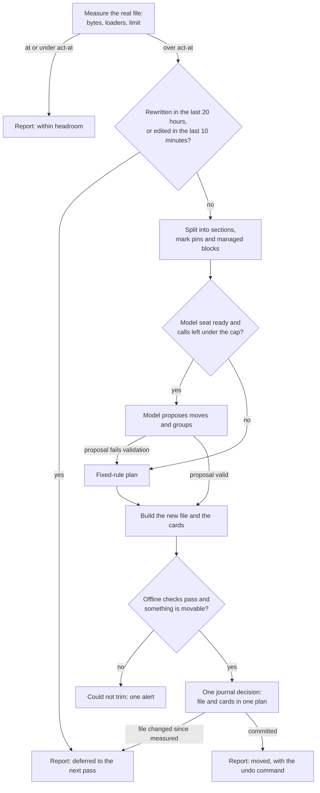
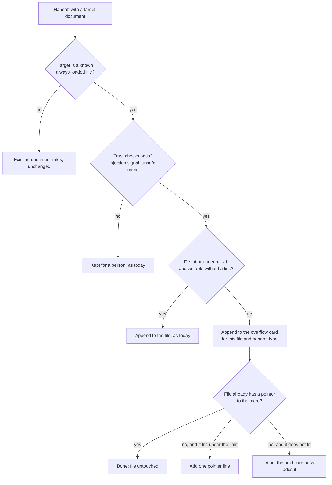
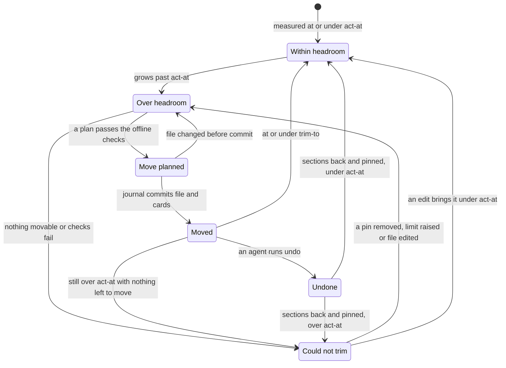

# Instruction budget care: design

Date: 2026-11-13. Status: draft. Part of Stage A ("memory tends itself") in
`docs/superpowers/specs/2026-11-12-brigade-stack-trim-design.md`.

Lines marked **(decided)** restate a decision the owner already made. Lines
marked **(proposed)** are the author's calls. Each proposed decision gives its
reason and the alternative it rejects.

## Summary

Every agent session starts by loading a few instruction files in full: a
workspace `AGENTS.md` and `USER.md`, a shared rules file, a user-level
`CLAUDE.md`, and so on. Agents and handoffs keep adding to them. When one grows
past its size limit, the harness cuts text off or Brigade refuses further
additions, and the owner has trimmed these files by hand about a dozen times
in a year.

This design makes the trim part of Brigade's background memory care, with no
person involved:

1. Brigade finds the always-loaded files on its own, from the harness profiles
   it already installs and the workspace files its doctor already checks.
2. It measures each file in bytes against one limit, taken from one table.
3. When a file passes 85% of its limit, the daily care pass moves whole
   sections, byte for byte, into private memory cards and leaves a short
   pointer where each section was. It stops when the file is at 70% of its
   limit, so the next few additions fit without another rewrite.
4. A handoff aimed at a file with no room goes into a card for that file
   instead of waiting for a person.
5. Every move is a journal decision. `brigade memory care undo <id>` puts the
   section back.
6. A file Brigade cannot bring under its limit raises one alert in the work
   brief that every agent reads, naming the next command.

Nothing is reworded. A model may help choose and group sections when one is
configured and the quota cap allows it. Without a model, the same pass runs on
fixed rules.

## One care pass for one file



## Terms

- **Always-loaded file.** A file a harness reads into every session before the
  agent acts. Called a bootstrap file in `src/brigade/budgets.py`.
- **Loader.** A harness that loads a given file. A file shared through
  symlinks has several.
- **Real file.** The file a path resolves to after following every symlink.
  Brigade measures, journals and rewrites the real file only.
- **Limit.** The size in bytes a file must never pass.
- **Act-at.** 85% of the limit. A care pass acts on a file above it.
- **Trim-to.** 70% of the limit. A pass moves sections until the file is at or
  under it.
- **Section.** A Markdown heading line and everything up to the next heading of
  the same or higher level.
- **Pin.** A mark that keeps a section, or a whole file, from being moved.
- **Managed block.** Text between a start and an end marker that another tool,
  or Brigade's own profile installer, owns.
- **Overflow card.** A memory card that collects handoff content aimed at one
  always-loaded file once that file has no room.
- **Pointer.** The line left where a moved section was.

## What exists today

Read on `origin/overhaul` at `a30e7f8f0`.

- **Two budget tables in one module.** `src/brigade/budgets.py:22-33` gives
  per-name limits (`USER.md` 8,000 bytes, `AGENTS.md` 12,000).
  `src/brigade/budgets.py:40-42` gives a flat soft limit of 10,000 and a hard
  limit of 11,500. The comment at `src/brigade/budgets.py:19-21` ties both to
  one harness that truncates near 12,000 characters.
- **The append guard.** `bootstrap_budget_problem` in
  `src/brigade/handoff_ingest_rules.py:280-291` calls
  `route_would_exceed_budget` (`src/brigade/budgets.py:73-87`), which refuses
  any append that would pass the per-name limit. Ingest turns that into the
  outcome `bootstrap-budget-exceeded` (`src/brigade/ingest.py:566-572`), and
  the inbox drain classes that code as a hold (`src/brigade/memory_inbox_drain.py:58`).
  It acts at the limit, with no headroom.
- **Reports.** `brigade doctor` checks the same per-name table
  (`src/brigade/doctor.py:1245-1270`). `brigade budgets check` does too
  (`src/brigade/budgets_cmd.py:44-82`), but it is an extras-only command
  (`src/brigade/cli/_index.py:60`). A separate doctor check estimates the
  Codex project instruction chain against Codex's own byte cap
  (`src/brigade/doctor_instruction_chain.py:35`, default cap 32,768 bytes at
  `src/brigade/codex_user_config.py:18`).
- **Harness projection knows the user-level files.** `harness_profiles.py`
  names the instruction file for each harness: Claude and Codex
  (`src/brigade/harness_profiles.py:110-111`), OpenClaw's workspace
  `AGENTS.md` (`src/brigade/harness_profiles.py:128-132`), Kimi, Grok and
  OpenCode (`src/brigade/harness_profiles.py:133-139`, `:160-168`). Cursor's
  rule file is a whole file Brigade owns (`src/brigade/harness_profiles.py:152`).
  The profile installer already detects one real file shared by several
  harnesses by resolving symlinks (`src/brigade/harness_profile_cmd.py:181-182`,
  `:200-226`), and each profile's install state records the workspace it was
  installed from (`src/brigade/harness_profile_cmd.py:66-75`).
- **Managed blocks.** Brigade writes its own hash-stamped block into foreign
  instruction files (`src/brigade/managed_block.py:1-28`). Other tools use
  their own marker pairs, such as `<!-- NAME:START -->` and `<!-- NAME:END -->`.
- **Imports.** Brigade's Claude hook classifier already treats an `@AGENTS.md`
  line in `CLAUDE.md` as an import (`src/brigade/claude_hooks/classify.py:35-37`).
- **Memory care.** `brigade memory care tend` runs four stages: hub, fixes,
  retire and inbox (`src/brigade/memory_care_tend.py:17`). It recovers
  interrupted decisions first (`src/brigade/memory_care_tend.py:49`).
- **The journal.** `memory_care_journal.commit` saves before-images in a
  private folder, then applies every change through the projection kernel as
  one plan (`src/brigade/memory_care_journal.py:150-228`). The kernel either
  publishes every mutation or restores every destination
  (`src/brigade/projection/kernel.py:1-7`) and compares each destination's
  digest with the expected before-state at execute time
  (`src/brigade/projection/kernel.py:279`). Undo refuses when any path changed
  after the decision (`src/brigade/memory_care_journal.py:268-275`).
  `safe_path` refuses any path with a symlink in it and any path outside the
  target (`src/brigade/memory_care_journal.py:92-102`). The kernel itself
  accepts absolute destinations (`src/brigade/projection/kernel.py:220-223`).
- **Archive.** `archive: never` in a card's frontmatter pins it
  (`src/brigade/memory_archive.py:53-54`).
- **Hub visibility.** The hub publishes cards only. `_local_cards` reads card
  roots (`src/brigade/memory_hub_sync.py:708-733`), and `withheld` keeps any
  card marked `visibility: private` off the hub, failing closed on anything
  unrecognised (`src/brigade/memory_hub_sync.py:644-681`).
- **Search.** `brigade memory search` rebuilds its index on every call from the
  card roots (`src/brigade/memory_cmd.py:1817-1832`, `:448-468`) and indexes
  the card body (`src/brigade/memory_bm25.py:33-36`). A new card under
  `memory/cards/` is findable on the next search with no index step.
- **Model calls.** The memory verify pass already has an isolated way to call
  a model on private text: a roster seat run with no tools, no plugins and no
  memory loading, allowed only when its audience is this machine
  (`src/brigade/memory_verify_seat.py:1-40`, `call` at `:587`, `probe` at
  `:616`).
- **Schedule.** The shipped daily care runbook runs `memory care scan` and
  `memory care import-issues` only
  (`src/brigade/templates/memory-care/runbooks/daily-care-pass.json:8`, `:12`).
  The ingest sweep runs `brigade ingest`, which then runs the inbox stage of
  tend and nothing else (`src/brigade/cli/ingest.py:37-40`).
- **Alerts.** The work brief carries memory care health and repeated care-job
  failures (`src/brigade/work_cmd/session/briefing.py:409-418`), and the
  memory operations graph gives each failed care job a next command
  (`src/brigade/memory_operations.py:565-590`).

## Where the brief or the trim design does not match the code

1. **Finding 1 has a second cause.** The file was 16,480 bytes. Brigade's own
   append guard uses the per-name limit of 8,000 bytes for `USER.md`
   (`src/brigade/budgets.py:27`), so the file had been over Brigade's limit for
   a long time, while the separate size checker used 17,000 and called it fine.
   Two tables that disagreed did as much harm as the missing headroom. This
   design keeps one table.
2. **Archiving is not yet automatic.** The trim design says the trim should
   work "the same way it already archives stale memory cards". No shipped
   schedule runs the retire stage: the daily runbook runs scan and
   import-issues, and ingest runs the inbox stage only. Archiving happens when
   something calls `brigade memory care tend`. This design adds `tend` to the
   daily runbook, which schedules the existing stages too.
3. **"Least-used sections" has no signal to read.** The whole file is loaded on
   every turn, so nothing records which section an agent used. The design
   ranks sections by when Brigade appended them, by position and by size, and
   lets a model judge when one is available.
4. **Exact-byte undo is only possible while the file is unchanged.** Today's
   undo refuses once any later edit lands, which for a file that agents append
   to daily means undo almost never works. The design adds an undo that puts
   each moved section back at its pointer and keeps later edits. It restores
   the exact before-bytes when nothing else changed.
5. **The journal cannot reach the shared rules file.** It refuses symlinked
   paths and paths outside the workspace. The design extends it to the real
   file behind a known instruction path.
6. **There is no quota cap or background model step in the code.** The trim
   design describes both. This design defines the smallest shared version.
7. **There is no "configured route" for a memory care alert.** The work brief
   is the route agents read, so the alert goes there.
8. **Finding 9 is a routing gap.** Ingest never reads
   the handoff `Type`. It routes on `Recommended memory action` and
   `Target document` only (`src/brigade/ingest.py:431`, `:530-532`).
9. **Symlinked targets wait for a person.** A handoff aimed at a document that
   is a symlink gets `document-destination-unsafe`, which the drain keeps for a
   person (`src/brigade/memory_inbox_drain.py:28`). For known instruction files
   the design routes to a card in the workspace instead.
10. **Setup does not install the schedule yet, and Windows needs a person.**
    `brigade init` does not call `care install`, and on Windows `care install`
    prints Task Scheduler commands for a person to run
    (`src/brigade/care_cmd.py:832-842`). This feature depends on the trim
    design's setup item closing both.

## Decisions

### Scope and discovery

**(proposed)** Brigade builds an inventory of always-loaded files on every pass
from three sources it already has, plus optional config. Nobody lists files by
hand.

| Level | Source | Files |
| --- | --- | --- |
| User | Harness profiles (`harness_profiles.resolve_user_profiles`) | Each harness's user instruction file, plus files it imports with an `@path` line |
| Workspace | The per-name table (`budgets.BOOTSTRAP_BUDGETS`) | `AGENTS.md`, `USER.md`, `TOOLS.md`, `MEMORY.md` and the rest that exist in the target |
| Repository | The target's `CLAUDE.md` and `AGENTS.md` chain, as `context_preview` reads it | Reported only |
| Any | `[instructions.files."<path>"]` in `.brigade/memory-care.toml` | Extra files, or a different class or limit for a found one |

Rules:

- Every path is resolved to its real file. One inventory row per real file
  lists each path and each harness that loads it.
- A user-level file is tended by the workspace recorded in the install state of
  the profile that loads it. When several profiles load it from different
  workspaces, the most recently installed one wins, because the install state
  is rewritten on each install. A user-level file with no installed profile is
  only reported.
- Imports are followed one level, from a file already in the inventory.
- A repository-depth target (`brigade init --depth repo`, stored at
  `src/brigade/config.py:259`) reports its files and never rewrites them.
  Those files are tracked in Git and change through review, and a background
  rewrite would leave uncommitted changes in a working tree.

Out of scope: whole files Brigade owns (Cursor's rule file and generated
files), skills, files outside UTF-8, files over 1 MiB (the ceiling in
`src/brigade/context_preview.py:20`), and the `MEMORY.md` index, which is
reported only (see Classes).

Rejected: a config list the owner maintains. It is the manual step the owner
asked to remove, and harness projection already knows the paths.

### Budgets

**(proposed)**

- **Unit: UTF-8 bytes.** Codex enforces a byte cap, the journal and kernel work
  in bytes, and the existing budgets are bytes. A file's byte count is never
  below its character count, so a byte limit is safe for a harness that counts
  characters. Rejected: tokens. Each vendor tokenises differently, counting
  needs a tokenizer per vendor, and the answer would change with model
  upgrades.
- **One limit per real file**, the smallest of:
  1. a cap a loader enforces that Brigade can read (today, Codex's project
     cap for files in the Codex project chain),
  2. `limit_bytes` for that file in config, or else the per-name table for
     workspace-level files, or else `default_limit_bytes` (20,000).
- **Act-at 85%, trim-to 70%.** A pass leaves at least 15% of the limit free.
  At a 20,000-byte limit that is 3,000 bytes, about ten typical handoff
  appends. The hand fix in finding 5 ended 54 bytes under its soft limit.
- **Totals across files** (a harness that loads four files) are reported per
  harness where Brigade can compute the chain. They do not trigger moves in
  this design.
- **The separate size checker's numbers are not imported.** Brigade's report
  becomes the one measure. The checker can be retired.

Rejected: keeping a soft and a hard limit as two numbers a person tunes. The
two thresholds here are derived from one limit, so they cannot drift apart.

### Classes of file

**(proposed)** Four classes.

| Class | Meaning | What care may do |
| --- | --- | --- |
| `append` | Collects facts and preferences | Move whole sections into cards, one-line pointer |
| `policy` | Hand-tuned rules | Move whole sections verbatim into cards, keep the heading line as the pointer |
| `report` | Measured only | Nothing. Over the limit raises the alert |
| `owned` | A whole file another tool or Brigade owns | Not in the inventory |

How a class is set, first match wins:

1. `class` for the file in config.
2. A `<!-- brigade:instructions report -->` line in the first five lines.
3. `report` for the configured memory index (`MEMORY.md` by default) and for
   repository-depth targets.
4. `append` for the documents ingest is allowed to append to:
   `USER.md`, `TOOLS.md` and `.learnings/*.md`
   (`src/brigade/handoff_ingest_rules.py:28-37`).
5. `policy` for everything else.

`policy` is the default because it is the safer class: it only ever moves text
whole and keeps every heading visible.

Pins:

- **Section pin:** a line `<!-- brigade:keep -->` directly under the heading.
  It pins the section and its subsections.
- **File pin:** class `report`, by config or by the marker above.
- **Pins by config:** `pin_headings = ["## Git and publication"]` for a file.
- **Automatic pin:** sections an undo put back are pinned for 30 days, so the
  next pass does not move them again.

Any agent can add a pin. A pin costs one short line.

### What moves and where

**(proposed)**

**Parsing.** Sections are found from ATX headings (`#` to `######`) outside
fenced code and outside managed blocks. Setext headings are body text. These
parts never move: frontmatter, everything before the first heading, the level-1
heading and its own text up to the first subheading, any section that contains
or crosses a managed block, and pinned sections. A section moves with all of
its subsections. A subsection may move alone.

**Managed blocks** are any balanced pair of HTML comment markers that end in
`START`/`END` or begin with `BEGIN`/`END`, plus Brigade's own markers in both
styles (`src/brigade/managed_block.py`). If the markers do not balance, the
file is marked could not trim and nothing in it moves. Guessing where a block
ends could cut into text another tool owns.

**Choosing sections, fixed rules:**

- `append` files: sections Brigade appended come first, oldest first, known
  from a provenance row ingest writes on each append from now on (digest of
  the appended bytes, date, handoff type). Then other sections from the bottom
  of the file up, since appends land at the end.
- `policy` files: the largest movable level-2 sections first, then level-3.
  Largest first moves the fewest rules for the bytes freed.
- Stop when the new file is at or under trim-to, or after
  `max_moves_per_file` (8) sections.
- Sections whose text trips the content guard's secret scan
  (`src/brigade/guard/engine.py:41`) are not moved and are listed in the
  summary. A card sits in the workspace tree, which may be tracked, and the
  instruction file may not be.

**Grouping.** Consecutive moved sections under the same parent heading go into
one card, split again if a card would pass `max_card_bytes` (12,000 by
default). With a model, sections may be grouped by topic across the file
instead. Finding 5 had 14 sections on two topics. Topic grouping makes two
cards there, and the fixed rule makes as many as there are parent headings.

**Where they go.** Cards in the owning workspace:
`memory/cards/instructions/<file-key>--<slug>.md`, where `<file-key>` names the
real file (for example `user-md`, `codex-agents-md`). Policy text goes to cards
too, not to a loose rules file, so it is searchable. The card holds the
section bytes unchanged after a frontmatter block:

```yaml
---
title: Burn queue
category: instructions
tags: [moved-instructions, codex-agents-md]
visibility: private
source_file: <display path of the real file>
moved_on: 2026-11-13
moved_by: 20261113T061500Z-instructions-1a2b3c4d
archive: never   # policy class only
---
```

**Pointers.**

- `append` class, one line per card, at the place of its first section:
  `- Moved to memory 2026-11-13: [Hub setup notes, 10 sections](memory/cards/instructions/user-md--hub-setup.md)`
- `policy` class, the original heading line, then one line:
  `Full text moved verbatim to memory/cards/instructions/codex-agents-md--burn-queue.md. Read it before acting on this topic.`
- A pointer line is at most 240 bytes. Titles are cut to fit. The path is
  relative to the instruction file when the card sits below its folder, and
  absolute otherwise.
- When the retire stage later archives a moved `append` card, the next
  instructions pass removes its pointer as part of its one rewrite of that
  file. `policy` cards carry `archive: never`, because the rule still applies.
  It was moved for space, and staleness rules do not apply to it.

Rejected: shortening passages and keeping full text elsewhere, as the hand fix
did for the rules file. Rewording a rule can weaken it (finding 8), and
nothing offline can check that a summary kept a rule's meaning.

### The model step

**(proposed)** A model is optional. The fixed rules above are a complete plan
on their own, so the pass never waits on a model (finding 3).

- **What a model may decide:** which movable sections to move, how to group
  them, and a title of at most 60 plain characters per group. Nothing else.
- **What stays fixed:** what is movable, all bytes written to the file and to
  cards, pointer format, limits and every check.
- **How it is called:** through a new `care_model` module that reuses the
  memory verify seat's isolated call (`src/brigade/memory_verify_seat.py`). The
  prompt carries private text, so only a seat whose audience is this machine
  is allowed.
- **The cap:** `[care.model] daily_call_cap` (10 by default), counted in a
  ledger at `.brigade/memory-care/model-calls.jsonl` that later Stage A model
  steps share. One instruction file costs at most one call per pass.
- **Seat choice:** `[care.model] seat`. When it is empty, setup fills it with
  the first local seat that passes the existing probe. When none passes, it
  stays empty and care runs on fixed rules.
- **Fallback, recorded in the summary:** no seat, cap spent, probe or call
  failed, timeout, or a reply that fails validation. Validation checks that
  each named section exists and is movable, that no section appears twice, and
  that the result reaches trim-to.

Rejected: letting policy files wait for a model between act-at and the limit.
With no seat configured that wait never ends, which is finding 2 and finding 3
together.

### Safety and undo

**(proposed)**

- **One decision per file per pass**, kind `instructions`, holding the
  instruction file change and every card it creates. The journal commits them
  as one kernel plan, so a crash leaves either all of it or none of it. The
  next pass starts with the existing recovery
  (`src/brigade/memory_care_tend.py:49`), which finishes or restores the plan.
  There is no window where a card exists without its pointer or a pointer
  exists without its card.
- **External real files.** The journal gains one path type: an absolute path
  to a real file the inventory registered. The final path must be a regular
  file. A symlink there is refused. Its parents may not be swapped during the plan (the
  kernel already checks parents, `src/brigade/projection/kernel.py:220-223`).
  Before-images go in the owning workspace's private journal folder. Links are
  never written through. The real file is rewritten and every link keeps
  pointing at it.
- **Concurrency.** The pass takes the care lock and the ingest document lock
  (`src/brigade/ingest.py:795-812`), so Brigade's own appends wait. Other
  agents' edits do not take a lock. The plan carries the digest the pass
  measured, and the kernel refuses if the file changed
  (`src/brigade/projection/kernel.py:279`). A refused file is retried on the
  next pass. A file modified in the last 10 minutes is skipped, since an agent
  is likely mid-edit. A write landing in the instant between the kernel's
  check and its rename can still be lost. That window is milliseconds, and
  agents editing the same file already race each other the same way.
- **Undo** (`brigade memory care undo <decision-id>`):
  - When the file and cards are unchanged since the move, undo restores the
    exact before-bytes and removes the cards.
  - When the file changed after the move, undo replaces each pointer with the
    original section bytes and keeps the later edits. It refuses, naming the
    pointer, if a pointer was edited or removed.
  - When a card was edited after the move, undo refuses and names the card.
    Putting back old bytes would lose the edit.
  - Restored sections are pinned for 30 days.
- **Visibility.** Every card created from an instruction file is
  `visibility: private`. Always-loaded files never reach the hub today, since
  the hub publishes cards only, and moving a section must not widen who can
  read it. `USER.md` holds personal preferences. An agent may make a card
  public later with an ordinary edit. Rejected: inheriting public by default,
  which would publish personal text on the next sync with no one choosing to.
- **`read_only_paths`** in the memory care config are honoured, as for every
  other care decision.

### Handoffs aimed at a full or capped file



**(proposed)**

- The guard compares against act-at, not the limit, so a file stops taking
  direct appends while there is still room for its pointers.
- The overflow card is `memory/cards/instructions/<file-key>--<type>.md`,
  where `<type>` is the handoff's `Type` reduced to one of `preference`,
  `fact`, `gotcha` or `note`. A `preference` handoff aimed at `USER.md` lands
  in `user-md--preference.md`, which is the preferences card finding 9 wanted.
  A full overflow card rolls to `-2`, `-3`.
- The card write uses ingest's existing card publication path, so the card
  name, symlink and frontmatter checks apply unchanged.
- A known instruction file reached through a symlink is no longer a reason to
  hold the handoff. The content goes to the card, which lives in the
  workspace. The pointer, if missing, is added by the care pass, which writes
  the real file through the journal. Ingest still never writes through a link.
- New outcome code `document-routed-to-card`, a success. The drain moves
  `bootstrap-budget-exceeded` from hold to retry
  (`src/brigade/memory_inbox_drain.py:48-66`), so handoffs held under the old
  rule are routed on the next drain with no person.
- Injection signals and unsafe names still go to a person
  (`src/brigade/memory_inbox_drain.py:17-31`). This design does not change any
  trust rule.
- Appends within headroom still go into the file, because the author asked for
  the text to be always loaded. Each one resets the prompt cache, so the
  overflow card starts taking appends at act-at, before the file gets close to
  its limit.

### Cache cost

**(proposed)** Every rewrite of an always-loaded file resets the prompt cache
for every agent that loads it (finding 7).

- At most one rewrite per file per pass, holding every move, pointer and
  pointer cleanup for that file.
- A file is rewritten only when it is over act-at, and then down to trim-to,
  so rewrites are spaced by the growth of 15% of the limit.
- Not again within `min_hours_between_rewrites` (20) of the last rewrite.
- Not while the file was modified in the last `quiet_minutes` (10).
- The pass runs once a day, at the existing daily care time.

### Verification

**(proposed)** Before committing, the pass checks offline:

1. Putting each moved section back at its pointer gives the original bytes
   exactly.
2. Each card body after its frontmatter equals the moved section bytes, and
   the card passes the card frontmatter rules ingest uses.
3. Managed blocks are byte-identical, in the same order and count.
4. Frontmatter, the text before the first heading and every pinned section are
   byte-identical.
5. Fences and managed-block markers still balance, and the file is valid
   UTF-8.
6. Every pointer names a card the same plan creates, and every pointer line is
   at most 240 bytes.
7. The new size is at or under trim-to, or the summary says how far it got.

After committing, the next pass re-measures and confirms each pointer still
resolves.

Not verified: whether any harness actually loaded the file, whether a model
followed a moved rule, or where a harness truncates. No check sends an agent
turn, and tests use fixture files only (finding 4). A test asserts that the
instructions stage starts no subprocess other than the optional model seat.

### Alerting and reporting

**(proposed)** The pass writes its part of the tend payload, which tend
already saves to `.brigade/memory-care/tend/latest.json`:

```json
{
  "stages": {
    "instructions": {
      "files": [
        {
          "path": "USER.md",
          "loaders": ["openclaw"],
          "class": "append",
          "bytes_before": 16479,
          "bytes_after": 5541,
          "limit": 8000,
          "state": "moved",
          "planner": "fixed-rules",
          "planner_reason": "seat-unset",
          "decision_id": "20261113T061500Z-instructions-1a2b3c4d",
          "moved": [{"heading": "### Hub notes", "card": "memory/cards/instructions/user-md--hub-notes.md", "bytes": 1840}],
          "undo": "brigade memory care undo 20261113T061500Z-instructions-1a2b3c4d"
        }
      ],
      "routed_handoffs": 3,
      "alerts": []
    }
  }
}
```

The `state` value is one of `within`, `deferred`, `moved`, `could-not-trim`,
`reported`.

**One alert** per file, raised when the state turns to `could-not-trim` and
cleared when it leaves that state. It is not repeated while the state holds.
It appears:

- in the work brief, beside the existing scheduled-care failures
  (`src/brigade/work_cmd/session/briefing.py:409-418`), as one line:
  `instruction_budget: could-not-trim <path> <bytes>/<limit> reason=<code> next="<command>"`,
- as a node in the memory operations graph with the same next command
  (`src/brigade/memory_operations.py:565-590`),
- in `brigade care status` output.

Reason codes and their next commands:

| Code | Next command |
| --- | --- |
| `nothing-movable` | `brigade memory care tend --stage instructions --dry-run --json` (lists pins and blocks to review) |
| `unbalanced-markers` | the same, which names the marker line |
| `checks-failed` | the same, which names the failed check |
| `still-over-after-moves` | none needed. The next pass continues |
| `unowned-user-file` | `brigade init --target <workspace>` for a harness that loads it |

A repeated failure of the pass itself (an exception, not a state) is a care
job failure and uses the existing repeated-failure route.

### Setup

**(proposed)** On by default, with no separate switch to turn on.

- The stage is part of `brigade memory care tend`. The shipped daily care
  runbook gains one step, `brigade memory care tend --target .`, after the
  existing two. An upgrade rewrites the shipped runbook and its pin, as setup
  owns both.
- The ingest routing change is part of `brigade ingest`, which the ingest sweep
  already runs every 30 minutes.
- `[instructions] mode = "observe"` turns the stage into a report for a target
  that needs it. Nothing sets it by default.

Rejected: observe first, then turn on by itself after a few clean passes. Each
move is verbatim, checked offline and undoable, so a trial period adds only
delay. And a report that nobody acts on is exactly how the rules file stayed
4,500 bytes over its limit for a week (finding 2).

This depends on setup installing the care schedule with no person
(`brigade init` running `care install`, and Windows getting a real scheduler
write). That is the trim design's setup item. If it has not landed when this
ships, slice 2 below carries it.

### Rollout

**(proposed)** Each slice is one pull request and is useful alone.

1. **Measure and route.** The inventory with symlink resolution, one limit per
   file, act-at and trim-to, the `report` output, ingest routing to overflow
   cards with the type-named card, the drain change for
   `bootstrap-budget-exceeded`, and the work brief alert. Doctor and
   `budgets check` read the same inventory. This alone stops finding 1 and
   finding 9 and makes finding 2 visible to every agent.
2. **Move workspace files.** Section parsing, pins, managed blocks, the
   fixed-rule plan for both classes, the `instructions` journal kind with the
   rebasing undo, the offline checks, and the runbook step.
3. **User-level and shared files.** The journal's external real-file path,
   ownership by profile install state, and `@path` imports.
4. **Model step.** `care_model` with the shared cap and ledger, model
   proposals validated against the fixed rules.

Deferred: acting on totals across files, repository-level rewrites, folding
`MEMORY.md` index lines into sub-index cards, and pushing alerts through hub
messages.

## How each field finding is prevented

| # | Finding | Prevented by |
| --- | --- | --- |
| 1 | `USER.md` 520 bytes under one limit, every append refused by another | One limit per file from one table. Appends past act-at go to an overflow card, never held |
| 2 | Shared rules file 4,500 bytes over for a week, nobody told | Real-file inventory covers symlinked user files. Daily pass moves sections. One alert in the work brief with a next command |
| 3 | Trim command had no model and the gateway refused the named one | The fixed-rule plan is complete. The model is optional, probed, capped, and any failure falls back |
| 4 | Budget test sent real agent turns and tested stale text | Offline structural checks only. Fixture-file tests. A test asserts no subprocess besides the optional model seat |
| 5 | Two hand passes, ending 54 bytes under the limit | Trim-to at 70% leaves 15% of the limit free. Grouped moves in one rewrite |
| 6 | A managed block between markers must never change | Managed blocks are parsed and never moved. Unbalanced markers stop the file. Check 3 compares them byte for byte |
| 7 | Every edit resets the prompt cache | One rewrite per file per pass, 20-hour spacing, quiet window, hysteresis between act-at and trim-to |
| 8 | Rewording a rule can weaken it | Sections move verbatim. The model chooses, it never writes. Policy pointers keep the heading |
| 9 | A preference handoff targeted `USER.md` as a document | Overflow cards are named by handoff type, so it lands in `user-md--preference.md` |

## New or changed commands and config

No new commands.

| Command or key | Change | Default |
| --- | --- | --- |
| `brigade memory care tend` | New stage `instructions`, in the default stage list | runs |
| `brigade memory care tend --stage instructions --dry-run --json` | Read-only inventory and plan | n/a |
| `brigade memory care undo <id>` | Handles kind `instructions`, with rebasing | n/a |
| `brigade ingest` | Routes capped-file appends to overflow cards | on |
| `brigade doctor`, `brigade budgets check` | Read the same inventory and limits | n/a |
| daily care runbook | Adds `brigade memory care tend --target .` | installed by setup |
| `[instructions] enabled` | Stage on or off | `true` |
| `[instructions] mode` | `apply` or `observe` | `"apply"` |
| `[instructions] act_at_percent` | Threshold to act | `85` |
| `[instructions] trim_to_percent` | Size to trim down to | `70` |
| `[instructions] default_limit_bytes` | Limit for files with no other source | `20000` |
| `[instructions] max_moves_per_file` | Sections moved per file per pass | `8` |
| `[instructions] min_hours_between_rewrites` | Spacing between rewrites | `20` |
| `[instructions] quiet_minutes` | Skip a file edited this recently | `10` |
| `[instructions] undo_pin_days` | Pin on sections put back by undo | `30` |
| `[instructions] exclude` | Paths never tended | `[]` |
| `[instructions.files."<path>"] class` | `append`, `policy` or `report` | derived |
| `[instructions.files."<path>"] limit_bytes` | Per-file limit | derived |
| `[instructions.files."<path>"] pin_headings` | Headings never moved | `[]` |
| `[care.model] seat` | Roster seat for care model steps | set by setup, else empty |
| `[care.model] daily_call_cap` | Model calls per day across care | `10` |
| `<!-- brigade:keep -->` | Section pin, line under a heading | n/a |
| `<!-- brigade:instructions report -->` | File pin, first five lines | n/a |

All keys live in `.brigade/memory-care.toml`, beside the existing `[tend]`
table (`src/brigade/memory_care_tend.py:21-41`).

## File states



Undo can also run on a decision from an earlier pass while the file is within
headroom. The diagram shows the common path.

## What this does not do

- Reword, summarise or merge any text.
- Edit a managed block, a Brigade-owned file, a skill or the `MEMORY.md` index.
- Rewrite files in a repository-depth target.
- Publish moved text to the hub, or change any card's visibility after
  creating it.
- Delete anything. Moved text lives in cards, and the journal keeps the
  before-bytes.
- Count tokens, or check what a harness actually loaded.
- Send agent turns, or call a model that can use tools.
- Change any trust rule in ingest. Injection signals still go to a person.
- Act on totals across files.
- Replace the separate size checker. It reads the files on its own and can be
  retired once Brigade's report is the one in use.

## Open questions

Each has a recommended answer, so implementation does not wait.

1. **Which limits apply on the field machine?** Brigade's table says 8,000 for
   `USER.md`. The separate checker used 17,000 and 20,000. Recommended: keep
   Brigade's table and the 20,000 default for user-level files. The 12,000
   figure behind the table is the only measured truncation point Brigade
   records. `USER.md` at 8,241 bytes after the hand fix gets a few more
   sections moved on the first pass, which is what the `append` class is for.
2. **Should policy files move without a model?** Recommended: yes, largest
   movable section first. The alternative leaves the file over its limit
   whenever no seat is configured, and past the limit the harness is already
   cutting text off at the end, which is an arbitrary cut.
3. **Should moved cards ever start public?** Recommended: no. Always private.
   An agent can change one card on purpose.
4. **Which workspace owns a shared user-level file installed from two
   workspaces?** Recommended: the most recently installed profile's
   workspace. Refusing both would leave the file untended, which is finding 2.
5. **May the retire stage archive moved `append` cards?** Recommended: yes,
   with the pointer removed on the next instructions pass. `policy` cards stay
   pinned.
6. **Adding `tend` to the daily runbook also schedules the hub, fixes and
   retire stages, which no schedule runs today. Is that wanted?** Recommended:
   yes. It is what Stage A intends, every stage is journaled and bounded
   (`max_archives_per_run` is 20), and it closes the gap in contradiction 2
   above.
7. **Should the handoff `Type` field drive routing elsewhere?** Recommended:
   only for overflow card names in this design. Wider use belongs to the
   handoff ingest work.
8. **What if Stage 2 of the trim removes the roster that the model seat comes
   from?** Recommended: `care_model` keeps one function to resolve a seat, so
   it can switch to whatever replaces the roster. The fixed-rule path does not
   depend on it.

## Files and modules an implementation would add or change

New:

- `src/brigade/instruction_inventory.py`: discover, resolve and classify files.
  `discover(target: Path, config: InstructionsConfig) -> list[InstructionFile]`.
- `src/brigade/instruction_sections.py`: Markdown section, fence, pin and
  managed-block parser. `parse(data: bytes) -> SectionDocument`.
- `src/brigade/instruction_trim.py`: fixed-rule plan, model proposal
  validation, build and offline checks.
  `plan(file: InstructionFile, doc: SectionDocument, *, proposal: Proposal | None) -> TrimPlan`,
  `check(plan: TrimPlan) -> list[str]`.
- `src/brigade/memory_care_instructions.py`: the tend stage, journal commit,
  report and alert state.
  `apply(target: Path, config: InstructionsConfig, *, today: date, dry_run: bool) -> dict[str, Any]`.
- `src/brigade/care_model.py`: shared care model call with the daily cap and
  ledger, on the verify seat's isolated call.
  `propose(target: Path, purpose: str, prompt: str, schema: dict[str, Any]) -> ModelReply | Fallback`.
- `tests/test_instruction_sections.py`: headings, fences, preamble, managed
  blocks, unbalanced markers, pins.
- `tests/test_memory_care_instructions.py`: one fixture per field finding,
  crash recovery, concurrent edit refusal, both undo paths, no subprocess.
- `tests/test_ingest_overflow_card.py`: routing at act-at, type-named cards,
  symlinked known files, drain retry of old holds.

Changed:

- `src/brigade/memory_care_tend.py`: add `instructions` to `STAGES`, load its
  config, send kind `instructions` to the new undo.
- `src/brigade/memory_care_journal.py`: external real-file paths, and a
  rebasing undo for kind `instructions`.
- `src/brigade/budgets.py`: act-at and trim-to, `default_limit_bytes`, and
  `limit_for(file)`. The per-name table stays.
- `src/brigade/handoff_ingest_rules.py`: guard at act-at through the inventory,
  and the overflow card name.
- `src/brigade/ingest.py`: the no-card document branch routes to the overflow
  card, new outcome `document-routed-to-card`, and an append provenance row.
- `src/brigade/memory_inbox_drain.py`: `bootstrap-budget-exceeded` from hold to
  retry, and the new code as a success.
- `src/brigade/cli/memory.py`: `instructions` among the `--stage` choices.
- `src/brigade/templates/memory-care/runbooks/daily-care-pass.json`: the `tend`
  step.
- `src/brigade/care_cmd.py`: refresh the shipped runbook and its pin on
  upgrade.
- `src/brigade/doctor.py` and `src/brigade/budgets_cmd.py`: read the inventory.
- `src/brigade/work_cmd/session/briefing.py` and
  `src/brigade/memory_operations.py`: the `instruction_budget` alert line and
  node.
- `docs/memory-care.md`: a section on instruction budget care, undo and pins.
